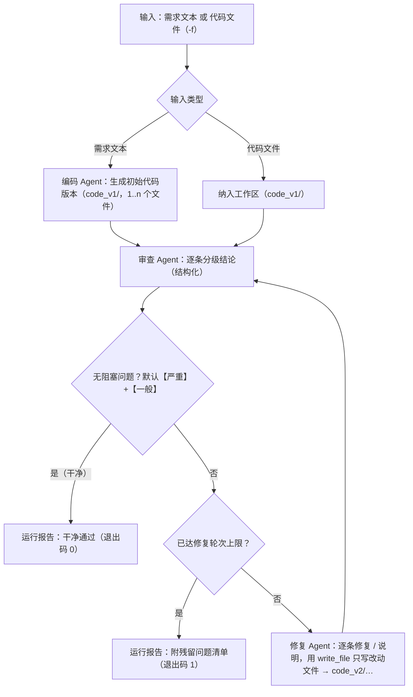

# code-review-workflow · 代码审查工作流（crw）

基于 LLM 的自动化代码审查工作流：输入一段需求（或一份既有代码），由**编码 → 审查 → 修复**三个 Agent 协作完成"写代码 → 查问题 → 修问题"的完整闭环；审查不通过自动进入修复并复审（轮次上限可配置），全过程落盘为可查、可续跑的运行记录，并逐调用记录 token 用量。

除一次性运行（`crw run`）外，还提供**会话模式**（`crw chat`）：用自然语言多轮对话——一个独立于三 Agent 的**编排/路由节点**理解你的意图（写/改代码、只审查、再走一轮审查修复、提问），按你的话指定轮次（"最多 3 轮""跑满 2 轮"），并在会话内让同一份代码持续演进（版本号跨轮连续递增）；对话可中断、可恢复、可回看。

## 目录

- [工作流](#工作流)
- [快速开始](#快速开始)
- [使用示例](#使用示例)
- [会话模式示例](#会话模式示例)
- [命令参考](#命令参考)
- [运行记录与产物](#运行记录与产物)
- [项目架构](#项目架构)
- [模型配置](#模型配置)
- [怎么看用量与命中率](#怎么看用量与命中率)
- [限制](#限制)
- [开发](#开发)
- [扩展指南](#扩展指南)

## 工作流



- **三个 Agent 各司其职**：编码 Agent 按需求写代码（一个代码版本 = 一个目录 `code_vN/`，1..n 个文件 + `manifest.json` 清单）；审查 Agent 复核版本内**全部文件**并输出分级问题清单（可读文件、运行代码核实）；修复 Agent 按清单逐条处置（修复或说明未采纳），**只把改动过的文件写回新版本目录**（未改动的文件由引擎从上一版本复制而来，不整份重贴），随后进入复审；**删除文件需经你确认**（修复只能提出申请）。每个版本目录都是整版本不可变快照，引擎按目录实际内容逐字节比对——"处置声称已修复、但版本目录一字未变"会被判为契约违规而不是放过。
- **干净判定**：默认把【严重】与【一般】都算阻塞问题——两者都为 0 才通过；【建议】不阻塞。`--severe-only` 放宽为只把【严重】当阻塞。修复轮次上限默认 3（`--max-iter` 调整，取值 0–10），达限则以残留问题清单收尾（退出码 1，如实汇报而非静默放过）。
- **状态与消息**：节点间通过共享状态 + 结构化契约（findings JSON）交接，全过程事件（含每次模型调用的 token 用量）写入运行日志（`log.jsonl`）。

## 快速开始

前置：Python 3.13+、[uv](https://docs.astral.sh/uv/)、任一 OpenAI 兼容供应商的 API key（默认 DeepSeek）。

```bash
# 1. 安装依赖
uv sync

# 2. 配置模型（二选一）
uv run crw config                        # 方式 A：交互式配置（推荐，支持多供应商）
setx CRW_DEEPSEEK_API_KEY "你的key"      # 方式 B：环境变量（Windows；setx 后需新开终端生效）
                                         # macOS/Linux：export CRW_DEEPSEEK_API_KEY="你的key"

# 3. 运行工作流
uv run crw run "写一个支持加减乘除与除零处理的命令行计算器"
uv run crw run -f tests/fixtures/buggy_samples/syntax_error.py   # 对既有代码执行"审查→修复"
```

可选：`uv tool install -e .` 后可直接运行 `crw`（无需 `uv run` 前缀）。

## 使用示例

```text
$ uv run crw run "写一个命令行四则运算计算器，除数为 0 时报错提示"
── 运行 r-20261015-1a2b ──────────────────────────────────────────
[输入] 需求：写一个命令行四则运算计算器，除数为 0 时报错提示；修复轮次上限 3（来源：内置默认）
[模型] DeepSeek/deepseek-flash（思考：off）

── [编码] 生成初始代码 ──────────────────────────────────────────
（实现说明；代码块只显示形状摘要，内容落盘为版本目录 code_v1/）
  ⋯ 已收到代码块（37 行，内容不在此显示）
[编码] 生成 code_v1/（2 个文件，共 61 行）

── [审查] 第 1 轮 ───────────────────────────────────────────────
  · 工具：read_file({"path": "code_v1/calculator.py"})
  ⋯ 已收到 JSON 结论（48 行，内容不在此显示）
[审查] 第 1 轮（code_v1/，2 个文件）：2 严重 / 1 一般 / 1 建议
  1. 【严重】calculator.py:18 — 除数为 0 时未处理，将抛出 ZeroDivisionError。
     建议：运算前判断除数，为 0 时给出可读错误。

── [修复] 第 1 轮 ───────────────────────────────────────────────
[修复] 第 1 轮：修复 3 项 → code_v2/（2 个文件）
  f-1 → 已修复：运算前判断除数，为 0 时给出中文提示。
  f-3 → 未采纳：该结论不成立，上游已校验。

── [审查] 第 2 轮 ───────────────────────────────────────────────
[审查] 第 2 轮（code_v2/，2 个文件）：0 严重 / 0 一般 / 1 建议 —— 干净通过（建议不影响判定）

── 完成：干净通过（共 2 轮审查 / 1 轮修复） ─────────────────────
运行记录：~/.crw/runs/r-20261015-1a2b（报告 report.md，含「Token 用量」小节）
```

要点：终端只给结论与过程摘要——**模型产出的代码与结构化 JSON 不整份回显**（内容在运行目录的产物文件里），
【严重】/【一般】/【建议】分级着色，每个 Agent 切换都有独立的阶段横幅。

## 会话模式示例

```text
$ uv run crw chat
── 会话 s-20261015-ab12 ──────────────────────────────────────────
[模型] DeepSeek/deepseek-flash（思考：off）
[轮次] 上限 3（来源：内置默认）；模式 up-to；消息里可说「最多 N 轮 / 跑满 N 轮」（夹取上限 10）
[会话] 直接说需求即可；/exit 或 Ctrl+C 退出；一轮进行中 Ctrl+C 可中断本轮（会话保留）
[判定] 【严重】与【一般】都算阻塞，不阻塞的只有【建议】
会话记录：~/.crw/sessions/s-20261015-ab12

你> 写一个待办 CLI，能增删查改，最多 2 轮
── [编排] ──────────────────────────────────────────
[编排] 好的，我来实现，最多 2 轮。
── 会话第 1 轮：按「写/改代码」处理；轮次上限 2（来源：需求文本提取）；模式 up-to ────
（编码 → 审查 → 修复循环的输出与 crw run 相同）
[会话] 第 1 轮（写/改代码）：审查 2 轮 / 修复 1 轮（上限 2，来源：需求文本提取）
[会话] 结论：干净通过（共 2 轮审查 / 1 轮修复）；代码版本 code_v2/（2 个文件）；建议动作：已完成
[会话] 运行记录：~/.crw/sessions/s-20261015-ab12/rounds/round-1（报告 report.md）

你> 再检查一轮
[编排] 好，先审查，再修一轮。
── 会话第 2 轮：按「再走一轮审查→修复」处理；轮次上限 1（来源：需求文本提取）；模式 exact；本轮按「审查→修复」默认跑满 1 轮（审查干净也会走一轮修复） ────
[会话] 第 2 轮（再走一轮审查→修复）：审查 2 轮 / 修复 1 轮（上限 1，来源：需求文本提取）
[会话] 结论：干净通过（共 2 轮审查 / 1 轮修复）；代码版本 code_v4/（2 个文件）；建议动作：已完成

你> /exit
[会话] 结束：共 2 轮；最后状态：干净通过
```

要点：终端只显示意图判定、轮次使用情况与结论——**每轮汇报由结构化状态渲染**，不由模型复述；代码版本号在会话内跨轮连续递增（第 2 轮从 `code_v3/` 起），`report.md` / `session.md` / `crw runs` 里都能对上；交互提示（`你> `）以天蓝色标记（非终端 / `NO_COLOR` 下自动退化为纯文本）。**「审查后修复」不会被干净判定跳过**：只想审查时说“只看不改”（`review` 意图，本轮按 0 轮处理，不会去改代码）；要动手修时用“再检查一轮 / 审查后修复”（`review_fix` 意图：默认跑满 1 轮，审查 → 修复 → 复审）。意图识别与轮次参数的规则逐条见[设计文档的会话命令与交互语义](docs/Design.md#54-会话命令与交互语义)。

## 命令参考

| 命令 | 说明 |
|------|------|
| `crw run [需求文本] / -f, --file <文件>` | 运行工作流（两种输入二选一；选项见下） |
| `crw chat [-f, --file <文件>] [--resume <会话号>]` | 会话模式：与编排节点多轮对话，驱动三 Agent 工作流（选项见下） |
| `crw sessions` | 列出会话（会话号 / 时间 / 轮次数 / 最后状态） |
| `crw runs` | 列出运行记录（运行号 / 时间 / 输入摘要 / 状态 / 修复轮数 / 残留严重数 / 模型 / 会话）——一次性运行与会话轮次聚合展示 |
| `crw show [运行号]` | 展示单次运行的状态、时间线、`[用量]` 行与产物路径（会话轮次同样可查，标出所属会话与轮次）；省略运行号时列出记录供选择 |
| `crw resume <运行号>` | 以该运行的最新版本目录为起点续跑（复制为新运行的起始版本目录，新开一条记录并关联）；会话轮次的运行号同样可用 |
| `crw review <路径...> \| -` | 单 Agent 快速审查（只查不改）：**目录或多于一个路径 = 整项目一次会话**（给文件清单，审查者按需 `read_file` 并顺 import / 调用链读同项目其他文件）；单个文件与 `-`（stdin，须单独给、不与路径同列）为内联快审；`--per-file` 回退到逐文件形态；`-o, --out <文件>` 输出 Markdown 报告，`--json` 结构化输出，`--no-exec` 关闭执行，`--model / --provider / --thinking` 临时覆盖 |
| `crw config [test]` | 模型供应商配置 / 连通性自检 / 思考挡位 / 运行默认值（轮次默认与上限） |
| `crw graph [-o, --out <文件>] [--parallel-review]` | 导出工作流 mermaid 流程图（节点 / 边集合与实现一致，由快照测试锁定；默认输出 stdout） |
| `crw uninstall` | 卸载：分级确认后清理程序 / 垫片 → PATH 条目 → 登记的环境变量 → 用户数据（确认前零删除；数据目录删除有放行保险——文件系统根、Git 仓库、用户主目录与当前工作目录的上级一律拒绝并提示手工删除） |
| `crw --version` | 版本号 |

`crw run` 选项：

| 选项 | 说明 |
|------|------|
| `-f, --file <文件>` | 输入既有代码文件（与需求文本二选一） |
| `--max-iter <n>` | 修复轮次上限（默认 3；0 = 只审不修；取值 0–10，超限为参数错误） |
| `--rounds-mode {up-to,exact}` | 轮次语义：`up-to` = 干净即早退（默认）；`exact` = 跑满指定轮次，结尾恒为一次审查 |
| `--severe-only` | 放宽干净判定：只把【严重】当阻塞（默认【严重】与【一般】都算阻塞） |
| `--no-exec` | 禁止审查/修复 Agent 运行代码核实（默认允许；执行非沙箱，见"限制"） |
| `--parallel-review` | 并行双视角审查：正确性 + 安全性同轮审查、汇合去重（调用量约翻倍；见"扩展指南"） |
| `--out <目录>` | 将最终版本目录（`code_final/`，含 manifest）与 `report.md` 复制到指定目录；两者成对编号，任一侧重名即整体取下一个可用序号（`_2` / `_3`） |
| `--model <名>` / `--provider <名>` | 临时覆盖本次运行的模型/供应商 |
| `--thinking <挡位>` | 快捷切换思考挡位（优先于配置，可与 `--model/--provider` 同用；可用挡位见「模型配置」，表外名称按参数错误拒绝） |
| `--no-stream` | 关闭流式渲染，整体输出 |

`crw resume` 支持与 `crw run` 相同的运行选项（`-f` 除外）。

`crw chat` 选项：`-f, --file <文件>`（以既有代码开始会话，与 `--resume` 二选一）、`--resume <会话号>`（恢复记忆、代码版本与轮次设置）、`--max-iter <n>`、`--rounds-mode {up-to,exact}`、`--severe-only`、`--no-exec`、`--model / --provider`、`--thinking <挡位>`、`--no-stream`。会话内不提供 `--parallel-review` 与 `--out`（每轮产物已在该轮的运行记录里）。

退出码：`crw run` / `crw resume`——`0` 完成且干净；`1` 达到修复轮次上限仍有阻塞问题（默认含【一般】，`--severe-only` 下只算【严重】）；`2` 运行错误（参数 / 配置 / 模型调用 / 节点失败等）。`crw chat`——`0` 会话正常结束且最后一轮干净；`1` 最后一轮达限残留；`2` 最后一轮运行错误或被中断（一轮都没跑过为 `0`）。`crw runs` / `crw sessions` 恒为 `0`（无记录时打印提示）；`crw show`——`0` 展示完成；`2` 记录不存在 / 记录损坏 / 旧格式记录 / 取消选择。`crw review`——`0` 完成；`1` 仅 `--json` 模式且存在【严重】；`2` 运行错误（整项目形态下那一次调用失败即整批失败；内联 / `--per-file` 形态下逐文件隔离，任一失败退 2）。`crw config test`——`0` 全部 OK；`1` 存在失败；`2` 配置错误。`crw graph`——`0` 导出完成（stdout 或文件）；`2` 写入失败。`crw uninstall`——`0` 清理完成或用户取消；`2` 存在未完成的清理失败项。

各命令的参数语义与失败策略逐条见[设计文档的命令面总览](docs/Design.md#51-命令面总览)与
[异常与空状态策略](docs/Design.md#510-异常与空状态策略)；`crw review` 两种形态（整项目一次会话与内联快审）的
选形规则与取舍理由见[审查命令的两种形态](docs/Design.md#53-审查命令的两种形态)。

## 运行记录与产物

每次运行自动落盘到 `~/.crw/runs/<运行号>/`（用户目录，不随仓库分发；数据目录可用 `CRW_HOME` 覆盖）：

会话模式把每轮存成会话目录下的一条完整运行记录（`~/.crw/sessions/<会话号>/rounds/round-<i>/`，结构与下表同构，`state.json` 多 `session_id` / `round_index` / `version_base`），另有会话档案 `session.json`、会话总报告 `session.md` 与三份按 Agent 的追加式记忆 `memory/<agent>.jsonl`。

```text
~/.crw/runs/r-20261015-1a2b/
├── report.md          # 运行报告：结论、时间线、Token 用量、逐轮问题清单、产物清单
├── state.json         # 运行状态快照（输入、迭代、状态、用量、错误等）
├── log.jsonl          # 事件流（节点开始/结束、工具调用、usage、契约重试、错误、中断）
└── workspace/
    ├── code_v1/       # 编码产物（或纳入的既有代码），版本 = 目录
    │   ├── main.py    #   版本内文件（相对路径即工作区内的相对路径）
    │   └── manifest.json  #   文件清单 + 每个文件的 sha256 与行数（由引擎按目录实际内容重算）
    ├── code_v2/       # 修复产物（每轮一份目录，保留版本历史；引擎复制上一版本 + 只覆盖改动文件）
    ├── review_1.json  # 第 1 轮审查结论（结构化 findings；location 为"相对路径:行号"）
    ├── review_1_correctness.json   # --parallel-review：正确性视角的原始结论
    ├── review_1_security.json      # --parallel-review：安全性视角的原始结论
    ├── review_2.json  # 第 2 轮审查结论
    └── fixes_1.json   # 第 1 轮修复处置（逐条对应 findings id，含本轮文件清单与删除处置）
```

`crw show <运行号>` 会打出一行 `[用量] 输入 … · 输出 …（正文 … + 思考 …） · 缓存命中 …（NN%） · N 次调用`；思考占比过半时再附一行 `[提示]`。

记录与产物的字段级格式（`state.json` 的键、`log.jsonl` 的事件类型、findings / fixes 契约）见
[设计文档的运行记录与事件流格式](docs/Design.md#64-运行记录与事件流格式)。

## 项目架构

一次请求穿过的层（单向依赖，下层不 import 上层）：

```
┌────────────────────────────────────────────────────────────────┐
│ cli.py / render.py   命令面（run·chat·runs·show·review·config…）与终端渲染 │
├────────────────────────────────────────────────────────────────┤
│ session/             会话层：编排/路由节点 · 会话档案 · 按 Agent 的追加式记忆   │
├────────────────────────────────────────────────────────────────┤
│ workflow/            编排引擎：graph（StateGraph）· state · engine ·        │
│                      contracts（契约与干净判定）· records（运行记录）         │
├────────────────────────────────────────────────────────────────┤
│ agents/              编码 / 审查 / 修复节点 + runtime（工具循环与用量采集）    │
├────────────────────────────────────────────────────────────────┤
│ llm.py · config.py · tools/   模型客户端 · 供应商配置 · 文件与执行工具         │
├────────────────────────────────────────────────────────────────┤
│ rounds.py · thinking.py · usage.py   纯数据叶子层（不依赖任何 crw 模块）      │
└────────────────────────────────────────────────────────────────┘
```

`crw run "需求"` 的路径是：`cli` 解析参数并解析模型配置 → `workflow/engine` 开一条运行记录（`~/.crw/runs/<运行号>/`）并把输入物化为起始版本目录 → `workflow/graph` 的 `StateGraph` 依次驱动 `agents` 的三个节点：编码产出 `code_v1/`，审查读文件 / 跑代码后给出结构化 findings，修复用 `write_file` 只把改动文件写进复制来的 `code_v2/` → 每轮结论由 `workflow/contracts` 校验（失败重试一次）并交回状态，`engine` 据此判定"是否还有阻塞问题 / 是否已达轮次上限"并循环 → 收尾由 `engine` 生成 `report.md` 与退出码，`render` 把过程与结论渲染到终端。`crw chat` 在这条链路外面多包一层 `session/`：编排节点先把你的消息解析成 `{intent, rounds, rounds_mode}`（`workflow/contracts` 校验），再按意图调用同一套工作流，每轮仍是一条完整运行记录，跨轮的代码版本与三份 Agent 记忆由会话层持有。

框架类型的边界：LangGraph 的图与状态类型限于 `workflow/`（`llm.py` 只负责把框架的递归错误翻译成可读报错），LangChain 的消息与流类型限于 `agents/runtime.py` 与 `llm.py`——上层（`cli` / `session` / `render`）只见字符串与普通数据（`usage.py` 这类叶子模块因此能同时被各层共用）。工具层四件：`list_dir` / `read_file` / `write_file` / `run_python`，路径一律相对**上下文根**解析、越界拒绝。

各层的逐条规格——状态字段与循环规则、节点协议与契约字段、工具路径的解析与越界拒绝、分层约束的代价和被推翻的条件——见
设计文档的[运行状态 schema](docs/Design.md#61-运行状态-schema)、
[审查与修复契约](docs/Design.md#62-审查与修复契约)与[分层与依赖方向](docs/Design.md#81-分层与依赖方向)。

## 模型配置

`~/.crw/models.json`（用户目录，不随仓库分发）管理多供应商：`crw config` 交互式增删供应商/模型、设默认、改 key、**配置模型思考挡位**（菜单 6；内置 DeepSeek / Kimi / OpenAI / 阿里云百炼 / Z.ai / BigModel 等预设）；`crw config test` 逐供应商连通性自检（OK / 401 / 超时）。

**思考挡位**（模型条目两种形态：纯字符串 = 无挡位；对象 `{"name": …, "thinking": {"levels": [...], "selected": …}}`）：`off` / `disabled` 走 `thinking.type=disabled`，`on` 是 `off` 的开启对偶（走 `thinking.type=enabled`），`none` / `minimal` / `low` / `medium` / `high` 走 `reasoning_effort`，`max` 为最高档复合注入（`reasoning_effort=high` 加 `thinking.type=enabled`），`enabled` 走 `enable_thinking` 开关，`enable-off` 是其关闭对偶，`budget:<正整数>` 走 `thinking_budget`；其余名称视为该供应商的自定义参数，经 `extra_body` 原样透传——这类名称只能在 `crw config` 的挡位清单里填，命令行的 `--thinking` 只认内置表与 `budget:<n>`。

**产品默认关闭思考**：预设把各供应商的默认挡位填在自己的**关闭通道**上（DeepSeek `off`、OpenAI `none`、阿里云百炼 `enable-off`、Kimi k2.6 `off`）。这一步必须显式发送参数——"什么都不发"在 DeepSeek 侧等于"思考开、effort high"，而不是关闭。Kimi k3 只有 `reasoning_effort` 而无关闭通道，Z.ai / BigModel 的 GLM 系思考恒开（`thinking.type=disabled` 官方直接报错）：这两类**不预填、不发送任何参数**，并在 `crw config` 的供应商回显里如实说明"思考不可关闭，成本不可控"（查不到可靠挡位就不猜）。你在菜单 6 手选过的条目优先于预设默认，菜单同时提供「清空」（退回不发送参数）与「跟随默认」（取预设的关闭档）两个入口。

挡位是运行配置的一部分：配置了挡位的模型在 `crw run` / `crw resume` / `crw chat` 头行、`state.json`、报告与 `crw show` / `crw runs` 中回显为 `供应商/模型（思考：挡位）`。**思考内容不显示、不落盘**（但按输出计费，见下一节）。

运行默认值 `~/.crw/settings.json`（与"仅供应商"的 models.json 分工）：`{"rounds": {"default": 3, "limit": 10}}`——`crw config` 菜单 7) 默认修复轮次 / 8) 轮次上限维护；`default` 是命令行与会话消息都未指定时的轮次，`limit` 是会话内消息提取值的夹取上限。两条上限的关系：命令行的 `--max-iter` 受 0–10 的**误填防护**约束（越界 = 参数错误），配置默认与会话消息提取值受 settings 的 `limit` 约束（夹取执行并标注；天花板 20，由配置界面显式设置）；`0 ≤ default ≤ limit ≤ 20` 不满足时按配置错误退出 2。

key 存储二选一：明文写入配置文件（注意权限与备份）或环境变量（预设供应商沿用官方短名：`CRW_DEEPSEEK_API_KEY`、`CRW_MOONSHOT_API_KEY`、`CRW_OPENAI_API_KEY`、`CRW_DASHSCOPE_API_KEY`、`CRW_ZAI_API_KEY`、`CRW_ZHIPUAI_API_KEY`；自定义供应商按名归一化生成）。供应商条目缺 key 时按序回退：`CRW_…` → `CRA_…` → `SE_CodeAgent`（后两者为与既有工具链兼容的变量，可不重复录入 key）。

环境变量（models.json 缺省时的回退）：

| 变量 | 必填 | 默认 | 说明 |
|------|------|------|------|
| `CRW_DEEPSEEK_API_KEY` | 配置文件缺省时必填 | — | 默认供应商（DeepSeek）的 API key |
| `CRW_MODEL` | 否 | `deepseek-flash` | 模型名（OpenAI 兼容接口均可） |
| `CRW_BASE_URL` | 否 | `https://api.deepseek.com` | OpenAI 兼容接入点 |
| `CRW_EXEC_TIMEOUT` | 否 | `10` | 代码执行超时（秒，1~60） |
| `CRW_MAX_CONTEXT_TOKENS` | 否 | `100000` | 单节点请求预算（超限去工具并收尾） |

解析优先级：`--model/--provider` 参数 > 配置文件 `default` > 环境变量。

配置文件的字段格式、环境变量全集与 key 回退链逐条见
[设计文档的配置文件与环境变量](docs/Design.md#66-配置文件与环境变量)。

## 怎么看用量与命中率

钱花在哪，产品自己在本地逐调用记账，不用去猜：

- **`report.md` 的「Token 用量」小节**：按节点一行 + **合计** 行，列为 `节点 / 调用 / 输入 / 缓存命中 / 输出 / 其中正文 / 其中思考`。
- **`crw show <运行号>`** 的 `[用量]` 行（`state.json` 损坏时改从 `log.jsonl` 回读）；**`crw review`** 结束时在 stderr 打 `[用量]` / `[提示]`（该命令不产生运行记录，这是它唯一的用量出口）。
- **原始账目**：`state.json` 的 `usage`（`节点名 → 账`）与 `log.jsonl` 里 `event=usage` 的行（逐调用一条）。

三件要记住的事：

1. **输出栏已含思考**。按量计费的 API 把推理文本计入输出——`completion_tokens` 已包含 `reasoning_tokens`，"其中思考"是输出的**分解项**而不是加数（合计才是计费口径）。终端不显示、也不落盘思考内容，但**不显示 ≠ 不产生 ≠ 不计费**。
2. **挡位比命中率更值钱**。实测（DeepSeek flash，同一命令 `--thinking off` vs `high`）：思考占输出 26%–91%，多数 60%–80%；off 与 high 的估算成本差约 −16%——降挡压掉的是输出侧的大头，但调用次数与未命中输入会上升。缓存命中的单价只有未命中的约 1/50，**命中率高低对总钱数的影响远小于挡位**；本产品实测命中率在 77%–97% 区间，未见配置缺陷。真正省钱的三根杠杆是：挡位（默认已关）、轮次（`--max-iter`）、投喂粒度（少开对话、按需分批）。
3. **核对方法**：同一时间段只用本产品，把该时间段各运行 `state.json` 的 `usage` 相加，与供应商账号页的当日增量逐项比对（输入 / 命中 / 输出三栏）。本地账与账号页取的是同源字段。

成本与时长的完整口径（阈值与测量方法）见[设计文档的成本口径](docs/Design.md#71-成本与时长)。

## 限制

- 审查/修复期间 Agent 可**在本机直接运行代码核实**（非沙箱、限时执行、输出截断、子进程环境净化；文件类工具限制在运行工作区内，但运行代码本身不受此限制）。`--no-exec` 可整体关闭执行。工作流的输入可能来自不可信代码，请谨慎对待执行行为。
- `crw review` 给目录时按整项目一次会话审查：目录**递归**扫描，跳过隐藏文件与目录（含 `.env`）、二进制文件与依赖/构建/缓存目录，超出规模上限（200 个文件 / 8 MB）的部分不列入清单并**逐个打印出来**；读取有工具轮次预算，读不完时审查者必须标注覆盖范围——不保证"全项目看完"。内联形态（单文件 / stdin / `--per-file`）把文件**前 2000 行**直接送进任务，超出部分会在结论里明示为未覆盖。
- 修复质量依赖模型能力：复杂缺陷可能修复不完全或引入新问题——工作流以"复审循环 + 残留清单 + 退出码 1"如实汇报，而非宣称必然修完。
- 审查与修复意见均由大模型生成，仅供参考，不能替代人工评审。
- 终端不整份回显模型产出的代码与结构化结论（只给形状摘要与分级清单），完整内容见运行目录产物文件。
- key 只存在于用户侧（`~/.crw/models.json` 或环境变量）与进程内存，不进入运行记录、日志与子进程环境。

## 开发

```bash
uv sync                    # 安装全部依赖
uv run pytest              # 运行测试（LLM 一律 mock，无真实网络调用）
uv run ruff check .        # 代码规范检查
uv run ruff format --check .  # 格式检查
```

测试分层与假模型策略见[设计文档的测试分层](docs/Design.md#102-测试分层)与
[测试环境与闸门](docs/Design.md#103-测试环境与闸门)。

## 扩展指南

项目按"节点即纯函数 + 契约"组织，新增 Agent / 节点的主干是：① 需要新状态字段时在 `workflow/state.py` **四处**同步（`RunState` / `PERSISTED_FIELDS` / `_DEFAULTS` / `new_state()`）；② 写节点函数（state → 增量更新，不碰文件、不打印）；③ 需要模型时复用 `agents/runtime.py` 装配，并在 `workflow/contracts.py` 注册契约与校验；④ 在 `workflow/graph.py` 注册节点与边（节点名进两张节点名表、条件边按需移挂、mermaid 字面量同步；并行分支用 reducer 或"独立 key + 汇合"）；⑤ 按新图复算 `recursion_limit`，并在 `engine._produce()` 里给新节点登记包装分支；⑥ 补节点级、端到端（**断言新字段进了 `state.json`**）与 `crw graph` 快照三类测试。完整十步指南（含每一步漏改后的真实后果）见[设计文档的新增一个 Agent 或节点](docs/Design.md#111-新增一个-agent-或节点)；
该节另附**并行双视角审查的实现示例**（`crw run --parallel-review`：正确性 + 安全性双视角同轮审查、汇合去重），见
[并行双视角审查的实现示例](docs/Design.md#112-实现示例并行双视角审查)。

尚未纳入产品的候选扩展方向见[设计文档的候选扩展方向](docs/Design.md#113-候选扩展方向)；本文档不代为承诺排期。
