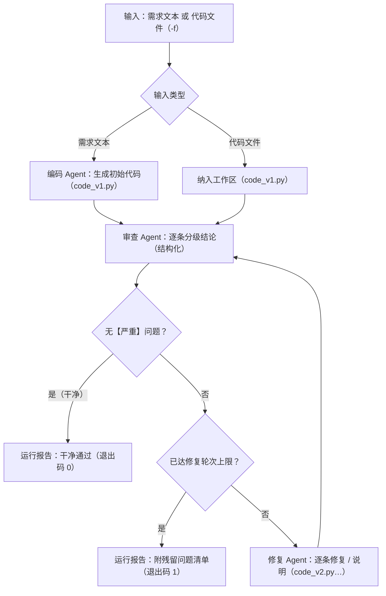

# code-review-workflow · 代码审查工作流（crw）

基于 LLM 的自动化代码审查工作流：输入一段需求（或一份既有代码），由**编码 → 审查 → 修复**三个 Agent 协作完成"写代码 → 查问题 → 修问题"的完整闭环；审查不通过自动进入修复并复审（轮次上限可配置），全过程落盘为可查、可续跑的运行记录。

## 工作流



- **三个 Agent 各司其职**：编码 Agent 按需求写代码（单文件）；审查 Agent 复核代码并输出分级问题清单（可读文件、运行代码核实）；修复 Agent 按清单逐条处置（修复或说明未采纳）后进入复审。
- **干净判定**：复审结果无【严重】问题即通过（`--strict` 可加严为"无严重且无一般"）；修复轮次上限默认 3（`--max-iter` 调整，取值 0–10），达限则以残留问题清单收尾（退出码 1，如实汇报而非静默放过）。
- **状态与消息**：节点间通过共享状态 + 结构化契约（findings JSON）交接，全过程事件写入运行日志（`log.jsonl`）。

## 快速开始

前置：Python 3.13+、[uv](https://docs.astral.sh/uv/)、任一 OpenAI 兼容供应商的 API key（默认 DeepSeek）。

```bash
# 1. 安装依赖
uv sync

# 2. 配置模型（二选一）
uv run crw config                        # 方式 A：交互式配置（推荐，支持多供应商）
setx CRW_DEEPSEEK_API_KEY "你的key"      # 方式 B：环境变量（Windows；setx 后需新开终端生效）
                                         # macOS/Linux：export CRW_DEEPSEEK_API_KEY="你的key"

# 3. 运行工作流
uv run crw run "写一个支持加减乘除与除零处理的命令行计算器"
uv run crw run -f tests/fixtures/buggy_samples/syntax_error.py   # 对既有代码执行"审查→修复"
```

可选：`uv tool install -e .` 后可直接运行 `crw`（无需 `uv run` 前缀）。

## 使用示例

```text
$ uv run crw run "写一个命令行四则运算计算器，除数为 0 时报错提示"
── 运行 r-20261015-1a2b ──────────────────────────────
[编码] 生成 code_v1.py（37 行）
[审查] 第 1 轮（code_v1.py）：2 严重 / 1 一般 / 1 建议
  【严重】code_v1.py:18 — 除数为 0 时未处理，将抛出 ZeroDivisionError。
  修改建议：运算前判断除数，为 0 时给出可读错误。
[修复] 第 1 轮：修复 3 项（code_v2.py；1 条建议未采纳）
[审查] 第 2 轮（code_v2.py）：0 严重 / 0 一般 / 1 建议 —— 干净通过（建议不影响判定）
── 完成：干净通过（共 1 轮修复）─────────────────────
运行记录：~/.crw/runs/r-20261015-1a2b/（报告 report.md 含"问题 ← 处置"对照）
```

## 命令参考

| 命令 | 说明 |
|------|------|
| `crw run [需求文本] / -f, --file <文件>` | 运行工作流（两种输入二选一；选项见下） |
| `crw runs` | 列出运行记录（运行号 / 时间 / 输入摘要 / 状态 / 修复轮数 / 残留严重数） |
| `crw show [运行号]` | 展示单次运行的状态、时间线与产物路径；省略运行号时列出记录供选择 |
| `crw resume <运行号>` | 以该运行的最新代码版本为起点续跑（新开一个运行，记录关联） |
| `crw review <路径...> \| -` | 单 Agent 快速审查（只查不改；`-` 读 stdin；目录跳过隐藏 / 二进制文件）；`-o, --out` 输出 Markdown 报告，`--json` 结构化输出，`--no-exec` 关闭执行，`--model / --provider` 临时覆盖 |
| `crw config [test]` | 模型供应商配置 / 连通性自检 |
| `crw graph [-o, --out <文件>]` | 导出工作流 mermaid 流程图（节点 / 边集合与实现一致，由快照测试锁定；默认输出 stdout） |
| `crw uninstall` | 卸载：分级清理程序、PATH 条目与用户数据（多道确认） |
| `crw --version` | 版本号 |

`crw run` 选项：

| 选项 | 说明 |
|------|------|
| `-f, --file <文件>` | 输入既有代码文件（与需求文本二选一） |
| `--max-iter <n>` | 修复轮次上限（默认 3；0 = 只审不修；取值 0–10，超限为参数错误） |
| `--strict` | 干净判定加严：无【严重】且无【一般】方可通过 |
| `--no-exec` | 禁止审查/修复 Agent 运行代码核实（默认允许；执行非沙箱，见"限制"） |
| `--out <目录>` | 将最终代码与报告复制到指定目录 |
| `--model <名>` / `--provider <名>` | 临时覆盖本次运行的模型/供应商 |
| `--no-stream` | 关闭流式渲染，整体输出 |

`crw resume` 支持与 `crw run` 相同的运行选项（`-f` 除外）。

退出码：`crw run` / `crw resume`——`0` 完成且干净；`1` 达到修复轮次上限仍有未修复的【严重】问题；`2` 运行错误（参数 / 配置 / 模型调用 / 节点失败等）。`crw review`——`0` 完成；`1` 仅 `--json` 模式且存在【严重】；`2` 运行错误。`crw config test`——`0` 全部 OK；`1` 存在失败；`2` 配置错误。

## 运行记录与产物

每次运行自动落盘到 `~/.crw/runs/<运行号>/`（用户目录，不随仓库分发；数据目录可用 `CRW_HOME` 覆盖）：

```text
~/.crw/runs/r-20261015-1a2b/
├── report.md          # 运行报告：结论、时间线、逐轮问题清单、产物清单
├── state.json         # 运行状态快照（输入、迭代、状态、错误等）
├── log.jsonl          # 事件流（节点开始/结束、工具调用、错误）
└── workspace/
    ├── code_v1.py     # 编码产物（或纳入的既有代码）
    ├── code_v2.py     # 修复产物（每轮一份，保留版本历史）
    ├── review_1.json  # 第 1 轮审查结论（结构化 findings）
    └── review_2.json  # 第 2 轮审查结论
```

## 架构

```
┌──────────────────────────────────────────────────────────────┐
│ cli.py / render.py    命令面（run·runs·show·review·config…）与终端渲染 │
├──────────────────────────────────────────────────────────────┤
│ workflow/             编排引擎：graph（StateGraph）· state · engine ·  │
│                       contracts（契约）· records（运行记录）           │
├──────────────────────────────────────────────────────────────┤
│ agents/               编码 Agent · 审查 Agent · 修复 Agent · runtime  │
├──────────────────────────────────────────────────────────────┤
│ llm.py / config.py / tools/   模型客户端 · 供应商配置 · 文件与执行工具   │
└──────────────────────────────────────────────────────────────┘
```

依赖方向单向：cli → workflow → agents → {llm, config, tools}；LangGraph/LangChain 框架类型不越层向上暴露。设计文档（模块划分、状态 schema、交接契约、复用与扩展指南）：[docs/Design.md](docs/Design.md)。

## 模型配置

`~/.crw/models.json`（用户目录，不随仓库分发）管理多供应商：`crw config` 交互式增删供应商/模型、设默认、改 key（内置 DeepSeek / Kimi / OpenAI / 阿里云百炼 / Z.ai / BigModel 等预设）；`crw config test` 逐供应商连通性自检（OK / 401 / 超时）。

key 存储二选一：明文写入配置文件（注意权限与备份）或环境变量（预设供应商沿用官方短名：`CRW_DEEPSEEK_API_KEY`、`CRW_MOONSHOT_API_KEY`、`CRW_OPENAI_API_KEY`、`CRW_DASHSCOPE_API_KEY`、`CRW_ZAI_API_KEY`、`CRW_ZHIPUAI_API_KEY`；自定义供应商按名归一化生成）。供应商条目缺 key 时按序回退：`CRW_…` → `CRA_…` → `SE_CodeAgent`（后两者为与既有工具链兼容的变量，可不重复录入 key）。

环境变量（models.json 缺省时的回退）：

| 变量 | 必填 | 默认 | 说明 |
|------|------|------|------|
| `CRW_DEEPSEEK_API_KEY` | 配置文件缺省时必填 | — | 默认供应商（DeepSeek）的 API key |
| `CRW_MODEL` | 否 | `deepseek-flash` | 模型名（OpenAI 兼容接口均可） |
| `CRW_BASE_URL` | 否 | `https://api.deepseek.com` | OpenAI 兼容接入点 |
| `CRW_EXEC_TIMEOUT` | 否 | `10` | 代码执行超时（秒，1~60） |
| `CRW_MAX_CONTEXT_TOKENS` | 否 | `100000` | 单节点请求预算（超限去工具并收尾） |

解析优先级：`--model/--provider` 参数 > 配置文件 `default` > 环境变量。

## 限制

- 审查/修复期间 Agent 可**在本机直接运行代码核实**（非沙箱、限时执行、输出截断、子进程环境净化；文件类工具限制在运行工作区内，但运行代码本身不受此限制）。`--no-exec` 可整体关闭执行。工作流的输入可能来自不可信代码，请谨慎对待执行行为。
- 修复质量依赖模型能力：复杂缺陷可能修复不完全或引入新问题——工作流以"复审循环 + 残留清单 + 退出码 1"如实汇报，而非宣称必然修完。
- 审查与修复意见均由大模型生成，仅供参考，不能替代人工评审。
- key 只存在于用户侧（`~/.crw/models.json` 或环境变量）与进程内存，不进入运行记录、日志与子进程环境。

## 开发

```bash
uv sync              # 安装全部依赖
uv run pytest        # 运行测试（LLM 一律 mock，无真实网络调用）
uv run ruff check .  # 代码规范检查
```

## 扩展：如何新增一个 Agent / 节点

项目按"节点即纯函数 + 契约"组织，新增 Agent / 节点六步走：① 按需在 `workflow/state.py` 加状态字段；② 写节点函数（state → 增量更新）；③ 需要模型时复用 `agents/runtime.py` 装配；④ 在 `workflow/graph.py` 注册节点与条件边（并行分支需 reducer 或"独立 key + 汇合"）；⑤ 结构化输出在 `workflow/contracts.py` 增 schema 与校验；⑥ 补节点级与端到端测试，并用 `crw graph` 核对流程图。完整指南与并行示例见 [docs/Design.md](docs/Design.md) §12.2。

## Roadmap

- [ ] 并行多视角审查（如"正确性 + 安全性"双审查者并行，结果合并）——见 Design §12.2
- [ ] 运行对比与审阅历史（多次运行的结论 diff）
- [ ] 可选的编排界面评估（Web 形态；仅在 Design §12.3 Backlog 评估，未排期）
