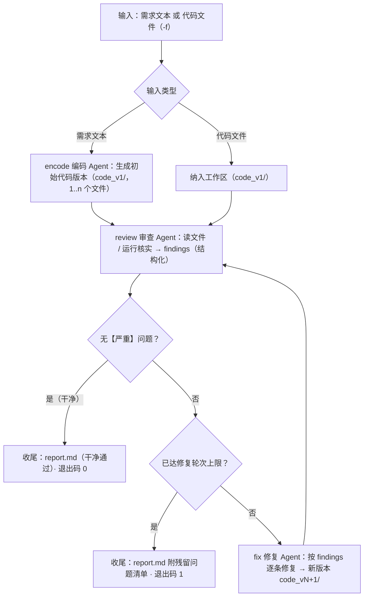

# Design.md — 代码审查工作流 code-review-workflow（CLI 命令 crw）

平台环境：Windows + Git Bash（PowerShell/CMD 兼容）。

> 本文描述**目标形态**；实现随里程碑推进与本文同步（每个里程碑收尾逐条核对，§10.2 为核对门禁）。§10 属过程记录章节（估算、Checklist、复盘）。

## 1. 项目概述

`crw` 是一个基于 LLM 的自动化代码审查工作流工具：给它一段需求，或一份既有代码文件，它以三个协作的 Agent 完成"编码 → 审查 → 修复 → 复审"闭环——编码 Agent 产出代码；审查 Agent 输出分级问题清单（可读文件、运行代码核实）；修复 Agent 逐条修复后进入复审，直到通过或达到轮次上限。全过程落盘为可查、可续跑的运行记录。

架构自始按工作流设计（workflow-first）：**编排引擎、状态管理、节点协议、运行记录是项目本体**；与同作者既有工具 `code-review-agent`（下称"前作"）重叠的基础能力（模型配置、Agent 运行时、工具层、审查提示词与结构化输出、终端渲染、持久化与选择交互等）以**按需复制 + 改造**方式并入（§6）。

## 2. 范围

### 2.1 范围划分

| 级别 | 内容 |
|------|------|
| Must | 工作流引擎：LangGraph `StateGraph` 编排"编码→审查→修复"（顺序 + 条件分支 + 循环）；三 Agent 真实模型端到端；Agent 间共享状态 + 结构化消息契约；运行记录（自动落盘 / 列表 / 选择 / 展示）；执行日志与状态追踪（事件流 + 报告）；节点级错误处理（失败落盘、可读报错）；模型多供应商配置（改造复用）；终端渲染（流式 / 分级着色，改造复用）；`crw run/runs/show/review/config`；**会话模式**：`crw chat`（三 Agent 之外的编排/路由节点驱动工作流，按 Agent 独立长久的记忆、轮次模式 up-to/exact、会话可恢复，见 §4.7/§5.4/§8.1）；pytest 测试集（LLM 一律 mock） |
| Should | `crw resume` 续跑（从失败/达限运行的最新版本继续）；`crw graph` mermaid 图导出（节点 / 边集合与实现一致，快照测试核对）；`--strict` 判定加严；`--no-exec` 关闭执行（run / resume / review）、`--out` 产物复制（run / resume）；`crw uninstall` 干净退场（M3 落地）；可演示的扩展示例节点（成本可控时落地，否则以 §12.2 扩展指南 + 节点级示例测试替代）；检测到 `~/.cra/models.json` 且本工具未配置时提示导入 |
| Won't | Web 可视化界面（题面把它列为「推荐实现」中的可选界面，不纳入——会话交互以 CLI 内的 `crw chat` 提供，不是图形编排界面）；多工作区 / 按项目配置；Docker 沙箱；联网搜索工具；多语言执行（`run_python` 语义不变）；跨会话长期记忆（记忆随会话存续、新会话从零开始，见 §4.7） |

> **题面对位（Homework2 幻灯片原文）**：必须项 = 至少 2 个 Agent 协作完成完整流程 / Agent 间消息传递或状态共享 / 基本流程控制（顺序执行）/ MVP 可运行——本项目 3 Agent + 共享状态与结构化契约 + 顺序 · 条件分支 · 循环，均已覆盖并超出；推荐项 = 条件分支 · 循环 · 并行执行、执行日志与状态追踪、错误处理与恢复机制、可视化编排界面（标注「可选」）——前三项覆盖（并行执行经 §12.2 扩展示例落地），界面项不纳入（图形编排界面；会话交互以 §8.1 的 `crw chat` 提供，属 CLI 内的编排层）；题面「MVP 可运行即可，不需要复杂调度」与本文的 MVP 定位一致。

工作流完整性说明：
- 输入两种模式：需求文本（编码起步）与既有代码文件（跳过编码，直接审查→修复）；
- 终止三种状态：干净通过（退出码 0）、达限残留（退出码 1）、运行错误（退出码 2）。

### 2.2 与前作的关系

本项目**不以**前作为工程基座：工程骨架、编排、模块划分、CLI 面全部新设计；前作仅在 §6.2 复用矩阵列出的重叠能力上被改造复用。两仓库独立演进、互不依赖。

## 3. 总体架构

```
┌───────────────────────────────────────────────────────────────────┐
│ cli.py / render.py    命令面与终端渲染（仅此层接触 argparse / 终端输入） │
├───────────────────────────────────────────────────────────────────┤
│ session/              会话层（会话模式）：编排/路由节点 · 会话态 · 按 Agent 记忆 │
├───────────────────────────────────────────────────────────────────┤
├───────────────────────────────────────────────────────────────────┤
│ workflow/             编排引擎                                      │
│   graph.py            StateGraph 组装：节点、边、条件路由、循环         │
│   state.py            运行状态 schema 与快照                         │
│   engine.py           运行驱动：执行 / 事件 / 错误 / 收尾报告           │
│   contracts.py        结构化契约（findings schema 定义与校验）         │
│   records.py          运行记录持久化（列表 / 选择 / 加载 / 续跑）       │
├───────────────────────────────────────────────────────────────────┤
│ agents/               Agent 节点                                    │
│   encoder.py / reviewer.py / fixer.py    编码 / 审查 / 修复装配       │
│   runtime.py                             Agent 运行时（循环 / 工具桥接）│
│   prompts.py                             系统提示词                   │
├───────────────────────────────────────────────────────────────────┤
│ llm.py · config.py · tools/    模型客户端 · 供应商配置 · 文件与执行工具  │
└───────────────────────────────────────────────────────────────────┘
```

模块划分（src 布局，包目录 `src/crw`）：

```
src/crw/
  cli.py           # 命令面：run/runs/show/resume/review/config/graph/uninstall + chat/sessions + 参数解析
  render.py        # 终端渲染管线（流式 / 分级着色 / 节点阶段展示）
  session/
    __init__.py    # 会话生命周期：新建 / 恢复 / 结束
    chat.py        # 会话循环：读入用户消息、中断与退出语义、会话级渲染
    orchestrator.py# 编排/路由节点：用户消息 → 意图与轮次参数（结构化）→ 选择下一节点 → 汇报渲染
    memory.py      # 三 Agent 各自的追加式记忆（落盘 / 载入 / 阈值压缩）
    state.py       # 会话态 schema（跨轮的会话状态）与快照
  workflow/
    graph.py       # StateGraph 组装与条件路由（框架类型不外泄）
    state.py       # 状态 schema（数据化）与快照读写
    engine.py      # 运行驱动：节点调用、事件、错误、报告、退出语义
    contracts.py   # findings 契约与校验（审查→修复的"协议"）
    records.py     # 运行记录：落盘（原子写）/ 列表 / 选择 / 加载 / 续跑
  agents/
    encoder.py     # 编码 Agent 节点
    reviewer.py    # 审查 Agent 节点
    fixer.py       # 修复 Agent 节点
    runtime.py     # Agent 运行时：create_agent 封装、轮次限制、错误协议、工具桥接
    prompts.py     # 三 Agent 系统提示词（审查部分改造复用前作）
  tools/
    __init__.py    # 工具注册表与执行（"错误："结构化协议）
    fs.py          # list_dir / read_file
    exec_py.py     # run_python（限时强杀 / 截断 / 环境净化）
  llm.py           # ChatOpenAI 封装（重试映射 / 异常翻译）
  config.py        # 供应商配置（models.json / 预设 / 环境变量 / 连通自检）
  uninstall.py     # 卸载：分级确认后的清理（程序 / 垫片 → PATH → 登记的环境变量 → 用户数据）
tests/
  fixtures/buggy_samples/   # 预埋样例：syntax_error.py、divide_by_zero.py（供演示与回归）
```

### 3.1 分层与依赖方向

- 依赖单向：`cli → session → workflow → agents → {llm, config, tools}`（会话模式）；一次性运行路径为 `cli → workflow → agents → {llm, config, tools}`。`render.py` 与 `session/` 仅被 cli 使用；编排节点经 `llm.py` 取模型（不新造调用栈）；任何下层不 import 上层。
- 框架类型边界：LangGraph 图/状态类型不越出 `workflow/`（engine 对外暴露纯数据结构）；LangChain 消息/流对象不越出 `agents/runtime.py`（对上层只给字符串与普通数据）。
- 状态载体（两层）：**运行态**——`StateGraph` 执行上下文是单轮运行状态的**唯一载体**（由框架托管）；**会话态**——跨轮存活的会话状态（轮次链、当前设置、各 Agent 记忆索引）由 `session/state.py` 定义、会话层持有并落盘，engine 不感知会话态。下述"不维护第二份内存正本"专指运行态。engine 只做生命周期——构建初始状态、驱动图执行、把节点边界状态导出为快照（state.json）、落日志、生成报告与退出码。
- 节点协议：节点为纯函数 `node(state) -> dict`（契约型节点可带 `retry_feedback: str | None = None`）——只读所需字段、只返回要更新的字段；禁止落盘、禁止直接打印/写日志（过程输出经 runtime 回调转成事件与渲染输入）；契约校验、重试与 `clean` 判定由 workflow 层的包装完成（agents 只负责产出），条件路由为只读 state 的纯函数。节点产出的原始文本经**暂存键**交回包装层（encode → `code_text`、review → `review_text`、fix → `fix_text`）：暂存键不在状态 schema 内，由包装层消费后不进入运行记录；阶段摘要由引擎按产物与契约结论自算（抽取 / 落盘见 §4.2.1）。
- 持久化职责切分：`state.py` = schema 与纯序列化/反序列化；`records.py` = 文件 IO（原子写、列表、加载、选择、结构自检）；`engine.py` = 组织时序（何时调用 records）；节点不接触文件。

## 4. 工作流设计

### 4.1 流程图（概念图；`crw graph` 导出口径见 §8.1）



`--strict` 时 F 的判据加严为"无【严重】且无【一般】"。本图为概念图；`crw graph` 输出为规范化 mermaid（节点 / 边集合与实现同源，核对以快照测试为准，见 §8.1）。

### 4.2 节点规格

| 节点 | 输入 | 输出 | 工具 | 失败模式 |
|------|------|------|------|----------|
| encode 编码 Agent | 需求文本（+ 可选上下文） | 代码版本目录 `code_v1/`（1..n 个文件 + manifest，写入运行工作区）+ 简要说明（输出格式见 §4.2.2） | 无（纯生成） | 抽取失败 / 空输出 / 缺 `file=` 声明 → 重试一次 → 仍失败按节点失败 |
| review 审查 Agent | 当前版本目录内**全部文件**（清单来自状态 `version_files`） | findings 结构化清单（§5.2 契约，location = 版本内相对路径:行号），经校验后写入状态（校验 / 重试在 workflow 层包装完成） | `list_dir` / `read_file` / `run_python`（核实用；`--no-exec` 关闭执行） | 契约校验失败 → 附错误清单重试一次 → 仍失败按节点失败 |
| fix 修复 Agent | 当前版本 + findings | 修复后的**完整版本** `code_vN+1/`（版本内全部文件 + manifest，可附删除申请）+ fixes 清单（逐条对应 findings id，§5.2）（输出格式见 §4.2.2） | read_file / run_python（内联验证修复，可关） | 抽取失败 / 缺文件覆盖 → 重试一次 → 仍失败按节点失败；整版本 `路径 → sha256` 与上版相同 → 视为"本轮未产生改动"（不失败，继续复审，报告标注） |

收尾（非 Agent 节点，由 engine 执行）：生成 `report.md`（结论、时间线、逐轮 findings、产物清单）并确定退出码。

### 4.2.1 产物抽取与落盘

- **输出格式（M3 及之前：单文件）**：编码 Agent = 恰好一个 ```python 围栏（全部代码合并到**单个 Python 文件**）+ 围栏外简要说明；修复 Agent = 恰好一个 ```python 围栏 + 恰好一个 ```json fixes 围栏 + 围栏外说明。**M3.5 起解除单文件硬约束**，目标形态见 §4.2.2。
- **落盘执行者**：抽取与落盘在 workflow 包装层 / engine 完成（节点只返回文本与结构化数据，自身不落盘）。
- **抽取规则（Markdown 语义）**：围栏闭合需同长或更长、语言标签 `python` / `py` 不区分大小写；M3.5 起编码 / 修复的围栏抽取按 §4.2.2 的目录形态重述（每文件一个带 `file=` 声明的 python 围栏），多余的围栏忽略并记 log（计入该轮阶段摘要）；**缺少必需围栏**或内容为空 → 附重试反馈重试一次 → 仍失败按节点失败。
- **落盘顺序（原子）**：先写 `workspace/code_v(N+1)/` 内的全部文件（每个文件临时文件 + 替换），再写该版本目录内的 `manifest.json`，随后写该轮处置 `workspace/fixes_N.json`（N = 修复轮次，与 `review_N.json` 按 finding id 配对），最后更新 `state.current_version_dir` 与 `state.version_files`；失败不产生半写文件。
- **`-f` 输入**：由 CLI 读取、按代码文本标准化（去首尾空行、统一以单个换行结尾）后包成目录版本 `workspace/code_v1/<原文件名>`（原始路径记入 `input.source_path`，报告标注"原文件 → 工作区"映射）；标准化保证版本间"逐字节相同"的比较口径一致。
- **修复验证**：修复 Agent 的 `run_python` 使用内联 `code=<候选代码>` 执行（不依赖未落盘文件）；`--no-exec` 下跳过验证并在报告标注。

### 4.2.2 多文件产出（M3.5 目标形态）

一个**代码版本 = 一个目录**（`workspace/code_v1/`）：目录内是该版本的全部文件（相对路径即工作区内的相对路径），
并由引擎在**版本目录内**生成 `manifest.json`（文件清单 + 每个文件的 sha256 + 行数）。单文件只是"目录里只有
一个文件"的特例，因此 §4.2.1 的抽取 / 落盘 / 原子性 / 逐字节比较语义全部按"目录"重述。
读取版本内容**以 `manifest.json` 清单为准**（清单缺失时才退回全目录读取）：`manifest.json` 是引擎落盘时写的
权威文件清单，执行核实（`run_python`）可能把字节码（`__pycache__/`、`*.pyc`）甚至被测程序自己写出的数据文件
留在版本目录里——这些**运行时副产物**不属于版本内容，也不进产物清单、不进 resume 复制、不参与整版本指纹比较；
`--out` 复制版本目录同样以清单为准。执行侧从源头收紧：`run_python` 的子进程环境设 `PYTHONDONTWRITEBYTECODE=1`
（一次性核实不需要字节码缓存），不再产生 `__pycache__`。

- **输入**：需求文本 → 编码 Agent 产出 1..n 个文件；`-f` 单文件输入 → **同样包成目录版本**
  （`code_v1/<原文件名>`，不做特殊路径分支，用户裁决 2026-10-13"改"）；`resume` → 复制父版本目录为新版本目录（`code_v1/`）。
- **编码 / 修复的输出契约**：每个文件一个 python 围栏，围栏 info 形如 ` ```python file=<相对路径> `；
  路径必须是版本内的**相对**路径（拒绝绝对路径与 `..`），重复路径取最后一个并在阶段摘要记"已忽略重复声明"；
  修复另给出恰好一个 ```json fixes 围栏，且**必须给出版本内的全部文件**（声明删除的可不出内容——
  未确认删除时引擎从上一版本原样保留，版本完整性由引擎兜底）——只给改动文件会让版本不完整，
  与"按文件审查 / 逐字节比较 / resume 从版本目录出发"的语义冲突。
  删除文件用显式声明 `{"deleted": ["<相对路径>", …]}` 提出，**执行前必须取得用户确认**（见下）。
- **审查**：一次审查覆盖版本内**所有**文件（审查 Agent 用 `list_dir` / `read_file` 自行读取）；findings 的 `location`
  一律 `相对路径:行号`（相对版本目录，如 `parser.py:18`、`pkg/util.py:7`）；契约顶层由 `file: "code_vN.py"` 改为
  `files: ["a.py", "b.py", …]`（版本内清单，缺省由校验层按 manifest 补权威值，给出即必须与 manifest 一致）。
- **修复**：与 findings 逐条对应的约束不变；修复 Agent 可读全部文件，也可新增文件（新路径即版本内的新条目）。
- **逐字节比较**（"本轮未产生改动"判定）：按**整版本**比较（manifest 的路径 → sha256 全等即视为无改动）。
- **产物与记录**：`review_N.json` 带 `files` 清单；`report.md` 的逐轮清单按文件分组；产物清单列出目录内文件；
  `--out` 复制整个版本目录为 `<out>/code_final/`（重名加序号）。
- **量级上限**（实现轮按实测调整并同步本节）：版本文件数 ≤ 20、单文件 ≤ 256 KB、版本总计 ≤ 1 MB；
  超限按契约违规重试一次，仍超限按节点失败（退出码 2）。
- **删除文件的确认闸门（用户裁决 2026-10-13）**：修复 Agent 只能**提出**删除，实际删除前引擎把待删清单
  （路径 + 该文件在本轮 findings 里对应的理由）打印出来并交互询问（`y/N`，**缺省不删**）。确认 → 新版本目录里
  不再包含该文件，报告标注"已确认删除"；拒绝 / 中断 / **非交互**（stdin 非终端、管道输入、CI）→ 文件保留，
  终端与报告标注"待确认删除（未执行）"。删除是工程清洁度、不改变判定结论与退出码；自动化场景因此永不静默删文件。
- **状态字段与「不做旧记录兼容」（用户裁决 2026-10-13）**：`current_code` 直接改为 `current_version_dir`
  （同步 `PERSISTED_FIELDS` 与 §4.3 表），**不写迁移分支**——旧单文件记录是开发期测试产物，已按用户指示清理
  （进回收站）。`crw show` / `crw resume` 只认版本目录形态；遇到旧格式记录给一行可读提示（"该记录来自单文件格式，
  已被新格式取代"）并按"记录不可用"退出码 2，而不是崩溃或静默出错。

### 4.3 状态 schema

| 字段 | 类型 | 说明 | 写入者 |
|------|------|------|--------|
| `run_id` | str | 运行号（`r-YYYYMMDD-` + 4 位小写十六进制，碰撞重试） | engine（初始化） |
| `parent_run_id` | str? | 续跑来源运行号（resume 时写入；新运行为空） | engine（初始化） |
| `input` | {kind, requirement?, source_path?} | 输入描述（requirement / file） | engine |
| `workspace` | str | 运行工作区路径（运行目录下 `workspace/`） | engine |
| `review_round` / `fix_rounds` | int | 已完成审查次数（首轮审查 = 1）/ 已完成修复轮数（初始 0）；审查发生时恒有 `review_round == fix_rounds + 1` | engine |
| `max_iterations` | int | 修复轮次上限（默认 3；取值与来源见 §4.4） | engine |
| `max_iterations_source` | str | 轮次取值来源：cli / requirement / config / parent / default | engine |
| `rounds_mode` | str | 轮次语义：up-to（干净即早退）/ exact（跑满指定轮次） | engine |
| `parallel_review` | bool | 是否并行双视角审查（`--parallel-review`；汇合形态见 §12.2） | engine |
| `session_id` | str? | 所属会话号（会话轮次写入；`crw run` 一次性运行为空） | engine（初始化） |
| `round_index` | int? | 会话内轮次序号（从 1 起；非会话运行为空） | engine（初始化） |
| `current_version_dir` | str | 最新版本目录路径（`workspace/code_vN/`） | engine（物化）/ encode / fix |
| `version_files` | list[str] | 当前版本内的文件清单（版本内相对路径，posix 风格；节点构造任务提示词用，节点不接触文件） | engine（物化）/ encode / fix |
| `findings` | list[Finding] | 最新一轮审查结论 | review / 汇合 |
| `findings_correctness` / `findings_security` | list[Finding] | 并行双视角的两个分支结论（**独立 key**，避免同超级步多写者冲突）；汇合后由 `findings` 承载权威结论，故不持久化（不进 state.json） | review 分支 |
| `clean` | bool | 最新一轮是否干净（engine 依契约判定；`--strict` 影响判据） | engine |
| `strict` | bool | 本次运行是否启用加严判定（`--strict`） | engine |
| `history` | list[NodeEvent] | 节点执行事件（node、审查/修复轮次、started_at、duration_ms、摘要、产物） | engine（追加） |
| `status` | str | running / success / residual / failed / interrupted | engine |
| `next_action` | str? | 收尾建议：done / review_again / fix_again（可直接照做 `crw resume`） | engine |
| `error` | {node, message}? | 失败信息（若有） | engine |
| `model` | str | 本次运行模型标识（供应商 / 模型名） | engine |
| `created_at` / `finished_at` | str | 时间戳 | engine |

Finding：

```json
{"id": "f-1", "severity": "严重|一般|建议", "location": "parser.py:18", "issue": "…", "suggestion": "…", "uncertain": false}
```

`id` 由契约校验层按序生成（`f-1`、`f-2`…）并随 `review_N.json` 落盘（供修复逐条对应）；`location` 为**版本内相对路径**加行号（如 `parser.py:18`、`pkg/util.py:7`）。

### 4.4 分支与循环语义

- **干净判定**：本轮 findings 中【严重】数为 0（`--strict`：严重与一般均为 0）。
- **循环**：每轮 = 修复 + 复审；`--max-iter` 为**0–10 的整数**（用户运行时指定）：默认 3；0 = 只审不修（首审不干净即残留，退出码 1）；负数 / 非整数 / 超过 10 为参数错误（退出码 2）。上限 10 为硬闸，防止误填大值造成无界循环与无界调用费用（默认 3、封顶 10 时最坏约 22 次模型调用）。n 轮修复最多产生 n+1 次审查；达限仍未干净 → 以残留清单收尾（状态 residual，退出码 1；`--strict` 下残留可能全部由【一般】构成，故报告与终端文案统一写"阻塞问题"，"残留严重数"列仍只数【严重】）。engine 在图调用处显式设置 `recursion_limit` 作崩溃护栏（**默认串行图**为 `2 × max_iter + 8`，并行双视角形态按 `3 × max_iter + 8` 复算，见 §12.2——护栏是崩溃保护，不是预算），框架递归错误翻译为可读运行失败。同轮 findings 与上轮完全相同（location + issue 集合一致）→ 阶段摘要、report.md 与 `crw show` 均标注"未收敛"，但**不提前中止**（标注已落地）。
- **轮次模式**：`up-to`（默认）= 至多 n 轮修复、任一复审干净即早退（首审干净则不进入修复）；`exact` = 固定跑满 n 轮修复 + n+1 次审查，即使中途干净也继续（"精益求精"场景）。两种模式**结尾恒为一次审查**，因此不存在"已修复但未审查"的收尾状态；`exact` 下若某轮修复与上版逐字节相同，按 §4.2 标注"本轮未产生改动"后继续。
- **轮次取值来源与优先级**：命令行 `--max-iter`/`--rounds-mode`（显式）> 本次用户消息的结构化提取值（会话模式，§5.4）> 配置默认（`~/.crw/settings.json`，§8.3）> 内置 3 / `up-to`；全部受硬上限约束，来源记入 `max_iterations_source`。越界语义分开：**命令行越界 = 参数错误（退出码 2）**；**消息提取值越界 = 夹到上限执行并在报告与时间线标注**（那是意图理解）。
- **早退**：`up-to` 模式下首轮审查即干净 → 直接收尾，不进入修复。
- **输入模式**：代码文件输入跳过 encode，其余流程一致。
- **续跑**：`crw resume <运行号>` 仅当父运行存在 `current_version_dir`（旧单文件格式记录除外——给一行可读提示 + 退出码 2）时可用（否则可读错误，退出码 2）；把父运行最新版本目录复制为新运行 `workspace/code_v1/`（`input.kind=file`，源记 `input.source_path`），`parent_run_id` 写入状态；`--max-iter`/`--rounds-mode`/`--strict`/`--no-exec` 由本次命令行决定，未显式给出的轮次设置**继承父运行**（来源标 `parent`），无父设置时退回配置默认；父运行的 `--strict` 与审查形态（`--parallel-review`）一并继承——续跑是"接着修"，换判定标准或换审查方式会让结论不可比；`--no-exec` 例外（它不进状态快照，命令面无法区分"显式关闭"与"从未设置"，故按未设置处理）。新运行轮次从 `review_round=1`/`fix_rounds=0` 重新计数；报告标注父运行与父残留摘要。

### 4.5 运行目录与产物

```
~/.crw/runs/<run_id>/
├── report.md            # 运行报告
├── state.json           # 状态快照（§4.3）
├── log.jsonl            # 事件流（每行一条 JSON 事件）
└── workspace/
    ├── code_v1/         # 各版本代码（保留全部历史版本；目录 + manifest.json）
    │   ├── main.py
    │   └── manifest.json
    ├── code_v2/
    ├── review_1.json    # 各轮审查结论（结构化；并行双视角时为汇合结果）
    ├── review_1_correctness.json   # 并行双视角：正确性视角的原始结论
    ├── review_1_security.json      # 并行双视角：安全性视角的原始结论
    ├── review_2.json
    └── fixes_1.json     # 各轮修复处置（逐条对应 findings id，与 review_N.json 配对）
```

- 报告结构：运行摘要（输入 / 模型（含思考挡位）/ 状态 / 审查与修复次数）→ 时间线（节点事件表）→ 逐轮问题清单（标题固定为"第 i 轮审查（基于 `code_v{i}/`）"，问题按文件分组、含"问题 ← 处置"对照与删除处置标注）→ 产物清单与路径（`-f` 输入标注"原文件 → 工作区"映射）。
- `--out <目录>`：将最终版本**整目录**复制为 `<out>/code_final/`（含 manifest.json；连同 report.md；重名成对加序号），便于在项目目录内取用产物。
- 运行记录属**用户目录数据**（不随仓库分发，默认 `~/.crw`，可用 `CRW_HOME` 覆盖）；不含密钥，含生成代码与审查结论。清理策略：`crw uninstall` 分级确认后清理（见 §6.2 #8）；容量上限策略入 Backlog。

### 4.6 错误处理与恢复

- 任一节点失败：捕获并写入 `status=failed`、`error`（节点与消息）与时间线；已产出产物保留；退出码 2 + 可读报错。
- LLM 调用：瞬时错误经 SDK 重试（仅建连期）；认证错误快速失败并给出 key 排查指引；流式中途断开不重试（防重复输出）。
- 审查契约校验失败：附错误清单重试一次（重试的第二次模型输出不重复渲染正文——前次输出仅进 log，`event=retry`；重试不计审查轮次）；仍失败按节点失败处理。
- 落盘失败（state / log / report）：按运行失败处理（`status=failed`、退出码 2），stderr 给出可读原因与已保留产物路径；report 生成失败时退出码 2 并指向 state.json；`--out` 复制失败不影响运行结论（stderr 警示，退出码仍按运行状态）。
- 中断（Ctrl+C）：写盘序列 = log 追加 interrupt 事件 → 原子写 `state.json`（`status=failed`、`error.node="interrupt"`、finished_at）→ 退出码 2；第二次 Ctrl+C 放弃写盘（"尽力"语义）。
- 任务级预算护栏：单节点请求的 token / 字符估算超阈值（`CRW_MAX_CONTEXT_TOKENS`，默认 100000）→ 停止工具 + 注入收尾指令（保留已达结论并标注可能不完整；工具轮次上限同机制，触达事实并入阶段摘要进 log 与时间线）；模型端 `context_length` 类 400 → 可读中文报错（建议分段审查或改用更大窗口模型）。
- 恢复：`crw resume`（Should）；失败运行的诊断信息在 `crw show` 中可见。

### 4.7 会话目录与产物（会话模式）

```
~/.crw/
├── runs/<run_id>/                     # 一次性运行（crw run）——格式同 §4.5
└── sessions/<session_id>/             # 一次会话（crw chat）
    ├── session.json                   # 会话档案：轮次链（run_id 列表）、当前设置、记忆文件索引
    ├── session.md                     # 会话总报告：各轮摘要与结论演进（人读，供演示与复盘）
    ├── memory/<agent>.jsonl           # encoder / reviewer / fixer 各自的独立记忆（追加式）
    └── rounds/
        └── round-<i>/                 # 每轮 = 一条完整运行记录（report.md / state.json / log.jsonl / workspace/）
```

- 会话号 `s-YYYYMMDD-` + 4 位小写十六进制；运行号仍为 `r-YYYYMMDD-` + 4 位，**全局唯一**，按运行号在
  `runs/` 与 `sessions/*/rounds/` 两处查找（`crw show` / `crw resume` 对两处一致可用）。
- 每轮记录与 `crw run` **同构**：同一套 state/log/report/workspace 代码，仅父目录不同，且 `state.json` 多
  `session_id` / `round_index` 两个字段；`crw runs` 扫两处并多一列"会话"。
- **代码版本号跨轮连续递增**（`code_v1/` → `code_v2/` …）：会话内是同一份代码在演进，报告里的"第几版"始终指向同一文件。
- 记忆文件每行一条消息（角色 / 文本 / 时间 / 来源轮次），**只追加、不改写**（对供应商前缀缓存友好）；压缩时追加一条
  `{"kind": "compaction", …}` 记录并保留旧行于磁盘（仅不再参与后续请求）。
- 会话结束写 `session.md`（各轮结论演进 + 最终状态 + 剩余建议）；`crw uninstall` 的清理范围包含 `sessions/`。

## 5. Agent 协作机制

### 5.1 状态共享与消息载体

- **共享状态**：三节点读写同一运行状态（§4.3 schema）——节点只读写自己负责的字段，引擎串起流转与循环判定。
- **消息载体（双层）**：① 状态字段（`findings`、`current_version_dir` 等）；② 工作区文件（代码版本、`review_N.json`）。结构化结论既是状态也是文件——可审计、可重放、可被下游逐条引用。
- **过程事件**：每次节点执行与工具调用写入 `log.jsonl`，作为状态追踪与演示的时间线来源。

### 5.2 结构化交接契约（审查 → 修复）

审查 Agent 的输出契约（由 `workflow/contracts.py` 定义并校验）：

```json
{
  "iteration": 1,
  "code_version": 1,
  "files": ["main.py", "pkg/util.py"],
  "findings": [
    {"id": "f-1", "severity": "严重|一般|建议", "location": "parser.py:18", "issue": "…", "suggestion": "…", "uncertain": false}
  ],
  "summary": "该轮整体评价"
}
```

- **校验规则**：顶层为对象；`iteration` = 本次审查序号（= `review_round`，1-based）；`code_version` = 当前版本号，`files` 为版本内文件清单（缺省由校验层按 manifest 补权威值，给出即必须与之一致）；`findings` 为数组（**可为空** = 本轮无问题，进入 clean 判定）；逐条：severity 枚举、location（版本内相对路径加行号）/ issue 非空字符串、suggestion 字符串（可空）、uncertain 缺省补 false、`id` 由校验层按序生成；`summary` 缺省补 ""；未知字段忽略并原样保留（旧单文件契约的 `file` 键被丢弃）；校验失败 → 附错误清单重试一次。
- **执行有效性门禁**：本轮须有至少一次成功工具事件（或内联送达记录）；`findings` 为空时 `summary` 不得为空串——否则视为"审查未执行"，重试一次 / 按节点失败（防"空数组即通过"逃逸）。工具事件的判定由审查节点交回的 `review_evidence`（本轮成功工具事件数 > 0）实现；`crw review` 的内联送达与不接工具的注入桩按"内联送达记录"视为满足该门禁。
- **权威字段的缺失与不符**：`iteration` / `code_version` / `files` 缺失时由校验层补权威值；给出但与权威值不符即违规（防模型自报版本号错位）。
- **重试接缝**：包装层经 `node(state, *, retry_feedback=None)` 回传错误清单（节点协议见 §3.1）；重试前 engine 发 `event=retry`，第二次模型输出的正文增量只进 log、不重复渲染。重试不计审查轮次。

修复 Agent 的输出契约（与代码围栏并列的 ```json 围栏）：

```json
{"fixes": [{"finding_id": "f-1", "status": "fixed|partial|skipped", "note": "…"}]}
```

- **校验规则**：`fixes` 覆盖上一轮 findings 的 `id` 全集（缺项 → 带缺失清单重试一次）；`skipped` 须给理由（不成立 / 不采纳）；报告按"问题 ← 处置"对照渲染。该契约与前述 findings 契约共同保证"问题 → 修复"可追溯。
- **边界**：重复 `finding_id` 取最后一条；未知 id 忽略并在报告标注；`status` 非枚举或 `skipped` 缺理由 → 附错误清单重试一次。

并行双视角审查（§12.2）下的契约不变：两个分支各自产出一份 §5.2 契约对象（落 `review_N_<视角>.json`），
汇合后的 `review_N.json` 仍是同一 schema（`findings` 为去重合并结果）；每条 finding 多一个附加字段
`views`（来源视角，如 `["正确性", "安全性"]`），供报告与审计追溯"这条结论是谁提的"。

### 5.3 设计理由

- 结构化契约让"Agent 间通信"可验证（不是自然语言口头交接）：修复有明确输入、复审可核验修复效果、报告可程序化汇总。
- 状态字段最小化 + 以文件保留产物，使中途失败不丢进度、可续跑、可审计。
- 节点与契约均为显式定义，新增 Agent 有章可循（§12.2）。

### 5.4 会话意图与轮次参数契约（会话模式的编排节点输出）

会话模式下，编排节点（§3）对每条用户消息产出结构化结果，由 workflow 层校验后才驱动工作流：

```json
{"intent": "code|review|review_fix|ask", "rounds": 5, "rounds_mode": "up-to|exact", "reply": "……"}
```

- **`intent` 取值**：`code` = 需写 / 改代码（含按新需求修改）→ 从编码 Agent 起步；`review` = 只审查不改（等价 rounds=0）；
  `review_fix` = 不改需求、从审查起步跑"审查→修复"循环（如"再检查一轮"）；`ask` = 提问或需澄清 → **不启动工作流**，直接回答 / 反问。
- **校验规则**：`intent` 必须为枚举值；`ask` 必须给出 `reply`；`rounds` 缺省 = 用配置默认，取值受硬上限约束并**夹取而非报错**并经报告标注
  （意图理解 ≠ 用户显式参数，见 §4.4）；`rounds_mode` 缺省 `up-to`；未知字段忽略并原样保留。
- **优先级**：命令行显式 `--max-iter` / `--rounds-mode` > 本次消息的结构化提取值 > 配置默认 > 内置 3 / `up-to`；
  来源写入 `state.json` 的 `max_iterations_source`。
- **路由兜底**：分不清意图时**一律按 `ask` 反问用户**（不静默挑一条路）；`ask` 分支不产生运行记录。
- **单口约束**：会话中只有编排节点与用户对话；三 Agent 不直接面向用户，其产出经结构化契约与状态进入汇报。

## 6. 复用策略（与前作 code-review-agent）

### 6.1 原则

1. **按需少量分次复制**：开发到对应里程碑、确认需要时，从前作仓库逐块复制**最小必要**文件；不整包搬运。
2. **复制即改造**：复制前审查、复制后改造才能并入——
   - 合规检查：密钥 / 隐私 / 命名 / 本机路径 / 历史语境残留（如注释中的旧里程碑编号、旧项目名）；不适合新仓库的内容一律清理；
   - 质量检查：已知实现缺陷与可简化处一并处理（不搬旧问题）；
   - 适配检查：接口、命名、配置路径、变量前缀、依赖方向按本项目架构调整。
3. **台账留痕**：每次复用记入开发进度台账（来源文件、目标文件、改造要点、commit），可审计。
4. **测试借鉴重写**：测试策略（mock LLM、禁真实网络、fixtures 预埋样例）借鉴；用例针对新架构重写，不整包搬运。

### 6.2 复用矩阵

| # | 能力 | 前作落点 | 本项目落点 | 改造要点 | 里程碑 |
|---|------|----------|------------|----------|--------|
| 1 | 模型客户端（ChatOpenAI 封装、SDK 重试映射、异常翻译、认证指引） | `src/cra/llm.py` | `src/crw/llm.py` | 文案 / 配置前缀改 CRW；接口面向节点运行时 | M2 |
| 2 | 多供应商配置（models.json、预设清单、环境变量存储与登记、连通自检、交互式配置） | `src/cra/config.py` + `src/cra/llm.py`（probe 连通自检）+ `src/cra/cli.py`（交互函数） | `src/crw/config.py` + `crw config` | 路径改 `~/.crw/`；变量前缀 CRW_（预设沿用官方短名，与 CRA_ 一一对应）；回退链 CRW_→CRA_→SE_CodeAgent；可提示导入 `~/.cra/models.json`（排期见 §12.1 M3） | M2 |
| 3 | 工具层（list_dir / read_file / run_python：限时强杀、输出截断、子进程环境净化、大文件上限、行号口径） | `src/cra/tools/` | `src/crw/tools/` | 环境净化名单纳入 CRW_/CRA_ 前缀；**路径语义改为上下文根限制（见 §8.4），工具 description 与提示词路径口径同步**；超时变量保留（`CRW_EXEC_TIMEOUT`） | M2 |
| 4 | 审查能力（审查角色提示词、分级输出约定、结构化输出校验经验） | `src/cra/prompts.py`（文本约定）+ `src/cra/cli.py`（`--json` 解析与校验） | `src/crw/agents/prompts.py`（审查部分）+ `workflow/contracts.py` | 重构为节点契约输入/输出；schema 按 §5.2 重构（平铺 + iteration/code_version/id），校验逻辑重写 | M2 |
| 5 | Agent 运行时（create_agent 封装、middleware：工具轮次限制 / 错误协议 / 系统通道） | `src/cra/agent.py` | `src/crw/agents/runtime.py` | 改"单任务节点"语义：**节点自身不持有跨轮会话正本**，跨轮记忆由会话层按 Agent 分别持有（§4.7 / D12）；保留轮次限制与"错误："协议；上下文截断沿用前作经验但按 §4.7 的"追加式 + 阈值压缩"实现；任务级预算护栏见 §4.6 | M2 |
| 6 | 终端渲染（行级单元流式、围栏 / 列表整组、分级着色、工具打点、过程 / 正文分层） | `src/cra/cli.py` 渲染管线 | `src/crw/render.py` | 阶段上下文由引擎事件驱动（不依赖框架 stream metadata）；阶段序列固定：node start →（工具边界 flush）→ retry（正文只进 log + 一行提示）→ 校验后清单分区渲染 → node end（释放暂扣 → 排空 → 本阶段样式落盘）→ 下一阶段标题；`--no-stream` 每阶段整体渲染 | M1–M3 |
| 7 | 持久化与选择 UX（原子写、名称白名单、列表 + 数字选择、结构自检） | `src/cra/sessions.py` + cli 命令 | `src/crw/workflow/records.py` | 由"会话"改造为"运行记录"（state / log / workspace、runs 列表、选择、resume） | M1 / M3 |
| 8 | 卸载程序（多道确认、分级清理、分离后台任务、环境变量登记清理） | `src/cra/cli.py` uninstall | `crw uninstall` | 名称改 code-review-workflow / crw；数据目录改 `~/.crw/`；分级确认顺序：程序 / 垫片 → PATH 条目 → 登记的环境变量 → 用户数据目录；确认前零删除 | M3 |
| 9 | 文档与流程资产（README / Design 组织、PSP 附录、评审 Checklist 格式） | 前作仓库根 `README.md` + `docs/` | 本项目 `docs/` | 借鉴格式，内容全新 | 全程 |
| 10 | 测试策略（mock LLM、禁真实网络、fixtures 预埋样例、行为级回归） | 前作 `tests/` | 本项目 `tests/` | 借鉴策略与样例思路；用例重写 | 全程 |
| 11 | 会话层（多轮会话循环、会话持久化、保存 / 加载 / 选择） | `src/cra/cli.py`（REPL 循环与命令处理）、`src/cra/sessions.py`（会话持久化与选择） | `src/crw/session/`（chat / orchestrator / memory / state） | 由"单一会话正本"改造为"编排节点 + 三 Agent 独立记忆 + 会话档案"；命令面与会话态按 §4.7 / §8.1 重写；上下文按 §4.7 压缩；不搬旧问题 | M4 |

### 6.3 非复用（全新设计与实现）

工作流引擎（graph / engine / state）、运行管理的语义层（runs / show / resume）、编码 Agent 与修复 Agent（提示词与装配）、报告生成、`crw graph`、一次性运行的 CLI 骨架与命令面。（**会话层属改造复用**，见 §6.2 #11；其命令面与契约按本项目的会话态与契约体系重写。）

### 6.4 契约继承说明

审查结论契约与前作对齐、但并非同构——差异：① 本项目为**版本目录化平铺结构**（顶层 `{iteration, code_version, files, findings, summary}`，M3.5 起 `files` 为版本内清单），前作为任意路径的 `files[]` + 顶层 summary；② 新增 `iteration` / `code_version` / `id` 字段；③ `files` / `location` 为版本内相对路径（`main.py`、`parser.py:18`）；④ 校验逻辑为新实现（前作校验仅在 `review --json` 分支）。`crw review --json` 保持前作 `files[]` 形态以兼容既有消费方式；提示词经验与"问题描述协议"可直接迁移。

## 7. 关键决策记录（ADR）

| # | 决策 | 状态 | 理由与后果 |
|---|------|------|-----------|
| D1 | workflow-first：项目从零按工作流架构设计，前作仅作重叠能力的改造复用来源 | 采纳 | 产品本体即工作流（编排 / 状态 / 节点 / 运行管理）；避免"在既有 CLI 上挂功能"的结构性债。后果：工程骨架与 CLI 全新设计，前作代码零复制即可开工 |
| D2 | 编排固定 LangGraph `StateGraph` | 采纳 | 节点 / 边 / 条件 / 循环 / 状态为一等原语，直接支撑顺序、分支、循环与可扩展性；与 Agent 运行时（create_agent）同生态，版本经 uv.lock 锁定；图可导出 mermaid（节点 / 边集合以快照测试核对） |
| D3 | 流程固定"编码→审查→修复（+ 复审循环）"，三个 Agent | 采纳 | 完整覆盖端到端流程评审关注；审查 Agent 复用前作核心能力；条件分支与循环由复审承载 |
| D4 | 产品身份：仓库 / 发行名 `code-review-workflow`、包 `src/crw`、命令 `crw`、pyproject `authors` 按指定写入（`Styx River` / `yxyy_11@126.com`） | 采纳 | 与"workflow 包含既有 Agent 能力"的定位一致；作者信息采用指定值（非脚手架默认） |
| D5 | 一次性运行的记录制：自动落盘 + 列表 / 选择 / 展示 + 续跑 | 采纳（2026-10-12 补注） | 工作流的一次执行产出是"一条运行记录"；持久化与选择 UX（原子写 / 白名单 / 选择交互）由改造复用获得。会话模式在其上增加会话态与会话档案（D12），一条运行记录的语义不变 |
| D6 | 复用 = 按需少量分次复制 + 复制即改造（§6.1） | 采纳 | 降低"旧问题 / 旧规则残留"风险；台账可审计 |
| D7 | 模型配置：`~/.crw/models.json` + `CRW_*` 变量，回退兼容 `CRA_*` → `SE_CodeAgent` | 采纳 | 与既有工具链兼容：读环境变量回退（CRW_→CRA_→SE_CodeAgent），本机既有 key 零重配（预设变量沿用官方短名，与 CRA_ 一一对应）；常态解析不读取前作数据目录——仅零配置时探测 `~/.cra/models.json` 存在性并提示导入（显式可选，导入即写 `~/.crw/models.json`） |
| D8 | 渲染复用改造：保留行级流式 / 分级着色 / 工具打点，适配"节点阶段"展示 | 采纳 | 保留既有终端体验；工作流上下文增加阶段标题与事件行 |
| D9 | 执行安全：运行代码非沙箱限制延续明示；**文件类工具以运行工作区为根（越界拒绝）**；子进程环境净化含 `CRW_*` / `CRA_*` / `*API_KEY*`；`--no-exec` 可整体关闭执行 | 采纳 | 输入可能为不可信代码；工作区根限制+环境净化收窄代理能力边界（run_python 任意代码执行不受路径限制，属已知边界）；`--no-exec` 给自动化场景"只静态审查"档位；前作的逐次确认闸门（`--ask-exec`/`/confirm`）不随本产品提供 |
| D10 | 交互形态：CLI 一次性运行 + 会话模式（`crw chat`）；**不做 Web 界面** | **修订（2026-10-12）** | 原为"不做 chat REPL"；用户 2026-10-12 解除该约束：会话由**三 Agent 之外的编排/路由节点**驱动，三 Agent 工作流保持纯净（D12）。Web 可视化界面仍不纳入（题面列为可选） |
| D12 | 会话模式：`crw chat` = 编排/路由节点（独立 LLM，单口对话者）+ 调用三 Agent 工作流；三 Agent 记忆各自独立、追加式、随会话长久且可跨进程恢复；轮次语义 up-to/exact，上限由引擎强制；路由不确定时反问用户 | 采纳（2026-10-12） | ①单一对话口是 UX 必需（避免三 Agent 抢话与上下文错乱）；②工作流颗粒度不变——协作 Agent 仍为编码/审查/修复三个，编排节点不产出代码与结论、不计入 Agent 数（题面 2–3 个）；③记忆独立，因为"同一上下文多角色扮演"等于自审自修，评审独立性无从谈起；④追加式记忆对供应商前缀缓存友好（裁剪会打断前缀）；⑤上限与校验在引擎，成本可验证 |
| D11 | 干净判定默认"无【严重】"，`--strict` 加严；达限以残留清单收尾（退出码 1） | 采纳 | 判据可程序化（退出码语义）；"修不完"如实汇报而非伪装成功 |
| D13 | 终端呈现口径：模型产出的**代码 / JSON 围栏不进终端**（只留一行形状摘要），结论按分级着色、按 Agent 分阶段面板渲染；并行分支的正文按分支缓冲后整块输出 | 采纳（2026-10-13，M3 试用反馈驱动） | 生产代码整份回显会刷屏，围栏内容是交给系统的结构化载荷而非给人读的正文；多个 Agent 同时说话时必须能一眼分辨谁在说（用户试用反馈 ①②③）。后果：`--no-stream` 与流式的差别收敛为"何时写出"，围栏抑制在两种模式下一致（均有测试锁定） |

## 8. 接口规格

### 8.1 CLI 命令面

```
crw run [<需求文本> | -f, --file <文件>] [选项]   # 运行工作流（核心）
crw chat [-f, --file <文件>] [--resume <会话号>] [选项]   # 进入会话模式（编排节点 + 三 Agent 工作流）
crw sessions                              # 列出会话（会话号 / 时间 / 轮次数 / 最后状态）
crw runs                                  # 列出运行记录（含会话轮次，多一列「会话」）
crw show [<运行号>]                       # 展示运行详情（省略运行号 → 列出记录供选择）
crw resume <运行号>                       # 续跑（从最新版本新开运行）
crw review <路径...> | - [选项]            # 单 Agent 审查（不修复；- 读 stdin）
crw config [test]                         # 供应商配置 / 连通性自检
crw graph [-o, --out <文件>] [--parallel-review]   # 导出 mermaid 流程图（默认单视角形态）
crw uninstall                             # 卸载
crw --version                             # 版本号
```

`crw run` 选项：`-f, --file <文件>`、`--max-iter <n>`（默认 3，取值 0–10）、`--rounds-mode {up-to,exact}`、`--strict`、`--no-exec`、`--parallel-review`、`--out <目录>`、`--model / --provider`、`--thinking <挡位|off>`（快捷切换思考挡位，可与 `--model/--provider` 同用；只认内置等级表，表外名称 = 参数错误并列出可用挡位）、`--no-stream`。
`--parallel-review` = 并行双视角审查（正确性 + 安全性同轮审查、汇合去重，§12.2）；显式开关，默认关闭（**用户裁决 2026-10-14 确认维持默认关闭**）——开启后每轮审查的调用量约翻倍。`crw graph --parallel-review` 导出该形态的图。
`crw chat` 选项：`-f, --file <文件>`（以既有代码开始会话）、`--resume <会话号>`、`--max-iter`、`--rounds-mode`、`--strict`、`--no-exec`、`--model / --provider`、`--no-stream`。
`crw review` 选项：`-o, --out <文件>`（Markdown 报告）、`--json`（结构化输出）、`--no-exec`、`--model / --provider`、`--thinking <挡位|off>`。

补充约定：

- `crw review`：路径可为文件或目录；目录只展开第一层文本文件，跳过隐藏文件（含 `.env`）与二进制文件（沿用既有口径）；`-` 读 stdin（单次且与路径互斥）；目标文件内容直接嵌入 prompt（行号口径与既有约定一致）。`--json` 输出沿用前作 `files[]` 形态；退出码 1 仅在该模式且存在【严重】时返回，非 `--json` 恒 0（结论供人读）；**不产生运行记录**（仅 `-o` 报告与 stdout）；中断给出 stderr 提示并退出 2。
- `crw resume` 选项：`--max-iter` / `--rounds-mode` / `--strict` / `--no-exec` / `--out` / `--model` / `--provider` / `--no-stream`（`-f` 不适用）；未显式给出的轮次设置继承父运行。
- `crw chat`：进入会话模式（§4.7）；用户消息由编排节点解释为 `code | review | review_fix | ask`（§5.4）；**单口对话**（仅编排节点面向用户）；
  中断语义：**Ctrl+C 一次 = 中断本轮**（本轮落盘 `status=interrupted`、回提示符、会话保留），**两次 = 退出会话**；`/exit` 与 EOF 为正常退出；
  每轮结束汇报含结构化 `next_action`（done / review_again / fix_again）与"轮次使用情况"；`--resume <会话号>` 恢复记忆、代码版本与轮次设置。
- `crw runs` 输出列：运行号 | 时间 | 输入摘要 | 状态 | 修复轮数 | 残留严重数 | 模型（含思考挡位口径）。
- `crw show` 输出：运行摘要 / 时间线（含每节点的工具调用数与工具调用明细）/ 逐轮 findings 表（含"未收敛"标注与逐条处置）/ 产物路径 /（失败或中断时）错误与"已中断"标注（陈旧 running 标注"可能已中断"）；摘要数据取自 `state.json`（损坏时**降级展示** `log.jsonl` 摘要 + 产物清单，并在 stdout 与 stderr 各给一行说明），逐轮表数据来源 = `workspace/review_*.json`。
- `crw show` 的"记录损坏"口径（定稿）：**降级展示照给，退出码照实为 2**——人读仍拿得到可用信息，脚本化消费能察觉异常。
- `crw graph`：输出规范化 mermaid（`__start__`/END 映射为可读标签、条件边标签中文映射）；与实现的一致性核对以节点/边集合快照测试为准（§4.1 为概念图）。
- `crw uninstall`：分级确认（程序 / 垫片 → PATH 条目 → 本程序登记的环境变量 → 用户数据目录），确认前零删除；未以 `uv tool` 安装时跳过程序清理并说明。
- `--no-exec` 实施闸口唯一：工具注册表组装层不注册 `run_python`（不做提示词层假设）；fixer 在 `--no-exec` 下仅静态修复。

退出码：

| 命令 | 0 | 1 | 2 |
|------|---|---|---|
| `crw run` / `crw resume` | 完成且干净 | 达限残留（仍有阻塞问题：默认【严重】，`--strict` 含【一般】） | 运行错误（参数 / 配置 / 模型调用失败等，含顶层兜底） |
| `crw review` | 完成 | 仅 `--json` 模式：存在【严重】 | 运行错误 |
| `crw config test` | 全部 OK | 存在失败 | 配置错误 |
| `crw runs` / `crw show` | 列表 / 详情输出完成（无记录时 `runs` 仍为 0） | — | `show`：记录不存在 / 记录损坏 / 取消选择 |
| `crw graph` | 导出完成（stdout 或文件） | — | 写入失败 |
| `crw uninstall` | 清理完成或用户取消（含"未安装 uv 工具"的跳过） | — | 存在未完成的清理失败项 |
| `crw chat` | 会话正常结束且最后一轮干净 | 最后一轮达限残留 | 最后一轮运行错误 / 被中断，或会话异常退出 |

### 8.2 运行记录格式

- `state.json`：§4.3 状态快照（含 input / review_round / fix_rounds / status / error / history / parent_run_id / strict）。
- `log.jsonl`：每行一个事件 `{"ts", "node", "event", "iteration"?, "detail"?}`；event ∈ start / end / tool / retry / error / interrupt（`node` 覆盖 encode / review / fix 与引擎级事件 `engine`）。
- `report.md`：§4.5 报告结构。
- `review_N.json`：schema = §5.2 契约对象（含顶层 `files` 清单；并行双视角时是汇合结果）；`review_N_<视角>.json`：并行双视角各分支的原始结论（同一 schema）；`fixes_N.json`：该轮处置包装对象 `{round, code_file, fixes, unknown_ids}`（供报告与 `crw show` 的"问题 ← 处置"对照，与 §5.2 的模型输出契约区分）；二者均原子写（同 `.tmp` + 替换）；落盘顺序固定：产物（code / fixes / review）先、`state.json` 后（防状态引用未落盘的结论）。
- 写入与自检：临时文件 `.<名称>.tmp` + `os.replace` 原子替换（POSIX 尽力 0600）；列表 / 加载忽略 `*.tmp` 与非目录项；运行目录名白名单校验（`r-` 前缀，防路径穿越）；`log.jsonl` 读取时跳过最后一条不完整行、`detail` 只存截断预览（约 400 字符）；`state.json` 在每个节点结束与失败时各原子写一次（引入并行分支后改为图超级步边界，同一超级步只写一次）；`state.json` 损坏时 `crw show` 降级展示 `log.jsonl` 摘要 + 产物清单 + 可读提示；`status=running` 且长时间无更新（判据 = `max(mtime(state.json), mtime(log.jsonl))` 超过 30 分钟；log 逐事件 append + flush）→ 列表 / 展示标注"可能已中断"（不自动改状态）。
- 会话相关：`session.json`（会话档案）/ `session.md`（会话总报告）/ `memory/<agent>.jsonl`（按 Agent 记忆）见 §4.7；会话轮次的 `state.json` 额外含 `session_id` / `round_index`；`status` 增 `interrupted`（被中断的本轮，`error.node="interrupt"`）；`crw runs` 跨 `runs/` 与 `sessions/*/rounds/` 两处聚合，会话列取自 `session_id`。
- runs 列表降级派生（单条坏记录不拖垮列表页）：修复轮数 = `state.fix_rounds` → workspace 中 `code_v*.py` 数 − 1 → "?"；残留严重数 = `state.findings` 计数 → 最新可解析 `review_N.json` 计数 → "?"；状态 = `state.status` → `log.jsonl` 末条 event 推断 → unknown。

### 8.3 配置文件与变量

- `~/.crw/models.json`：结构同前作（`default` + `providers` 数组，`default` 以首个 `/` 分隔供应商/模型）；由 `crw config` 维护；写入原子替换。
- 解析优先级：`--model / --provider` > 配置文件 `default` > 环境变量（`CRW_MODEL` / `CRW_BASE_URL` → `CRA_MODEL` / `CRA_BASE_URL` → 内置默认）。
- key 回退链：条目 `api_key` → `CRW_<供应商变量名>_API_KEY` → `CRA_<供应商变量名>_API_KEY` → `SE_CodeAgent`（后两者为与既有工具链兼容的变量）。**预设供应商沿用官方短名**：DeepSeek→`CRW_DEEPSEEK_API_KEY`、Kimi (Moonshot)→`CRW_MOONSHOT_API_KEY`、OpenAI→`CRW_OPENAI_API_KEY`、阿里云百炼→`CRW_DASHSCOPE_API_KEY`、Z.ai→`CRW_ZAI_API_KEY`、BigModel→`CRW_ZHIPUAI_API_KEY`（与对应 `CRA_*` 一一对应，保"零重配"）；自定义供应商按名称归一化（大写、空格与非字母数字转 `_`）生成。
- 加载时冲突校验：多个未设 `api_key` 的供应商最终回退到同一变量、但 `base_url` 主机不同 → 配置错误并给出修复指引（沿用并扩展既有校验）。
- 数据目录：默认 `~/.crw`（配置、运行记录与会话）；可用 `CRW_HOME` 环境变量覆盖（测试与多环境隔离用）。
- **模型级思考挡位（M3.5 目标）**：`models.json` 的模型条目兼容两种形态——
  `"models": ["deepseek-flash", {"name": "deepseek-v4-pro", "thinking": {"levels": ["off", "low", "high", "max"], "selected": "high"}}]`；
  字符串等价于"该模型无思考挡位"。`thinking.levels` 只能是内置等级表（见下）的子集或用户自定义名称，
  `selected` 必须是 `levels` 之一（或 `"off"`，表示默认关闭思考）。
- **内置思考等级表**（"尽可能多地把可能的名字记下来"，发送方式按供应商惯例；未知名称一律经 `extra_body` 原样透传）：

  | 等级名 | 发送方式 | 备注 |
  |---|---|---|
  | `off` / `disabled` | `extra_body={"thinking": {"type": "disabled"}}` | 关闭思考（DeepSeek 等兼容层支持 Anthropic 风格参数） |
  | `none` | `reasoning_effort="none"`（OpenAI / DeepSeek 均以 none 表示关闭思考） | 关闭思考的第二通道，按名分派 |
  | `on` | `extra_body={"thinking": {"type": "enabled"}}` | `off` 的开启对偶（Kimi k2.6 等需显式开启的通道；用户裁决 2026-10-14 新增） |
  | `minimal` / `low` / `medium` / `high` | `reasoning_effort="<等级>"` | OpenAI 系与 DeepSeek 系（DeepSeek 官方示例用 `high`） |
  | `max` | `extra_body={"thinking": {"type": "enabled"}}` + `reasoning_effort="high"` | 供应商自定义的"最高档" |
  | `enabled`（布尔开关） | `extra_body={"enable_thinking": true}` | 部分国产兼容端点（以官网为准） |
  | `enable-off`（布尔开关） | `extra_body={"enable_thinking": false}` | `enabled` 的关闭对偶（百炼 Qwen 系的关闭通道；用户裁决 2026-10-14 新增） |
  | `budget:<n>`（数值预算） | `extra_body={"thinking_budget": n}` | 供应商自定义预算 |

  实现轮已**查各预配置供应商官网回填**（查证日 2026-10-14）：
  - **DeepSeek**：`thinking.type` 与 `reasoning_effort`（V4 系档位 `none/low/high/max`）→ 预填 `off/none/low/high/max`；
  - **Kimi**：`kimi-k3` 用 `reasoning_effort`（`low/high/max`，无 `thinking` 参数）→ 预填 `low/high`；
    `kimi-k2.6` 用 `thinking.type`（可关可开）→ 预填 `off/on`（用户裁决 2026-10-14"新增映射"：
    内置 `on` 即 `thinking.type=enabled`）；
  - **OpenAI**：`reasoning_effort=none/low/medium/high` → 按 **5.6 系列（当代 GPT）口径**预填
    （用户裁决 2026-10-14；官网逐模型核实由用户按需进行，可随时在菜单 6 清空 / 修改）；
  - **阿里云百炼**：`enable_thinking`（布尔）与 `thinking_budget` 走 `extra_body` → 预填 `enabled/enable-off`
    （用户裁决 2026-10-14"新增映射"：内置 `enable-off` 即 `enable_thinking=false`）；
  - **Z.ai / BigModel（GLM-5.3 系）**：思考恒开（`thinking.type=disabled` 报错，官方口径不支持关闭）→
    用户裁决 2026-10-14"接受不可关闭"：**不预填**（无可用配置项，条目保持字符串形态）。
  - 已核实（锁定版本行为）：`langchain-openai 1.7.0` / `openai 3.28.0` 均把 `reasoning_effort` 作一等参数并支持
    `extra_body`；`thinking` 非一等参数，必须走 `extra_body`。
  **官网查不到挡位的供应商不猜、不预填**：在收尾总结里**逐条列出交给用户**（用户裁决 2026-10-13："查不到的告诉我，
  我去找"），界面与文档同步留空并提示"可自定义输入"。
- `crw config` 新增菜单项「模型思考挡位」：选供应商 → 选模型 → 勾选该模型支持的挡位（内置表多选 + 自定义名称输入）
  → 选默认挡位；未配置的模型不发送任何思考参数（行为与 M3 一致）。
- **回显（后端改动必须体现在前端输出）**：`crw run` / `crw resume` 头行写
  `[模型] DeepSeek/deepseek-v4-pro（思考：high）`，未配置挡位时不显示括号；`state.model`、`report.md`、`crw show`、`crw runs`
  同口径（挡位是运行配置的一部分，报告里必须看得见）。
- **单次覆盖与快捷切换（用户裁决 2026-10-13）**：`--thinking <挡位|off>` 优先级高于配置，并可与
  `--model / --provider` **同时使用**（切换模型的当次就能指定挡位）。校验只认**内置等级表**，不要求该模型
  预配置过这个挡位（"切换时临时指定"正是它的用法）；表外名称 → 参数错误（退出码 2，并列出可用挡位），不静默夹取。
- **思考内容不回传**（D12 的口径扩展到一次性运行）：推理文本不显示、不入库、不进日志；若某供应商要求工具循环中
  回传 reasoning 才能继续，则回传但同样不显示、不入库（实现轮以锁定版本实测为准并记入 PROGRESS）。
- `~/.crw/settings.json`：**运行默认值**（与"仅供应商"的 `models.json` 分工）——当前仅 `rounds`：`{"rounds": {"default": 3, "limit": 10}}`；由 `crw config` 维护（交互菜单：默认修复轮次 / 轮次上限）；写入原子替换。校验：二者均为整数且 `0 ≤ default ≤ limit ≤ 20`（**20 = 代码内绝对天花板**，改动须评审，防"把上限改到无界"）；违规按配置错误处理（退出码 2）并给出修复指引。轮次取值优先级见 §4.4。
- `crw config test`：逐供应商 `max_tokens=1` 探测（OK / 401 / 超时）；短超时 + 不重试（自检语义是快速反馈）。

### 8.4 其他约定

- 路径语义（上下文根）：文件类工具（`list_dir` / `read_file`）与 `run_python` 的 `path` 均以**上下文根**解析——工作流节点执行时 = 运行工作区；`crw review` 独立执行时 = 显式目标文件所在目录（多路径取目录并集；stdin 输入退回进程启动目录）。路径规范化后越出根（含使用 `..`）、绝对路径与 `~` 展开一律返回结构化错误（用户显式传入的审查目标除外）；**拒绝名单**：隐藏文件与数据目录内路径（`~/.crw`、`~/.cra`、`CRW_HOME`）——防凭证类文件被读入模型上下文与日志；子进程工作目录 = 上下文根；CLI 的 `-f` 输入由 CLI 自身读取。工具 description 与审查提示词的路径口径须与本节一致（改造要点见 §6.2 #3）。
- 输出通道：结论 / findings 清单 / 报告走 stdout；流式过程叙述、审查原文与错误走 stderr（`--json` 时 stdout 纯 JSON）。
- 中文输出：面向用户的文案为中文；代码与标识符为英文。

## 9. 工程规格

- 包管理：uv，`requires-python >= 3.13`；包目录 `src/crw`；hatchling `packages = ["src/crw"]`；`[project.scripts]` → `crw = "crw.cli:main"`。
- 运行依赖：`langchain>=1.0`、`langgraph>=1.0`、`langchain-openai>=1.0`、`rich`（以 uv.lock 锁定；新增依赖须先评审）。
- 开发依赖：`pytest`、`ruff`。
- ruff：默认规则 + `line-length = 100`；`tests/fixtures` 豁免（预埋样例属数据非业务代码）。
- pytest：`testpaths = ["tests"]`；**测试内禁止真实网络调用（LLM 一律 mock）**。
- 密钥与隐私边界：key 只存在于用户侧（`~/.crw/models.json` 或环境变量）与进程内存；仓库内任何文件不得出现真实密钥、真实姓名、学号或本机用户路径（pyproject `authors` 中指定的作者邮箱除外——有意保留的联系信息）；含隐私的本地文件必须持续由 `.gitignore` 覆盖。
- 版本来源：`pyproject` `version = "0.1.0"`；`crw --version` 经 `importlib.metadata.version("code-review-workflow")` 读取；`.python-version` 入库（锁定 3.13）。

### 9.1 可测试性接缝（pytest 约定）

- 数据目录重定向：配置与运行记录的根目录均经 `CRW_HOME` 解析（默认 `~/.crw`；`config_path()` 与 records 同源）；conftest 统一指向 `tmp_path`，测试不写真实用户目录。
- 注入接口：run_id 生成器与时钟由 engine 构造参数注入（默认实现 + 测试固定值，保证可断言）；`workflow/graph.py` 的 `build_graph(nodes=…)` 接受节点覆盖表——脚本化假节点与真实 Agent 节点共用该接缝（缺省装配由引擎经 `agents.build_nodes` 给出，覆盖表逐键替换）；模型注入沿用既有 `model=` 注入模式并由 runtime 暴露。
- 网络闸门：conftest 阻断 socket 兜底"禁真实网络"（LLM 一律 mock）。
- 事件断言：以 `log.jsonl` 行与 `state.json` 快照为断言对象（行为级）。

## 10. PSP 附录（过程记录章节）

**开发过程定位**：本项目采用**增量开发**——每个里程碑交付一个可用增量，经评审验收后持续反馈，回归测试保护既有增量，评审意见回灌下一里程碑。代码审查按静态（ruff + pytest）、动态（端到端演示运行）、代码走查（里程碑收尾，范围 = 该里程碑 diff）三级落地；每轮收尾以本产品（`crw review`）审查本轮改动（自审门禁）。

### 10.1 估算表

| 项 | 估算 | 实际 |
|----|------|------|
| 总规模 | 约 6000–7000 行（src ~3000 + tests ~3000–4000，含 fixtures） | 待实测 |
| 人工投入 | 里程碑验收每轮约 10 分钟；终稿审查 1 次 | 待实测 |
| 日历时间 | 2 周内 5 个里程碑（M0–M4） | 待实测 |

### 10.2 评审 Checklist（收尾门禁，每里程碑逐项执行）

- [ ] 全仓库无明文密钥（grep 复核）；key 读取点唯一（config 层）
- [ ] 无裸 `except:`；节点 / 工具异常要么结构化回传模型、要么落盘 + 可读报错
- [ ] `run_python` 超时强杀、输出截断、子进程环境净化（含 `CRW_*` / `CRA_*` / `*API_KEY*`）
- [ ] 文件 / 执行工具以上下文根解析：规范化后越根（含 `..`）/ 绝对路径 / `~` / 隐藏文件与数据目录被拒绝（含测试）；工具 description 与提示词路径口径与 §8.4 一致
- [ ] `crw config` 与引擎测试均经 `CRW_HOME` / 注入接口使用临时目录（不写真实用户目录）
- [ ] 达修复轮次上限行为符合 §4.4（残留清单 + 退出码 1），有回归用例
- [ ] 运行记录原子写与结构自检；损坏记录不影响既有运行
- [ ] README 每条命令逐条实测可复制执行
- [ ] pytest 覆盖：引擎（分支 / 循环 / 失败）、契约校验、三 Agent（mock）、CLI 参数、records 读取
- [ ] ruff 全绿；公开函数有类型标注与 docstring
- [ ] 依赖方向与框架类型边界符合 §3.1（无反向 / 越层 import）
- [ ] `git status` 干净：无 venv / 缓存 / 密钥 / 本地开发文档被跟踪
- [ ] Design.md 与实现一致（命令、参数、路径、schema、退出码）

### 10.3 复盘与缺陷记录

（随开发填写：缺陷编号、发现处、处置与去向、未采纳项理由。）

## 11. 风险与限制

- **修复质量依赖模型能力**：复杂缺陷可能修复不完全或引入新回归——以复审循环 + 残留清单如实汇报，不宣称"必然修完"。
- **执行非沙箱**：审查 / 修复期间运行代码为本地直接执行（限时 + 截断 + 环境净化）；文件类工具已限制在上下文根内，但 `run_python` 执行任意代码**不受路径限制**（具备当前用户全部权限，可读取工作区外文件）——已知边界；缓解：`--no-exec` 整体关闭执行；输入不可信代码时不建议自动执行（前作的逐次确认闸门不随本产品提供）。
- **成本与时长**：一次运行含多轮 LLM 调用（初始编码 + 每轮审查 / 修复）；复杂需求耗时与费用上升；`--max-iter` 为控制阀；`--parallel-review` 使每轮审查的调用量与耗时约翻倍（显式开关，默认关闭）。
- **框架版本漂移**：LangChain / LangGraph 迭代快，以 uv.lock 锁定；升级属重构，须回归全绿。
- **运行记录含生成代码**：位于用户目录（不含密钥）；分享报告时注意内容本身可能含敏感业务逻辑。
- **会话模式的成本与记忆膨胀**：会话内每个 Agent 每次调用都会带上自己的全部历史（追加式），调用量随轮次增长；靠供应商的前缀缓存摊薄，但最终受模型上下文窗口约束——按 §4.7 的阈值压缩控制。`exact` 模式跑满 n 轮的调用量是确定的（约 n 次修复 + n+1 次审查 + 每条用户消息 1 次编排节点调用），可据此估预算。
- **会话路由误判**：编排节点可能把"提问"当"改需求"（或反之）。缓解：不确定时一律反问用户（§5.4），且每轮汇报显式写明"本条消息按 X 处理"，用户可当场纠正——不静默猜。

## 12. 路线图与扩展指南

### 12.1 里程碑

- **M0 工程骨架与文档基线**：uv 工程、CLI 骨架、目录结构、测试基线；文档入库；git init 与首次提交。
- **M1 工作流引擎与假节点端到端**：状态 / 契约 / 图 / 引擎 / 记录落盘；假节点默认装配（含三分支路径）；fixtures 落地；`run / runs / show` 最小可用。
- **M2 真实 Agent 节点与复用接入**：复用矩阵 #1–#5 改造并入；三 Agent 真实模型端到端；`config` / `review` 可用；`--no-exec` / `--out` 与任务级预算护栏落地。
- **M3 流程控制强化与可扩展性**：`--strict` / `--max-iter` 边界 / `resume` / 错误恢复 / `graph` 导出；`crw uninstall` 改造复用；`~/.cra/models.json` 导入提示；扩展指南 +（成本可控时）扩展示例节点；渲染精修。
- **M3.5 优化轮（新增，2026-10-13 用户指定，插在 M4 之前）**：① 用本产品 `crw review` 对本轮改动前的全仓代码做自审并修复确认项；
  ② **多文件产出**（解除 §4.2.1 的单文件硬约束，目标形态见 §4.2.2）；③ **模型级思考挡位配置**（§8.3：是否思考 + 强度，
  配置界面可选、内置等级表、CLI 与记录回显，思考内容不显示不落盘）。
- **M4 会话模式**：会话层改造复用（矩阵 #11）——编排/路由节点、会话态、按 Agent 的追加式记忆与阈值压缩；`crw chat` / `crw sessions` / `--resume`、中断与退出语义、汇报 `next_action`；`--rounds-mode` 与轮次来源优先级（含需求文本的结构化提取）；`~/.crw/settings.json` 与 `crw config` 的轮次设置；会话目录布局（§4.7）。
- **M5 收尾与交付**：文档终稿与一致性核对、全量自审、打包演练、演示材料（含会话模式演示）、提交清单。

### 12.2 如何新增一个 Agent / 节点（可扩展性指南）

1. **加状态字段**（如需要）：改 `workflow/state.py`，并同步本 §4.3 表格；
2. **写节点函数**：`def my_node(state) -> dict`——只读所需字段、只返回要更新的字段；禁止落盘 / 打印（过程输出走 runtime 回调）；
3. **注册到图**：在 `workflow/graph.py` 的 `build_graph(*, nodes=…, defaults=…)` 中加节点与边；`nodes` 为"节点名 → 函数"的覆盖表（逐键替换），`defaults` 为缺省装配（生产路径 = `agents.build_nodes(runtime)` 的真实 Agent 节点，测试 = 脚本化假节点）；两者都缺时显式报错，不静默少接节点；
4. **并行 / 扇出**：同一超级步的多写者必须二选一——① reducer（仅用于需**跨轮累积**的字段，如 `history`；注意其累积语义，快照测试须排序断言）；② **"独立 key + 汇合节点"（按轮替换语义的字段一律此法：汇合节点显式覆盖、无条件写，未运行分支的旧值不得残留）**。两分支的 findings id 由汇合节点统一重编号，去重键 `(location, issue)` 取较严重者；不变量 `review_round == fix_rounds + 1` 调整为"每轮审查汇合完成时"成立；`recursion_limit` 须按新图节点 / 边数复算。否则 LangGraph 运行时会抛 `InvalidUpdateError` 或污染状态；
5. **涉及模型**：复用 `agents/runtime.py` 装配（不新造调用栈）；产出必须定义契约并在 `workflow/contracts.py` 注册校验（含重试规则）；
6. **条件路由**：写成只读 state 的纯函数；`clean` 判定等派生逻辑放 workflow 层；
7. **测试**：假节点注入的节点级用例 + 端到端路径用例 + `crw graph` 节点/边集合快照；
8. **文档**：更新本指南与 README 流程图（`crw graph` 输出核对）。
9. **涉及会话层**：新增意图 / 路由分支时，改 `session/orchestrator.py` 的意图枚举与 §5.4 契约，并在 `session/state.py` 增会话态字段；**会话轮次仍走 §4.7 的"每轮一条运行记录"，不要另造记录格式**。

**示例（已落地，`crw run --parallel-review`）**：**并行双视角审查**——`review_correctness` / `review_security` 两个审查节点（同一 runtime、同一工具集、不同系统提示词）在同一超级步**并行扇出**，各写独立 key `findings_correctness` / `findings_security`（无写冲突）；汇合节点 `merge_reviews` **无条件覆盖** `findings`（按 `(location, issue)` 去重取较严重者、统一重编号 `f-1…`、每条附 `views` 来源视角），随后沿用同一条复审条件边（判据 = 合并后【严重】数为 0，与单审查口径一致）；分支原始结论落 `review_N_<视角>.json`、合并结果落 `review_N.json`。落地要点（照做即可复现同一形态）：

- **扇出**：入口由条件边路由函数返回**目标清单**触发并行（`route_entry_parallel`：需求 `["encode"]` / 文件 `["review_correctness", "review_security"]`）；"修复后复审"用 `fix` 到两个审查节点的**静态多出边**触发并行——两种写法都让两个分支落在同一超级步；
- **护栏**：`workflow/graph.py` 的 `recursion_limit(max_iterations=n, parallel_review=True) == 3 × n + 8`（每轮多一个汇合超级步）；
- **并发下的呈现**：两个分支的模型调用/工具调用真的同时进行（子图在线程池里跑），渲染层按分支缓冲正文、在自己的阶段结束时整块输出，避免两位审查者的叙述在终端交错；引擎的事件归属按**节点名**归档（不按线程/单槽），否则工具事件会被记到另一个分支的轮次上；
- **测试策略**：并行用例的假模型按"提示词里的分支标记"路由响应，而非按调用顺序——并发执行下顺序不可依赖（这是本轮实测踩到的坑）。

成本：每轮审查的模型调用与耗时约翻倍，故为显式开关（默认关闭）。

### 12.3 Backlog（未决功能池，新功能想法先入池再排期）

运行对比与审阅历史 diff；环境变量侧的供应商泛化（`CRW_API_KEY` / `CRW_PROVIDER`：当前 env 回退路径固定按 DeepSeek 变量名取 key）；`~/.crw/models.json` 中 `base_url` 的严格校验（要求可解析出主机名，收紧"key 串用"检测的假阴性）；运行记录与 `.crw/sessions` 容量策略（保留上限 / 清理）；`~/.cra/models.json` 导入（若未在 M3 落地）；Web 编排界面（评估）；多文件工作流与多语言审查扩展；跨会话长期记忆（当前语义为"记忆随会话存续、新会话从零开始"，见 §4.7 / D12）；会话内的并行审查（会话层就绪后评估）。

> **出池记录（2026-10-12）**：**轮次指定增强**已定稿并进入规格正文——轮次模式与来源优先级见 §4.4、会话意图与参数契约见 §5.4、配置项见 §8.3；**会话模式**已立项（D12），落 M4，不再留在未决池。
>
> **出池记录（2026-10-13，用户点定）**：**编码 Agent 的多文件产出**已立项（规格见 §4.2.2）；
> **模型级思考挡位配置**已立项（规格见 §8.3）——两项合并为 **M3.5 优化轮**，插在 M4 之前；原"多文件工作流与多语言审查扩展"
> 条目保留在池内（那是工作流/审查面的语言扩展，与本轮的"编码产物版本化形态"是两件事）。
