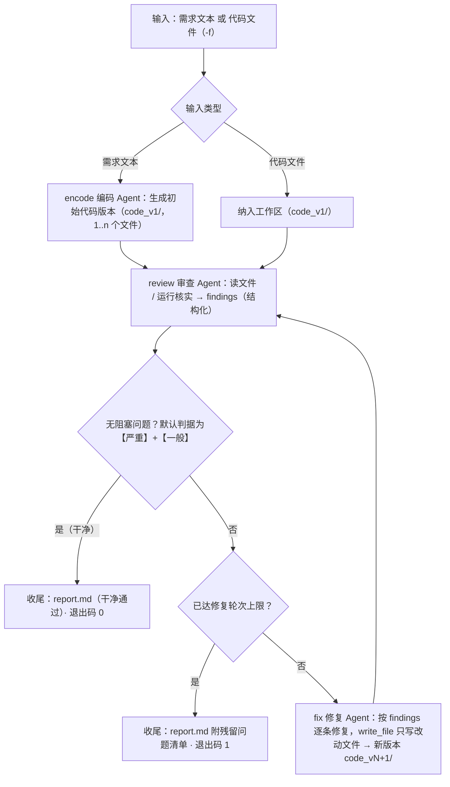

# Design — code-review-workflow（CLI 命令 `crw`）

本文是 `crw` 的架构与契约规格：目标与范围、需求与假设、信息架构与流程、功能与交互、数据模型与接口契约、
质量属性、技术选型与折衷、风险、验收与测试策略、扩展指南与术语。

对外使用文档（安装、命令用法、参数速查）见 [README.md](../README.md)；本文只写"为什么这样设计"与"契约是什么"，
不重复教程。文中标注"实测"的数字来自真实供应商运行（DeepSeek flash）的本地用量账；未实测的结论一律写明"未实测"。

运行与开发平台：Windows + Git Bash（兼容 PowerShell 与 CMD）。

## 目录

- [1. 目标与背景](#1-目标与背景)
- [2. 范围与约束](#2-范围与约束)
  - [2.1 做什么](#21-做什么)
  - [2.2 不做什么](#22-不做什么)
  - [2.3 技术栈与平台约束](#23-技术栈与平台约束)
  - [2.4 性能与合规目标](#24-性能与合规目标)
- [3. 需求与关键假设](#3-需求与关键假设)
  - [3.1 用户与业务需求](#31-用户与业务需求)
  - [3.2 系统需求（逐条标注可测试性）](#32-系统需求逐条标注可测试性)
  - [3.3 关键假设](#33-关键假设)
- [4. 信息架构与流程](#4-信息架构与流程)
  - [4.1 分层与模块](#41-分层与模块)
  - [4.2 端到端流程](#42-端到端流程)
  - [4.3 节点规格](#43-节点规格)
  - [4.4 版本目录与产物抽取](#44-版本目录与产物抽取)
  - [4.5 分支与循环语义](#45-分支与循环语义)
  - [4.6 事件与状态流转](#46-事件与状态流转)
  - [4.7 会话模式的流程](#47-会话模式的流程)
- [5. 功能与交互](#5-功能与交互)
  - [5.1 命令面总览](#51-命令面总览)
  - [5.2 运行与续跑的选项](#52-运行与续跑的选项)
  - [5.3 审查命令的两种形态](#53-审查命令的两种形态)
  - [5.4 会话命令与交互语义](#54-会话命令与交互语义)
  - [5.5 配置命令与思考挡位](#55-配置命令与思考挡位)
  - [5.6 记录查询与图导出](#56-记录查询与图导出)
  - [5.7 卸载](#57-卸载)
  - [5.8 输出与渲染口径](#58-输出与渲染口径)
  - [5.9 退出码](#59-退出码)
  - [5.10 异常与空状态策略](#510-异常与空状态策略)
  - [5.11 可观测性](#511-可观测性)
- [6. 数据模型与接口契约](#6-数据模型与接口契约)
  - [6.1 运行状态 schema](#61-运行状态-schema)
  - [6.2 审查与修复契约](#62-审查与修复契约)
  - [6.3 会话意图与轮次参数契约](#63-会话意图与轮次参数契约)
  - [6.4 运行记录与事件流格式](#64-运行记录与事件流格式)
  - [6.5 会话档案与记忆格式](#65-会话档案与记忆格式)
  - [6.6 配置文件与环境变量](#66-配置文件与环境变量)
  - [6.7 数据生命周期与隐私](#67-数据生命周期与隐私)
  - [6.8 路径语义与上下文根](#68-路径语义与上下文根)
- [7. 非功能与质量属性](#7-非功能与质量属性)
  - [7.1 成本与时长](#71-成本与时长)
  - [7.2 可靠性与恢复](#72-可靠性与恢复)
  - [7.3 安全与执行边界](#73-安全与执行边界)
  - [7.4 隐私与密钥边界](#74-隐私与密钥边界)
  - [7.5 可维护性](#75-可维护性)
  - [7.6 可测试性](#76-可测试性)
- [8. 技术方案与架构折衷](#8-技术方案与架构折衷)
  - [8.1 分层与依赖方向](#81-分层与依赖方向)
  - [8.2 编排与运行时选型](#82-编排与运行时选型)
  - [8.3 关键折衷与推翻条件](#83-关键折衷与推翻条件)
- [9. 风险、依赖与缓解](#9-风险依赖与缓解)
- [10. 验收标准与测试策略](#10-验收标准与测试策略)
  - [10.1 验收口径](#101-验收口径)
  - [10.2 测试分层](#102-测试分层)
  - [10.3 测试环境与闸门](#103-测试环境与闸门)
  - [10.4 缺陷分级](#104-缺陷分级)
- [11. 扩展指南](#11-扩展指南)
  - [11.1 新增一个 Agent 或节点](#111-新增一个-agent-或节点)
  - [11.2 实现示例：并行双视角审查](#112-实现示例并行双视角审查)
  - [11.3 候选扩展方向](#113-候选扩展方向)
- [12. 附录与术语](#12-附录与术语)
  - [12.1 术语表](#121-术语表)
  - [12.2 契约样例](#122-契约样例)

## 1. 目标与背景

`crw` 是一个基于 LLM 的自动化代码审查工作流工具。给它一段需求，或一份既有代码文件，它用三个协作的
Agent 完成"编码 → 审查 → 修复 → 复审"闭环：编码 Agent 产出代码；审查 Agent 输出分级问题清单（可读文件、
运行代码核实）；修复 Agent 逐条处置后进入复审，直到通过或达到轮次上限。全过程落盘为可查、可续跑、
可审计的运行记录，并逐次模型调用记录 token 用量。

产品本体是**工作流**而不是"一次审查调用"：编排引擎、运行状态、节点协议、结构化交接契约与运行记录
构成项目的核心，模型能力只是节点的填充物。这个定位带来三条设计后果：

1. **Agent 之间的交接必须可验证**。结论以结构化契约（findings / fixes）传递并落盘，而不是自然语言口头
   交接——修复有明确输入，复审能核验修复效果，报告可程序化汇总。
2. **过程必须可恢复**。状态与产物逐节点落盘，失败或达限的运行可以用 `crw resume` 接着修，不必从零重来。
3. **成本必须可控**。轮次上限、思考挡位、执行开关都暴露在命令面与配置里，用量逐调用记账并可读；
   护栏（递归上限、上下文预算）按图形态复算而不是凭经验估。

两种使用形态：**一次性运行**（`crw run`，批处理语义，退出码 0/1/2）与**会话模式**（`crw chat`，
多轮 user↔agent 对话，由三 Agent 之外的编排/路由节点驱动同一套工作流）。会话模式的引入不改变协作
Agent 的数量与工作流本身——不带会话时 `crw run` 完全可用。

## 2. 范围与约束

### 2.1 做什么

当前提供：

| 能力 | 形态 |
|------|------|
| 工作流引擎 | LangGraph `StateGraph` 编排"编码 → 审查 → 修复"，含顺序、条件分支与复审循环 |
| 三个协作 Agent | 编码 / 审查 / 修复，真实模型端到端可跑 |
| Agent 间协作 | 共享运行状态 + 结构化消息契约（findings / fixes），过程事件写入事件流 |
| 运行记录 | 每次运行自动落盘为一条记录（报告 / 状态快照 / 事件流 / 工作区产物）；列表、选择、展示 |
| 续跑 | `crw resume <运行号>` 从失败或达限运行的最新版本目录新开一条记录 |
| 节点级错误处理 | 失败落盘、可读报错、已产出产物保留；契约违规重试一次 |
| 单 Agent 快速审查 | `crw review`（只查不改），目录或多于一个路径走整项目一次会话，单文件与 stdin 走内联快审 |
| 多供应商模型配置 | `~/.crw/models.json` + 环境变量回退；`crw config` 交互维护，`crw config test` 连通自检 |
| 思考挡位 | 模型级挡位配置与 `--thinking` 单次覆盖；产品默认关闭思考；挡位随运行回显 |
| 用量记账与读数 | 逐调用采集输入 / 缓存命中 / 输出（含思考分解），报告小节、`crw show` 与 `crw review` 的 `[用量]` 行 |
| 终端渲染 | 流式行级渲染、分级着色、按 Agent 分阶段面板、工具打点 |
| 会话模式 | `crw chat` / `crw sessions`：编排/路由节点驱动工作流、按 Agent 独立长久的记忆、轮次模式 up-to/exact、会话可跨进程恢复 |
| 图导出 | `crw graph` 输出与实现同源的规范化 mermaid |
| 干净退场 | `crw uninstall` 分级确认后清理程序、PATH 条目、登记的环境变量与用户数据 |
| 测试集 | pytest 用例覆盖引擎、契约、记录、命令行、会话与工具；LLM 一律 mock，测试内禁真实网络 |

工作流完整性口径：

- 输入两种模式：需求文本（从编码起步）与既有代码文件（跳过编码，直接进入审查 → 修复）；
- 终止三种状态：干净通过（退出码 0）、达限残留（退出码 1）、运行错误（退出码 2）。

### 2.2 不做什么

| 不提供 | 为什么 |
|--------|--------|
| Web 图形编排界面 | 交互形态固定为 CLI（一次性运行 + 会话模式）。会话模式是命令行内的编排层，不是图形界面；图形界面对工作流能力没有增量，只增加维护面 |
| 多工作区 / 按项目配置 | 配置与数据目录单一（`~/.crw`）。按项目切换会让"用哪个模型、跑几轮"变成隐式状态，同一条命令在不同目录下结论不可比 |
| Docker 沙箱 | 执行核实是本机直接执行 + 限时 + 截断 + 子进程环境净化；引入容器需要镜像与运行时依赖，超出产品范围（边界与缓解见 7.3） |
| 联网搜索工具 | 审查上下文只来自版本目录、用户输入与执行结果；外网检索会把不可信内容引入结论且无法复现 |
| 多语言执行 | `run_python` 的语义固定为 Python 代码执行。非 Python 语言的审查与执行扩展见 11.3，纳入前须先解除本条并重新评审 |
| 跨会话长期记忆 | 记忆随会话存续、新会话从零开始（见 6.5）。长期记忆需要处理过期、冲突与用户撤回，属独立设计 |
| 逐次执行确认 | 执行开关是命令级的 `--no-exec`（整体关闭），不做每次工具调用的询问：逐次询问会把一次批处理运行拆成 N 次人工等待，与"跑完给结论"的形态冲突 |
| 旧运行记录格式兼容 | 单文件格式已被版本目录形态取代。只给一行可读提示并按"记录不可用"退出（见 4.4 与 8.3），不写迁移分支 |

### 2.3 技术栈与平台约束

- 包管理：uv；`requires-python >= 3.13`；`.python-version` 锁定 3.13。
- 命名固定：仓库与发行名 `code-review-workflow`、包目录 `src/crw`、命令 `crw`；构建后端 hatchling
  （`packages = ["src/crw"]`）；入口 `[project.scripts] crw = "crw.cli:main"`。
- 运行依赖：`langchain>=1.0`、`langgraph>=1.0`、`langchain-openai>=1.0`、`rich`；版本由 `uv.lock` 锁定，
  新增依赖须先经用户评审。
- 开发依赖：`pytest`、`ruff`。
- ruff：默认规则 + `line-length = 100`；`tests/fixtures` 豁免（预埋样例属数据而非业务代码）。
- pytest：`testpaths = ["tests"]`；测试内禁止真实网络调用，LLM 一律 mock。
- 版本号来源：`pyproject` 的 `version = "0.1.0"`；`crw --version` 经
  `importlib.metadata.version("code-review-workflow")` 读取，不在代码里重复常量。
- 平台：Windows + Git Bash 为主要开发与验收环境，路径处理与终端能力须兼容 PowerShell / CMD；
  经 `setx` 写入的环境变量需要新开终端才生效。
- 面向用户的文案为中文，代码与标识符为英文。

### 2.4 性能与合规目标

- **成本可预算**：一次运行的模型调用数是确定的——初始编码 1 次会话 + 每轮 1 次修复 + n+1 次审查；
  会话模式再每条用户消息加 1 次编排节点调用。思考默认关闭，且默认判据下"只有【一般】问题"也要跑修复轮，
  因此 `--max-iter` 同时是费用闸门（三条降本杠杆与实测量级见 7.1）。
- **失控有护栏**：`recursion_limit` 按图形态与实际轮次复算（公式与推导见 4.5）；
  单节点请求预算 `CRW_MAX_CONTEXT_TOKENS`（默认 100 000 tokens）；工具轮次默认 10 轮。
- **时长有界**：`run_python` 默认 10 秒超时（可配 1–60 秒），超时强杀进程树并在回收窗口（5 秒）后标注
  输出未收集完；输出截断（单次回传模型 2 000 字符、内部收集上限 64 KB）；HTTP 请求超时 60 秒、建连期重试 3 次；
  `crw config test` 用 15 秒短超时且不重试（自检要的是快速反馈）。
- **可中断**：Ctrl+C 后按固定写盘序列收尾（事件 → 状态快照 → 退出），第二次 Ctrl+C 放弃写盘但不改变结论。
- **隐私合规**：密钥只存在于用户侧配置文件或环境变量与进程内存，不进入运行记录、日志与子进程环境；
  仓库内任何被跟踪文件不得含真实密钥、真实姓名、学号或本机用户路径（见 7.4）。
- **不承诺省钱换算**：报告与读数只给 token 数，不换算成货币金额——价目与峰谷属易变数据（见 11.3）。

## 3. 需求与关键假设

### 3.1 用户与业务需求

- **用一段需求换一份被审过的代码**：写完不是终点，交付的是"写完 → 被独立审查 → 按清单修复 → 复审通过"
  的结果；审查不通过时如实残留，而不是静默放过。
- **结论可审计**：每条问题有编号、定位（`相对路径:行号`）与处置去向，报告里能对上"问题 ← 修复"。
- **过程可追溯**：每个节点的耗时、事件与产物都在运行记录里；记录可查询、可续跑。
- **成本可控可解**：轮次、思考挡位、执行开关都在命令面；用量逐调用记账并能在本地读到。
- **换模型不换工具**：多供应商配置、连通自检与单次覆盖，避免为试第二个模型改代码。
- **能持续对话**：会话模式让同一份代码在多轮指令下持续演进（版本号跨轮连续递增），可中断、可恢复、可回看。

### 3.2 系统需求（逐条标注可测试性）

每条需求给**可执行的验收命令或可断言的输出形态**（不写代码位置），并指向定义该契约的小节；
参数取值与阈值只在第 5、6 章各出现一次，本表不复述。

| 编号 | 需求 | 可测试性 | 规格 |
|------|------|----------|------|
| SR-01 | 输入两形态互斥：需求文本或 `-f` 文件，二者都必须给且不为空白 | `crw run` 不带输入 → 参数错误、退出码 2；`crw run -f x.py` → 无编码阶段，直接进入审查 | 5.1–5.2 |
| SR-02 | 三 Agent 闭环与复审循环 | `crw graph` 输出的节点集合为 encode / review / fix，且含 fix→review 回边与 review→结束的条件分支 | 4.2–4.3 |
| SR-03 | 干净判定默认加严：阻塞集 = 【严重】+【一般】，【建议】永不阻塞 | 只含【一般】结论的运行不早退、会进入修复；`--severe-only` 下同输入首审即干净通过、退出码 0 | 4.5 |
| SR-04 | 达限以残留清单收尾 | `--max-iter 0` 且首审不干净 → 退出码 1、报告列出残留阻塞问题 | 4.5、5.9 |
| SR-05 | 命令行轮次上限有边界，越界即参数错误 | `--max-iter 11` / `--max-iter -1` / `--max-iter abc` → 参数错误、退出码 2 | 4.5、5.2 |
| SR-06 | 轮次模式 `up-to`（干净即早退，默认）与 `exact`（跑满，结尾恒为一次审查） | `--rounds-mode exact` 跑满时报告里的审查次数比修复次数多 1，即使中途已干净 | 4.5 |
| SR-07 | 权威字段由校验层裁定 | 模型自报 `iteration` / `code_version` / `files` 与权威值不符 → 附错误清单重试一次；第二次仍不符按节点失败、退出码 2 | 6.2 |
| SR-08 | 执行有效性门禁 | 审查结论为空数组且本轮无成功工具事件、或 `summary` 为空 → 判为"审查未执行"，重试一次 → 仍失败按节点失败 | 6.2 |
| SR-09 | 版本目录形态与清单权威 | 编码产物落 `workspace/code_v1/` + `manifest.json`；修复后新版本目录只覆盖改动文件，`manifest.json` 由引擎按磁盘内容重算 | 4.4 |
| SR-10 | 版本产出受量级上限约束 | 构造超限产出 → 按契约违规重试一次，仍超限按节点失败、退出码 2；编码与修复两条路径同判据 | 4.4 |
| SR-11 | 删除须经用户确认 | 修复提出删除时终端打印待删清单与依据并询问 `y/N`；stdin 非终端 / 拒绝 / 中断 → 文件保留、报告标"待确认删除（未执行）" | 4.4 |
| SR-12 | 运行记录三件套 + 工作区 | `crw run` 后记录目录含 `report.md` / `state.json` / `log.jsonl` / `workspace/`；`crw runs` 列出、`crw show <运行号>` 展示 | 6.4 |
| SR-13 | 续跑前置条件与继承 | 父运行有版本目录 → 新运行 `code_v1/` 为其副本且 `parent_run_id` 非空；父记录损坏或旧格式 → 一行可读提示、退出码 2 | 4.5 |
| SR-14 | 中断语义 | 运行中 Ctrl+C → `log.jsonl` 末条为 interrupt 事件、`state.json` 写入终态、退出码 2；一次性运行状态 `failed`，会话轮次状态 `interrupted` | 5.9、7.2 |
| SR-15 | 落盘失败不静默 | 写 `state.json` / `log.jsonl` / `report.md` 失败 → 状态 `failed`、退出码 2、stderr 给出原因与已保留产物路径 | 5.10 |
| SR-16 | 连通自检 | `crw config test` → 逐供应商一行结果（OK / 401 / 超时）；全 OK 退出码 0、存在失败退出码 1、配置错误退出码 2 | 5.5、5.9 |
| SR-17 | key 回退链与串用防护 | 未设 key 的两个供应商回退到同一环境变量但 `base_url` 主机不同 → 配置错误、退出码 2 并给修复指引 | 6.6 |
| SR-18 | 思考默认关闭且必须显式发送 | 默认配置下请求体携带预设通道的关闭参数；`--thinking` 传入表外名称 → 参数错误、退出码 2 并列出可用挡位 | 6.6 |
| SR-19 | 挡位随运行回显 | `crw run` 头行 `[模型] 供应商/模型（思考：挡位）`，无生效挡位时不显示括号；`state.model`、报告、`crw show`、`crw runs` 同口径 | 5.11、6.1 |
| SR-20 | 用量读数三处同源 | `report.md` 有「Token 用量」小节（列与合计行见 6.4）；`crw show` 打 `[用量]` 行；`crw review` 在 stderr 打 `[用量]` 行；无用量数据时整节省略 | 5.11、6.4 |
| SR-21 | 会话意图路由 | `crw chat` 中"只看不改"→ 本轮不进入修复并标注；"再检查一轮"→ 默认 `exact` + 1 轮并标注；提问 → 不产生运行记录 | 6.3 |
| SR-22 | 会话恢复 | `crw chat --resume <会话号>` 恢复记忆、代码版本与轮次设置；`crw sessions` 列为 会话号 / 时间 / 轮次数 / 最后状态 | 5.4、6.5 |
| SR-23 | 会话内中断与退出 | 一轮进行中 Ctrl+C 一次 → 本轮落 `interrupted` 并回到提示符、会话保留；两次 → 退出会话；`/exit`、`exit` 与 EOF 正常退出 | 5.4 |
| SR-24 | `crw review` 自动选形 | 目标为目录或多于一个路径 → 一次会话产出全工程结论；单个文件或 `-` → 内联快审；`--per-file` 强制逐文件；跨盘符等无法确定公共父目录时打印一行说明并退回逐文件 | 5.3 |
| SR-25 | 审查的规模闸与跳过告知 | 目录目标递归扫描，三类跳过各打一行 stderr；超过规模闸的部分不列入清单并逐个打印 | 5.3 |
| SR-26 | `--json` 输出契约 | stdout 为纯 JSON `{"files": [{file, findings, summary}], "summary"}`；存在【严重】时退出码 1，非 `--json` 恒 0；该命令不产生运行记录 | 5.3 |
| SR-27 | 图导出与实现同源 | `crw graph [--parallel-review]` 输出的节点与边集合与编译出的图一致（由快照测试锁定）；写文件失败退出码 2 | 5.6、10.2 |
| SR-28 | 卸载分级确认 | 确认前零删除；数据目录删除遇"文件系统根 / 含 `.git` / 用户主目录及其上级 / 当前工作目录及其上级"时打印拒绝原因并提示手工删除 | 5.7 |
| SR-29 | 执行开关闸口唯一 | `--no-exec` 下模型侧没有执行工具可调用；`crw review --no-exec` 同判据；修复阶段仅静态修复 | 7.3 |
| SR-30 | 并行双视角审查 | `--parallel-review` 下两个审查分支同一超级步、各写独立状态键，汇合结果按 `(location, issue)` 去重取较严重者并重编号；每条 finding 附 `views` 来源视角；会话模式不提供该开关 | 11.2 |
| SR-31 | 输出通道分道 | 结论 / 清单 / 报告走 stdout；流式过程叙述与错误走 stderr；`--json` 时 stdout 只有 JSON | 5.8 |
| SR-32 | 陈旧运行识别 | `status=running` 且记录文件的 mtime 超过陈旧阈值 → 列表与展示标注"可能已中断"，不自动改写状态 | 6.4 |

### 3.3 关键假设

以下假设不成立时产品的行为已定义；假设一旦整体失效，对应设计需要在 8.3 的推翻条件下重做。

| 假设 | 依据 | 假设不成立时的行为 |
|------|------|--------------------|
| 供应商会回报 usage | OpenAI 兼容接口的常见行为，**不保证** | 未回报的调用只进 `calls`，绝不折算成 0 token；命中率写"缓存命中未回报"而不给数；报告与 `crw show` 的用量整项略过（见 6.4） |
| 模型按工具协议返回 | 兼容层与部分模型的正文风格不一 | 运行时识别"把供应商原生工具调用标记当正文"的形态 → 记 `retry` 事件 → 重发一次（本轮已有成功工具事件时保留工具重发，否则去掉工具）→ 仍失败抛可读的运行失败，退出码 2 |
| 模型遵守输出契约 | 实测会违反：缺围栏、自报错误的 `iteration` / `code_version` / `files` | 权威字段缺失时由校验层补权威值、给出即必须一致；缺必需围栏或内容为空 → 附错误清单重试一次 → 仍失败按节点失败（见 6.2） |
| 审查至少调用一次工具再下结论 | 模型可能一次工具都不调就给出空清单 | 执行有效性门禁：`findings` 为空时必须同时有成功工具事件（或内联送达记录）与非空 `summary`，否则判为"审查未执行"（见 6.2） |
| 执行核实不污染版本目录 | 运行会留 `__pycache__` / `*.pyc`，被测程序还会自写数据文件 | 读取版本内容以 `manifest.json` 清单为准；子进程环境设 `PYTHONDONTWRITEBYTECODE=1`；运行时副产物不进产物清单、不进续跑复制、不参与整版本指纹比较 |
| 未改动文件由模型重贴是安全的 | 重贴时可能顺手改坏无关文件 | 修复节点只写改动文件（`write_file`），其余文件由引擎从上一版本复制；引擎按磁盘实际内容校验完整性 |
| 供应商前缀缓存的行为 | 官网口径 + 本地账目核对：自动开启、按缓存前缀单元全匹配（非任意最长公共前缀）、无固定 TTL（数小时至数天，best-effort）、每用户隔离 | 追加式记忆因此对缓存友好；原地裁剪会打断前缀，故压缩也用**追加**一条 `compaction` 行的方式表达（见 6.5） |
| 推理文本按输出计费，且"不发参数"不等于"关闭" | 供应商把 `reasoning_tokens` 计入 `completion_tokens`；部分模型的官方默认就是"思考开" | 关闭必须显式发送关闭参数；没有可靠关闭通道的恒开型供应商不发送任何参数，并在配置回显里如实说明成本不可控（发送规则见 6.6） |
| 第三方命令行工具的输出形态稳定 | 会变：例如 `uv tool list` 在没有工具时打印一行提示文本 | 工具名一律按"名称 + 版本"的行形状取词，不按"非 `-` 开头的行取首词"这类脆弱口径解析；后台脚本与主进程同一套解析规则 |
| 工作流的输入是可信代码 | **不成立**——需求与代码文件都可能来自不可信来源 | 执行非沙箱属已知边界（见 7.3）：文件类工具限定上下文根、子进程环境净化凭证类变量、`--no-exec` 可整体关闭；执行任意代码仍具备当前用户权限，不做"安全"承诺 |
| 锁定版本的流式路径无需 `stream_usage` 即回报 `usage_metadata` | 已按 `uv.lock` 锁定版本核实 | 用量采集依赖该结论；升级依赖版本时须重验，若不再回报则退化为"未回报用量"（不报错、不虚增） |
| 提示词与契约可以使用两套路径语言 | **不成立** | 版本内相对路径是唯一口径：任务提示词的清单、围栏声明的 `file=`、findings 的 `location`、`write_file` 的目标必须同一套写法，否则磁盘收尾的覆盖检查会把"按提示词写"的产出判成缺文件 |
| 供应商要求工具循环中回传 reasoning 文本 | 官网有此口径，但本技术栈实测未触发：消息转换只发 `content` / `tool_calls` / `role`，多次真机运行（含多轮工具循环与思考开启）没有一次因缺回传报 400 | 若换供应商 / 换模型后出现 400，按"回传但不显示、不落盘"处理；该条留作更换供应商时的复查注记 |

## 4. 信息架构与流程

### 4.1 分层与模块

```
┌───────────────────────────────────────────────────────────────────┐
│ cli.py / render.py    命令面与终端渲染（仅此层接触 argparse / 终端输入） │
├───────────────────────────────────────────────────────────────────┤
│ session/              会话层：编排/路由节点 · 会话态 · 按 Agent 的记忆    │
├───────────────────────────────────────────────────────────────────┤
│ workflow/             编排引擎                                      │
│   graph.py            StateGraph 组装：节点、边、条件路由、循环         │
│   state.py            运行状态 schema 与快照                         │
│   engine.py           运行驱动：执行 / 事件 / 错误 / 收尾报告           │
│   contracts.py        结构化契约（schema 定义与校验、干净判定）         │
│   records.py          运行记录持久化（列表 / 选择 / 加载 / 续跑）       │
├───────────────────────────────────────────────────────────────────┤
│ agents/               Agent 节点                                    │
│   encoder.py / reviewer.py / fixer.py    编码 / 审查 / 修复装配       │
│   runtime.py                             Agent 运行时（循环 / 工具桥接）│
│   prompts.py                             系统提示词                   │
├───────────────────────────────────────────────────────────────────┤
│ llm.py · config.py · tools/    模型客户端 · 供应商配置 · 文件与执行工具  │
├───────────────────────────────────────────────────────────────────┤
│ rounds.py · thinking.py · usage.py   纯数据叶子层（不 import 任何 crw 模块）│
└───────────────────────────────────────────────────────────────────┘
```

模块划分（src 布局，包目录 `src/crw`）：

```
src/crw/
  cli.py           # 命令面：run/runs/show/resume/review/config/graph/uninstall + chat/sessions + 参数解析
  render.py        # 终端渲染管线（流式 / 分级着色 / 节点阶段展示 / 列表与详情）
  session/
    __init__.py    # 会话层说明（模块分工与口径）
    chat.py        # 会话循环：读入用户消息、编排路由、驱动工作流、中断与退出语义、会话档案与会话总报告
    orchestrator.py# 编排/路由节点：用户消息 → 意图与轮次参数（结构化）→ 选择下一节点 → 汇报渲染
    memory.py      # 三 Agent 各自的追加式记忆（落盘 / 载入 / 阈值压缩）
    state.py       # 会话态 schema、会话号与目录、会话档案读写与列表
  workflow/
    graph.py       # StateGraph 组装与条件路由（框架类型不外泄）
    state.py       # 状态 schema（数据化）与快照读写
    engine.py      # 运行驱动：节点调用、事件、错误、报告、退出语义
    contracts.py   # findings 契约与校验（审查→修复的"协议"）、量级上限、干净判定
    records.py     # 运行记录：落盘（原子写）/ 列表 / 选择 / 加载 / 续跑 / 结构自检
  agents/
    encoder.py     # 编码 Agent 节点
    reviewer.py    # 审查 Agent 节点
    fixer.py       # 修复 Agent 节点
    runtime.py     # Agent 运行时：轮次与预算护栏、错误协议、工具桥接、用量采集
    prompts.py     # 三 Agent 系统提示词（含并行双视角的视角附加段）
  tools/
    __init__.py    # 工具注册表与执行（"错误："结构化协议）；按节点裁剪工具集
    fs.py          # list_dir / read_file / write_file（write_file 自带原子写）
    exec_py.py     # run_python（限时强杀 / 截断 / 环境净化）
  rounds.py        # 轮次与代码版本口径的纯派生计算（取值枚举 + 版本/轮次序号）
  thinking.py      # 内置思考等级表：挡位名 → OpenAI 兼容客户端的发送参数（纯映射）
  usage.py         # token 用量记账：逐调用采集、按节点累计、命中率与展示文本
  llm.py           # 模型客户端封装（重试映射 / 异常翻译 / 连通自检）
  config.py        # 供应商配置（models.json / 预设 / 环境变量 / 运行默认值 / 数据目录）
  uninstall.py     # 卸载：分级确认后的清理（程序 / 垫片 → PATH → 登记的环境变量 → 用户数据）
tests/
  fixtures/buggy_samples/   # 预埋样例：syntax_error.py、divide_by_zero.py（供演示与回归）
```

### 4.2 端到端流程



判定节点的口径与条件路由次序（先判达限、再判干净）见 4.5。

本图是概念图。`crw graph` 输出的是与编译出的图同源的规范化 mermaid（`__start__` / 结束节点映射为可读标签、
条件边标签中文映射），两者的一致性由快照测试核对，核对以测试为准（见 5.6）。

### 4.3 节点规格

节点是纯函数：只读所需状态字段、只返回要更新的字段；不落盘、不打印、不写日志（过程输出经运行时回调转成
事件与渲染输入）。契约校验、重试与 `clean` 判定由 workflow 层的包装完成，节点只负责产出。节点产出的原始文本
经**暂存键**交回包装层：encode → `code_text`、review → `review_text`、fix → `fix_text`；暂存键不在状态 schema
内，被包装层消费后不进入运行记录。阶段摘要由引擎按产物与契约结论自算。

| 节点 | 输入 | 输出 | 工具 | 失败模式 |
|------|------|------|------|----------|
| encode 编码 Agent | 需求文本（会话轮次另加既有实现 `prior_files` 与记忆） | 代码版本目录 `code_v1/`（1..n 个文件 + manifest）+ 简要说明 | 无（纯生成） | 抽取失败 / 空输出 / 缺 `file=` 声明 → 重试一次 → 仍失败按节点失败 |
| review 审查 Agent | 当前版本目录内**全部文件**（清单来自状态 `version_files`） | findings 结构化清单（见 6.2），`location` = 版本内相对路径:行号 | `list_dir` / `read_file` / `run_python`（核实用；`--no-exec` 关闭执行） | 契约校验失败 → 附错误清单重试一次 → 仍失败按节点失败；空清单且无执行证据同样按失败处理 |
| fix 修复 Agent | 当前版本（由引擎**复制**为本轮的新版本目录，该目录即节点的上下文根）+ findings | 用 `write_file` **只把改动的文件写回该版本目录** + fixes 清单（逐条对应 findings id，可附删除申请，见 6.2）；manifest、文件清单与整版本指纹由引擎按**目录实际内容**重算 | `read_file` / `write_file` / `run_python`（自验写回的文件；`--no-exec` 关闭执行） | fixes 契约违规 / 写盘结果不完整（缺文件、空文件、超量级、声称已改却无变化）→ 重试一次（重试前引擎先把目录复位）→ 仍失败按节点失败；整版本 `路径 → sha256` 与上版相同 → 视为"本轮未产生改动"（不失败，继续复审，报告标注） |

收尾不是 Agent 节点，由引擎执行：生成 `report.md`（结论、时间线、用量、逐轮清单、产物清单）并确定退出码。

汇合节点（仅并行双视角形态存在，见 11.2）是无模型、无 IO 的 workflow 层纯函数，把两个分支的结论合成
权威的 `findings`；`clean` 判定与审查轮次推进仍由引擎的包装层按权威值写回。

### 4.4 版本目录与产物抽取

**一个代码版本 = 一个目录**（`workspace/code_v1/`）：目录内是该版本的全部文件，相对路径即工作区内的相对路径；
引擎在版本目录内生成 `manifest.json`（`version` + 每个文件的 `path` / `sha256` / `lines` + `total_bytes`）。
单文件只是"目录里只有一个文件"的特例，因此抽取、落盘、原子性与逐字节比较的语义全部按目录表述。

**清单权威**：读取版本内容以 `manifest.json` 为准（清单缺失时才退回全目录读取）。执行核实可能把字节码
（`__pycache__/`、`*.pyc`）甚至被测程序自己写出的数据文件留在版本目录里——这些运行时副产物不属于版本内容，
不进产物清单、不进续跑复制、不参与整版本指纹比较；`--out` 复制版本目录同样以清单为准。执行侧从源头收紧：
`run_python` 的子进程环境设 `PYTHONDONTWRITEBYTECODE=1`（一次性核实不需要字节码缓存）。

**输入侧**：需求文本由编码 Agent 产出 1..n 个文件；`-f` 单文件输入同样包成目录版本
（`code_v1/<原文件名>`，不设特殊分支）；续跑把父运行的最新版本目录复制为新运行的 `code_v1/`。

**输出格式**：

- 编码 = 每个文件一个 ```python 围栏，围栏 info 形如 `` ```python file=<相对路径> ``；路径必须是版本内的
  **相对**路径（拒绝绝对路径与 `..`），重复路径取最后一个并在阶段摘要记"已忽略重复声明"。编码节点维持围栏
  形态——起点没有可复制的版本目录，"只写改动文件"对它没有意义。
- 修复 = 恰好一个 ```json fixes 围栏 + 围栏外说明；**产物正文不在围栏里**，改动文件由节点用 `write_file`
  直接写回本轮的版本目录，未改动的文件不写（可读文件与新增文件的语义不变，删除只能以
  `{"deleted": ["<相对路径>", …]}` **提出**）。
- 审查 = 恰好一个 ```json 围栏（见 6.2）。

**抽取规则（Markdown 语义）**：围栏闭合需同长或更长；语言标签 `python` / `py` 不区分大小写；多余的围栏忽略并
记入日志（计数进该轮阶段摘要）；缺少必需围栏或内容为空 → 附重试反馈重试一次 → 仍失败按节点失败。

**落盘顺序（原子）**：

- 编码：先写版本目录内的全部文件（每个文件临时文件 + 替换），再写该目录内的 `manifest.json`。
- 修复：引擎**先**把上一版本复制为本轮新版本目录（起点即上一版内容）→ 节点用 `write_file` 覆盖改动文件 →
  引擎按**目录实际内容**校验（不得丢、不得为空、量级不超限、"处置标为 fixed / partial 却整版本指纹没变"视为违规）
  并重算 `manifest.json` → 写该轮处置 `workspace/fixes_N.json`（N = 修复轮次，与 `review_N.json` 按 finding id
  配对）→ 更新 `state.current_version_dir` 与 `state.version_files`。失败不产生半写文件。
- `write_file` 的写盘本身是工具层的原子写（`.tmp` + `os.replace`）：工具层自带原子写而不依赖运行记录模块，
  以免下层反向依赖上层。

**`-f` 输入的标准化**：由 CLI 读取后去首尾空行、统一以单个换行结尾，再包成目录版本（原始路径记入
`input.source_path`，报告标注"原文件 → 工作区"映射）。`write_file` 的写入口做同一标准化——否则"模型少写一个
换行"会被逐字节比较读成一次改动。

**修复验证**：修复 Agent 的 `run_python` 直接执行**已写回版本目录的文件**（`path=<文件名>`，或写一段最小核实
脚本），不再要求把候选代码整份内联；提示词明确"一次就够、只验改动涉及的部分"；`--no-exec` 下跳过验证并在报告标注。

**量级上限**：版本文件数 ≤ 20、单文件 ≤ 256 KB、版本总计 ≤ 1 MB。编码的围栏抽取与修复的写盘校验共用同一把
尺子（契约层的 `version_size_errors`），两条产出路径的超限语义一致：按契约违规重试一次，仍超限按节点失败
（退出码 2）。

**删除文件的确认闸门**：修复 Agent 只能提出删除（它没有删除能力，写入根里也没有删除工具）。实际删除前引擎把
待删清单（路径 + 该文件在本轮 findings 里对应的理由）打印出来并交互询问（`y/N`，**缺省不删**）。确认 → 新版本
目录不再包含该文件，报告标注"已确认删除"；拒绝 / 中断 / **非交互**（stdin 非终端、管道输入、CI）→ 文件保留，
终端与报告标注"待确认删除（未执行）"。删除是工程清洁度问题，不改变判定结论与退出码；自动化场景因此永不静默删文件。

**旧格式记录不做兼容**：单文件形态的记录已被版本目录形态取代，不写迁移分支。`crw show` / `crw resume` 只认
版本目录形态；遇到旧格式记录给一行可读提示（"该记录来自单文件格式，已被新格式取代"）并按"记录不可用"退出码 2，
而不是崩溃或静默出错。

### 4.5 分支与循环语义

- **干净判定**：本轮 findings 中**阻塞性结论**为 0 即干净。阻塞集默认 = 【严重】+【一般】，由契约层的
  `judge_clean` / `blocking_count` 一处定义；`--severe-only` 放宽为只把【严重】当阻塞；【建议】在两档下都不阻塞
  （结论行确有【建议】条目时标注"（建议不影响判定）"，0 条时不加，两档同口径）。达限残留的文案与判定同源——
  默认判据下残留可能全部由【一般】构成，故报告、结论句与 `crw show` 一律写"阻塞问题"，不写死"【严重】"；
  `crw runs` 的"残留严重数"列仍只数【严重】，那是另一件事。没有 `severe_only` 字段的旧记录按缺省 `False` 解释，
  即同一条记录续跑时判据比它当初更严——这是口径统一的预期结果，不是缺陷。
- **循环**：每轮 = 修复 + 复审。`--max-iter` 为 **0–10 的整数**：默认 3；0 = 只审不修（首审不干净即残留，
  退出码 1）；负数 / 非整数 / 超过 10 为参数错误（退出码 2）。上限 10 是**命令行的误填防护**（默认 3、封顶 10
  时最坏约 2×10 次修复/审查调用）；配置默认与会话消息提取走 `settings.rounds.limit`（默认 10、代码内绝对
  天花板 20，见 6.6）——那两处由配置界面显式设置、不是手滑输入，代价上限（每轮 1 次修复 + 1 次审查）在设置时
  可见。两个口径不矛盾：命令行越界 = 参数错误、配置值越界 = 配置错误（都退出码 2）、消息提取值越界 = 夹到
  `limit` 执行并标注。两条路径的护栏都由同一套机制兜底：`recursion_limit` 按实际轮次复算（串行 `2n + 8`、
  并行双视角 `3n + 8`），达限即收尾；n 轮修复最多产生 n+1 次审查；达限仍未干净 → 以残留清单收尾（状态
  `residual`，退出码 1）。护栏是崩溃保护不是预算：引擎在图调用处显式设置它，框架的递归错误翻译成可读的运行失败。
  同轮 findings 与上轮完全相同（`location + issue` 集合一致）→ 阶段摘要、`report.md` 与 `crw show` 均标注
  "未收敛"，但**不提前中止**。
- **轮次模式**：`up-to`（默认）= 至多 n 轮修复、任一复审干净即早退（首审干净则不进入修复）；`exact` = 固定跑满
  n 轮修复 + n+1 次审查，即使中途干净也继续（精益求精场景）。两种模式**结尾恒为一次审查**，因此不存在
  "已修复但未审查"的收尾状态；`exact` 下若某轮修复与上版逐字节相同，按 4.3 标注"本轮未产生改动"后继续。
  实现口径：条件边先判达限、再判干净（`exact` 下干净不停）；`exact` 且本轮审查干净时，修复按"复核改进"任务下发
  （无问题可改也要复核并给出确信的小步改进）。会话里 `review_fix` 意图未指定模式时按 `exact` + 1 轮执行（见 6.3）。
- **轮次取值来源与优先级**：命令行 `--max-iter` / `--rounds-mode`（显式）> 本次用户消息的结构化提取值（会话模式）
  > 配置默认（`~/.crw/settings.json`）> 内置 3 / `up-to`；全部受硬上限约束，来源记入 `max_iterations_source`
  （枚举 `cli` / `requirement` / `config` / `parent` / `default`）。会话的当前设置（`session.json` 的 `settings`）
  插在"消息提取"之后参与后续轮次，**其自身来源沿用记录值**——上一轮从消息里提取到的轮次会以 `requirement` 来源
  继续生效，直到被新的消息或命令行改变。`--rounds-mode` 不并入轮次数值的来源：只给模式时数值仍走上述链。
- **早退**：`up-to` 模式下首轮审查即干净 → 直接收尾，不进入修复。
- **输入模式**：代码文件输入跳过 encode，其余流程一致。
- **续跑**：`crw resume <运行号>` 仅当父运行存在 `current_version_dir` 且目录仍在时可用（否则可读错误、退出码 2；
  旧单文件格式记录给一行提示 + 退出码 2）。新运行把父运行最新版本目录复制为 `workspace/code_v1/`
  （`input.kind=file`，源记 `input.source_path`），`parent_run_id` 写入状态。`--max-iter` / `--rounds-mode` /
  `--severe-only` / `--no-exec` 由本次命令行决定，未显式给出的轮次设置**继承父运行**（来源标 `parent`），
  无父设置时退回配置默认。父运行的**放宽判定**（`severe_only`）与审查形态（`--parallel-review`）一并继承——
  续跑是"接着修"，换判定标准或换审查方式会让结论不可比；因此 `--severe-only` 是"本次与父运行取或"
  （父运行放宽过就继续放宽），无法在续跑时把放宽收回默认。`--no-exec` 例外：它不进状态快照，命令面无法区分
  "显式关闭"与"从未设置"，按未设置处理。新运行轮次从 `review_round=1` / `fix_rounds=0` 重新计数；
  报告标注父运行与父残留摘要。

### 4.6 事件与状态流转

- **共享状态**：三节点读写同一运行状态（schema 见 6.1）——节点只读写自己负责的字段，引擎串起流转与循环判定。
- **消息载体（双层）**：① 状态字段（`findings`、`current_version_dir` 等）；② 工作区文件（代码版本目录、
  `review_N.json`）。结构化结论既是状态也是文件——可审计、可重放、可被下游逐条引用。
- **过程事件**：每次节点执行与工具调用写入 `log.jsonl`，构成状态追踪与报告时间线的来源（事件枚举见 6.4）。
- **写入时序**：产物（代码 / review / fixes）先落、`state.json` 后落，防止状态引用尚未落盘的结论；
  `state.json` 在每个节点结束与失败时各原子写一次（引入并行分支后改为**图超级步边界**，同一超级步只写一次）。

### 4.7 会话模式的流程

会话目录布局与档案格式见 6.5，本节只讲流程与语义。

```
~/.crw/
├── runs/<run_id>/                     # 一次性运行（crw run）
└── sessions/<session_id>/             # 一次会话（crw chat）
    ├── session.json                   # 会话档案
    ├── session.md                     # 会话总报告
    ├── memory/<agent>.jsonl           # encoder / reviewer / fixer 各自的独立记忆
    └── rounds/
        └── round-<i>/                 # 每轮 = 一条完整运行记录
```

- **单口对话**：会话中只有编排节点与用户对话；三 Agent 不直接面向用户，其产出经结构化契约与状态进入汇报。
  编排节点不产出代码与结论，因此**不计入协作 Agent 数**——协作 Agent 始终是编码 / 审查 / 修复三个。
- **每轮一条运行记录**：会话轮次与 `crw run` 同构——同一套 state / log / report / workspace 代码，仅父目录不同，
  且 `state.json` 多 `session_id` / `round_index` / `version_base` 三个字段。`status` 增 `interrupted`：
  会话轮次被中断记 `interrupted`，一次性运行记 `failed` + `error.node="interrupt"`。
- **会话号与运行号**：会话号 `s-YYYYMMDD-` + 4 位小写十六进制；运行号仍为 `r-YYYYMMDD-` + 4 位、**全局唯一**。
  按运行号在 `runs/` 与 `sessions/*/rounds/` 两处查找，`crw show` / `crw resume` 对两处一致可用；轮次目录按
  `round-<i>` 命名，会话侧按 `state.json` 里的 `run_id` 匹配；`state.json` 不可读的降级记录可用
  `<会话号>/round-<i>` 引用。
- **代码版本号跨轮连续递增**：会话档案记 `current_version`，下一轮把 `version_base` 设为它 + 1；该轮的第一个
  版本目录（编码产物，或"只审查 / 再修一轮"时从上一版本复制来的起始版本）即 `code_v<该号>/`，其后的修复依次 +1。
  会话内是同一份代码在演进，报告里的"第几版"在会话内始终指向同一份代码。"只审查 / 再修一轮"把上一轮的最新版本
  **复制**为本轮起始版本（与续跑同口径）；编码轮次不复制——新版本由编码输出定义，既有实现以 `prior_files`
  内联进编码任务提示词（编码节点无工具），内联总量有上限（200 000 字符）：超出时省略较后的文件，并在提示词里
  如实写明"这些文件不在上述实现里、也不会自动保留到新版本"。
- **记忆按 Agent 独立**：三 Agent 各持一份追加式记忆，下一轮作为**历史消息**（system 之后的 user/assistant 序列）
  交给运行时。记忆独立与追加式的理由、代价见 8.3；一次性运行没有记忆，不发送历史消息。
- **汇报由结构化状态渲染**：每轮汇报含轮次使用情况（审查 / 修复轮数、上限与来源）、结论句（与引擎的
  `conclusion_text` 同源）、代码版本、`next_action` 与运行记录路径——不由模型复述；模型只负责"本条消息按什么
  处理"的回复文本。
- **缓存友好**：编排节点的系统提示词是常量（会话现状与本次消息都在用户消息里）；会话现状含已进行的轮次数、
  当前版本与文件清单、上一轮结论。

## 5. 功能与交互

### 5.1 命令面总览

```
crw run [<需求文本> | -f, --file <文件>] [选项]   # 运行工作流（核心）
crw chat [-f, --file <文件>] [--resume <会话号>] [选项]   # 进入会话模式（编排节点 + 三 Agent 工作流）
crw sessions                              # 列出会话（会话号 / 时间 / 轮次数 / 最后状态）
crw runs                                  # 列出运行记录（含会话轮次，多一列「会话」）
crw show [<运行号>]                       # 展示运行详情（省略运行号 → 列出记录供选择）
crw resume <运行号>                       # 续跑（从最新版本新开运行）
crw review <路径...> | - [选项]            # 单 Agent 审查（不修复；- 读 stdin）
crw config [test]                         # 供应商配置 / 连通性自检
crw graph [-o, --out <文件>] [--parallel-review]   # 导出 mermaid 流程图（默认单视角形态）
crw uninstall                             # 卸载
crw --version                             # 版本号
```

产品形态固定为这两类：**一次性运行**（`crw run`，批处理语义）与**会话模式**（`crw chat`，多轮对话）。
命令面只有一条路径解析器，跨选项的输入契约（互斥、空白、非法组合）在参数层拦截为参数错误。

### 5.2 运行与续跑的选项

`crw run` 选项：

| 选项 | 口径 |
|------|------|
| `-f, --file <文件>` | 既有代码文件输入，与需求文本二选一（跳过编码，直接进入审查） |
| `--max-iter <n>` | 修复轮次上限：默认 3、取值 0–10；0 = 只审不修；越界或非整数为参数错误 |
| `--rounds-mode {up-to,exact}` | 轮次语义：`up-to` 干净即早退（默认）、`exact` 跑满且结尾恒为一次审查；该选项不改变轮次数值的来源 |
| `--severe-only` | 放宽干净判定：只把【严重】当阻塞（默认【严重】与【一般】都算阻塞） |
| `--no-exec` | 关闭执行核实（实施闸口见 7.3）：修复阶段仅静态修复 |
| `--parallel-review` | 并行双视角审查（正确性 + 安全性同轮审查、汇合去重）；显式开关、默认关闭，开启后每轮审查调用量约翻倍 |
| `--out <目录>` | 将最终版本**整目录**复制为 `<out>/code_final/`（含 `manifest.json`，连同 `report.md`；重名成对加序号） |
| `--model <名>` / `--provider <名>` | 临时覆盖本次运行的模型 / 供应商 |
| `--thinking <挡位>` | 快捷切换思考挡位：优先于配置，可与 `--model/--provider` 同用；只认内置等级表，表外名称 = 参数错误并列出可用挡位（见 6.6） |
| `--no-stream` | 关闭流式渲染，每阶段整体输出 |

`crw resume <运行号>` 支持与 `crw run` 相同的运行选项，只有 `-f` 不适用（起点由父运行决定）；未显式给出的轮次
设置继承父运行，`--severe-only` 与父运行的放宽状态**取或**，审查形态（`--parallel-review`）一并继承，
`--no-exec` 不继承（见 4.5）。

`--out` 的失败不影响运行结论：复制失败只打 stderr 警示，退出码仍按运行状态——产物导出是便利功能，
不该把一次成功的运行改判成失败。

### 5.3 审查命令的两种形态

`crw review` 是单 Agent 审查（只查不改，不产生运行记录）。两种形态按目标自动选形：

- **整项目形态**（目标是**目录**、或给了**多于一个路径**，且未 `--per-file`、不含 `-`）：**一次对话**给出全工程
  结论。任务里附**文件清单**（`序号 | 相对上下文根的路径（行数）`，按建议读取优先级排序：入口文件 >
  非测试文件 > 行数多 > 字典序），**不内联正文**；审查者用 `read_file` 按需读取，并被要求**顺着 import / 调用链
  读被引用的同项目文件**后再下结论，跨文件一致性列为必查项（签名与调用点对不上、循环导入、异常在某层被静默吞掉、
  同名不同义、导出但从未使用、跨模块资源由谁关闭）；`location` 用 `相对路径:行号`。读取有预算——该形态的工具轮次
  上限 30（工作流节点仍用缺省 10），读不完必须在结论里**如实说明覆盖了清单里的哪些文件**。上下文根 = 各目标的
  **公共父目录**（唯一化是清单可读的前提：多根下同名文件会按根顺序命中第一个候选，读到哪个都可能错）；公共父目录
  无法确定（跨盘符等）时打印一行说明并退回逐文件形态。
- **内联形态**（单个文件、stdin、或显式 `--per-file`）：内容直接嵌入 prompt（行号口径与 `read_file` 一致，
  单文件 2000 行内联上限），逐文件各开一次会话——`--per-file` 保留作整项目形态的**质量对照与安全阀**。
  `-`（stdin）只能单独使用，与路径同给（多于一个）是参数错误。

目录目标**递归**扫描：跳过隐藏文件与目录（含 `.env`）、忽略名单目录（依赖 / 构建 / 缓存）与数据目录、跳过二进制
文件；**三类跳过各打一行 stderr 说明**（每类最多列 20 个名字并给出总数），用户看得见"哪些没被审"。规模闸 =
**200 个文件 / 8 MB**，超出部分不列入清单并**逐个打印**（静默丢文件会让"审查通过"被读成"全都看过"）。

失败隔离：整项目形态下这一次调用失败即**整批失败**（没有"部分成功"，stdout 不留半截结论）；内联 / `--per-file`
形态下逐文件隔离，任一失败最终退 2。

选项：`-o, --out <文件>`（Markdown 报告）、`--json`（结构化输出）、`--per-file`（回退逐文件形态）、
`--no-exec`、`--model / --provider`、`--thinking <挡位>`。

`--json` 的输出形态是 `{"files": [{"file", "findings", "summary"}], "summary"}`——这是两种审查形态共用的形状
（内联快审同样逐条产出 `files[]` 条目），消费方不必为形态分叉。整项目形态下多条 `files[]` 条目出自**同一位审查者的同一次
判断**，全部采纳、不做逐文件拼接；顶层 `summary` 取报告自带的、缺失才由条目汇总。退出码 1 仅在 `--json` 模式且
存在【严重】时返回，非 `--json` 恒 0（结论供人读）。中断给 stderr 一行提示 + 回显已花掉的 `[用量]` + 退出 2。

用量出口：结束时 stderr 打 `[用量]` 一行（思考占比过半时再打 `[提示]`）——本命令不落运行记录，这是它唯一的用量
读数处。

### 5.4 会话命令与交互语义

`crw chat` 选项：`-f, --file <文件>`（以既有代码开始会话，与 `--resume` 二选一）、`--resume <会话号>`、
`--max-iter`、`--rounds-mode`、`--severe-only`、`--no-exec`、`--model / --provider`、`--thinking <挡位>`、
`--no-stream`。

- `--parallel-review` 不在会话内提供（该形态仍是一次性运行的扩展，见 11.3）。
- `--out` 不注册：会话每轮的产物已在该轮的运行记录里，给了参数不生效只会误导，因此传 `--out` 是参数错误。
- `-f` 只用于"会话首轮以既有代码起步"；`--resume` 的起点由会话档案决定。

交互语义：

- 用户消息由编排节点解释为 `code | review | review_fix | ask`（契约见 6.3），分不清意图时一律按 `ask` 反问，
  不静默挑一条路；会话里还没有代码版本时收到 `review` / `review_fix` 给可读提示、不启动工作流。
- **中断**：一轮进行中 Ctrl+C 一次 = 中断本轮（本轮落盘 `status=interrupted`、回到提示符、会话保留）；
  两次 = 退出会话。`/exit`、`exit`、`/quit`、`quit` 与 EOF 为正常退出。
- 每轮结束汇报含结构化 `next_action`（done / review_again / fix_again）与"轮次使用情况"；
  `--resume <会话号>` 恢复记忆、代码版本与轮次设置。
- 会话轮次设置优先级：命令行显式 > 消息提取（越界夹到 `settings.rounds.limit` 并标注）> 会话当前设置 >
  配置默认 > 内置（见 4.5）。
- 会话结束写 `session.md` 并打印会话目录；会话头行回显模型、轮次设置与**干净判定档**，让用户在开始前就知道
  这一场用什么判据跑。

### 5.5 配置命令与思考挡位

`crw config`（无子参数）进入交互式配置，菜单覆盖：添加 / 删除供应商、管理模型条目、设置默认供应商与模型、
改 key 的存储方式（写入配置文件或登记到环境变量）、**菜单 6 = 模型思考挡位**、**菜单 7 = 默认修复轮次**、
**菜单 8 = 轮次上限**。菜单顶部回显当前值；供应商概览为每个"配过 thinking 的模型条目"列出其 `selected`
（未设默认值显示 `未设`），并单独一行打印恒开型供应商的说明文本。

- **菜单 6（思考挡位）**：选供应商 → 选模型 → 勾选该模型支持的挡位（内置表多选 + 自定义名称输入，输入"清空"
  移除全部）→ 选默认挡位（可输入"跟随默认"取预设值）。未配置且预设也没有可靠挡位的模型不发送任何思考参数。
  「清空」的语义是移除该模型的全部挡位配置、退回"不发送任何参数"，并提示这对"出厂默认就是思考开"的供应商
  反而更贵；「跟随默认」取预设的关闭档。
- **菜单 7 / 8（运行默认值）**：写入 `~/.crw/settings.json`，校验规则与语义见 6.6。
- **导入提示**：本工具零配置且 `~/.cra/models.json` 存在时提示导入；导入即写本工具的配置，读不到该文件
  时按"没有可导入的配置"处理，不让配置界面因此报错。
- `crw config test`：逐供应商以 `max_tokens=1` 探测（OK / 401 / 超时），短超时且不重试。

挡位的取值、发送方式与生效链属数据契约，写在 6.6。

### 5.6 记录查询与图导出

- `crw runs` 输出列：运行号 | 时间 | 输入摘要 | 状态 | 修复轮数 | 残留严重数 | 模型（含思考挡位口径）| 会话
  （非会话运行为 `—`）。列表跨 `runs/` 与 `sessions/*/rounds/` 两处聚合，会话列取自 `session_id`。
  单条坏记录不拖垮列表页：修复轮数、残留严重数与状态按派生口径降级（见 6.4）。无记录时打印一行提示、退出码 0。
- `crw sessions` 输出列：会话号 | 时间 | 轮次数 | 最后状态（最后状态取**最后一轮的运行状态**；`session.json`
  不可读时按降级口径显示）。
- `crw show [<运行号>]`：省略运行号时列出记录供数字选择（候选清单走 stderr，stdout 只留被选中记录的详情）。
  输出为运行摘要 / `[用量]` 行（+ 思考占比过半时的 `[提示]` 行）/ 时间线（含每节点的工具调用数与调用明细）/
  逐轮 findings 表（含"未收敛"标注与逐条处置）/ 产物路径 /（失败或中断时）错误与"已中断"标注（陈旧 running
  标注"可能已中断"）。摘要数据取自 `state.json`；损坏时**降级展示** `log.jsonl` 摘要 + 产物清单，用量改从
  `log.jsonl` 的 usage 事件回读，并在 stdout 与 stderr 各给一行说明。逐轮表数据来源 = `workspace/review_*.json`。
  用量为空账（假节点运行）时整行略过——不显示 ≠ 显示 0。除运行号外，也接受 `<会话号>/round-<i>` 引用。
  **"记录损坏"的口径是定稿**：降级展示照给、退出码照实为 2——人读仍拿得到可用信息，脚本化消费能察觉异常。
  旧单文件格式记录：一行可读提示 + 退出码 2。
- `crw graph [-o, --out <文件>] [--parallel-review]`：输出规范化 mermaid 到 stdout 或文件；内容取自与
  `build_graph` 同源的节点/边集合，一致性由快照测试核对（4.2 的图是概念图）。写文件失败退出码 2。

### 5.7 卸载

`crw uninstall` 分级确认后的清理，顺序为：程序 / 垫片 → PATH 条目 → 本程序登记的环境变量 → 用户数据目录。
每一级单独确认，**确认前零删除**（只打印清单）；只有显式 `y` / `yes` 视为确认，回车与其它输入按拒绝处理。
未以 `uv tool` 安装时跳过程序清理并说明。

数据目录删除有四道放行保险，命中任一即打印拒绝原因并提示手工删除、不动手：

1. 目录名必须是默认的 `.crw`，或 `CRW_HOME` 被显式设置；
2. **文件系统根一律拒绝**（`CRW_HOME=/` 这类误配属"设了但指错"，主目录那道保险在跨盘时拦不住别的盘的根）；
3. 含 `.git` 的目录（仓库）不删；
4. 用户主目录及其上级、当前工作目录及其上级不删。

### 5.8 输出与渲染口径

- **通道**：结论 / findings 清单 / 报告走 stdout；流式过程叙述、审查原文与错误走 stderr；`--json` 时 stdout
  只有纯 JSON。
- **中文口径**：面向用户的文案为中文；代码与标识符为英文。错误文案为可读中文并限长（超过 400 字符截断），
  并遮蔽 `sk-` 形态的密钥串（尽力而为的兜底，不是保证）。
- **模型产出的代码 / JSON 围栏不进终端**：只留一行形状摘要（"已收到代码块（37 行，内容不在此显示）"），
  完整内容在运行目录的产物文件里；结论按分级着色、按 Agent 分阶段面板渲染。围栏抑制在流式与 `--no-stream`
  下一致，两种模式的差别收敛为"何时写出"。
- **阶段序列固定**：节点开始 →（工具边界 flush）→ retry（前次输出只进 log + 一行提示）→ 校验后的清单分区渲染
  → 节点结束（释放暂扣 → 排空 → 本阶段样式落盘）→ 下一阶段标题。`--no-stream` 下每阶段整体渲染。
- **并行分支**：两个审查分支的正文按分支缓冲、各自阶段结束时整块输出——多位审查者同时说话时必须能一眼分辨
  谁在说；引擎的事件归属按**节点名**归档（不按线程、不用单槽），否则工具事件会被记到另一个分支的轮次上。
- 交互提示（会话里的输入前缀）带颜色标记，非终端或 `NO_COLOR` 环境自动退化为纯文本。

### 5.9 退出码

| 命令 | 0 | 1 | 2 |
|------|---|---|---|
| `crw run` / `crw resume` | 完成且干净（无阻塞问题） | 达限残留（仍有阻塞问题：默认含【一般】，`--severe-only` 下只算【严重】） | 运行错误（参数 / 配置 / 模型调用失败等，含顶层兜底） |
| `crw review` | 完成 | 仅 `--json` 模式：存在【严重】 | 运行错误 |
| `crw config test` | 全部 OK | 存在失败 | 配置错误 |
| `crw runs` / `crw sessions` | 列表输出完成（无记录时仍为 0） | — | — |
| `crw show` | 详情输出完成 | — | 记录不存在 / 记录损坏 / 取消选择 / 旧格式记录 / 无记录可选 |
| `crw graph` | 导出完成（stdout 或文件） | — | 写入失败 |
| `crw uninstall` | 清理完成或用户取消（含"未安装 uv 工具"的跳过） | — | 存在未完成的清理失败项 |
| `crw chat` | 会话正常结束且最后一轮干净（一轮都没跑过同样为 0） | 最后一轮达限残留 | 最后一轮运行错误 / 被中断，或会话异常退出 |

### 5.10 异常与空状态策略

异常对用户呈现的形态（落盘与恢复的保证见 7.2）：

- **节点失败**：stderr 一行可读原因（归因到节点）+ 退出码 2；已产出的产物保留，报告写错误小节。
- **契约校验失败**：第一次失败只打一行重试提示（前次输出不重复渲染），重试成功则正常继续；第二次失败按节点失败。
- **协议失败**（模型把供应商原生工具调用标记当正文）：不把它当结论打到 stdout——记 `retry` 事件、按是否有成功
  工具事件选择重发变体，仍失败抛可读的运行失败。"看不见的协议失败"比崩溃更危险。
- **落盘失败**：按运行失败处理（状态 `failed`、退出码 2），stderr 给出原因与已保留产物路径；报告生成失败时
  指向 `state.json`。
- **中断（Ctrl+C）**：一次 = 按固定写盘序列收尾并退出码 2；第二次 = 放弃写盘，结论仍按中断给出。
- **预算护栏触达**：阶段摘要与时间线标注触达事实，结论标注"可能不完整"；不静默截断。
- **模型端上下文超长**（`context_length` 类 400）：可读中文报错，建议分段审查或改用更大窗口模型。
- **记录不可用**：`state.json` 损坏 → 降级展示 + 退出码 2；旧单文件格式 → 一行提示 + 退出码 2；
  续跑的父记录损坏或没有版本目录 → 一行说明为什么不能续跑 + 退出码 2。
- **配置错误**：损坏的 `models.json` / `settings.json`、无法解析的模型引用、key 串用嫌疑（多个未设 key 的供应商
  回退到同一变量但主机不同）→ 配置错误 + 修复指引，不静默夹取或猜默认。
- **空状态**：无运行记录 / 无会话记录时打印"先执行什么命令"的一行提示；`crw show` 省略运行号且无记录时给
  stderr 一行并退出 2（没有可选项就不是成功）；用量账为空时整节略过而不是写 0；无供应商配置时提示添加供应商
  或设置环境变量。
- **删除申请在非交互环境**：不阻塞、不猜测——保留文件并在终端与报告标注"待确认删除（未执行）"。
- **产物导出失败**：`--out` 复制失败只警示，不改变运行结论与退出码。

### 5.11 可观测性

一次运行对用户可见的信息面有四层，都由同一份状态与事件流派生，不另立口径：

1. **终端**：阶段标题、流式正文（围栏内容除外）、工具打点、分级结论清单、`[模型]` / `[用量]` / `[提示]` 行、
   结论句与运行记录路径。
2. **`report.md`**：运行摘要（输入 / 模型含挡位 / 状态 / 审查与修复次数 / 轮次上限与来源 / 干净判定档
   （`无【严重】且无【一般】（默认判据）` 或 `无【严重】（--severe-only 放宽）`）/ 起止时间；续跑附父运行与父残留、
   会话轮次附会话与轮次）→ 时间线 → 「Token 用量」小节（位置固定：时间线与逐轮清单之间；列与合计行见 6.4）
   → 逐轮问题清单（每轮标题固定为“第 i 轮审查（基于 `code_v{i}/`）”，问题按文件分组）
   → 产物清单与路径 →（失败 / 中断时）错误小节。
3. **`crw show` / `crw runs` / `crw sessions`**：按记录号查询的详情与列表（含降级形态）。
4. **原始账目**：`state.json` 的 `usage`、`log.jsonl` 的逐调用 `usage` 事件与工具事件。

可观测性的两条硬口径：**未回报 ≠ 0**（缺字段按未知处理，见 6.4）；**后端改动必须体现在前端输出**——
挡位、判定档、轮次来源这类运行配置一旦进入状态，就必须在头行、`state.json`、报告、`crw show` 与 `crw runs`
里同样看得见，否则用户无法复现"这次为什么这么贵"。

## 6. 数据模型与接口契约

### 6.1 运行状态 schema

| 字段 | 类型 | 说明 | 写入者 |
|------|------|------|--------|
| `run_id` | str | 运行号（`r-YYYYMMDD-` + 4 位小写十六进制，碰撞重试） | engine（初始化） |
| `parent_run_id` | str? | 续跑来源运行号（resume 时写入；新运行为空） | engine（初始化） |
| `input` | {kind, requirement?, source_path?} | 输入描述（requirement / file） | engine |
| `workspace` | str | 运行工作区路径（运行目录下 `workspace/`） | engine |
| `review_round` / `fix_rounds` | int | 已完成审查次数（首轮审查 = 1）/ 已完成修复轮数（初始 0）；审查发生时恒有 `review_round == fix_rounds + 1` | engine |
| `max_iterations` | int | 修复轮次上限（默认 3；取值与来源见 4.5） | engine |
| `max_iterations_source` | str | 轮次取值来源：cli / requirement / config / parent / default | engine |
| `rounds_mode` | str | 轮次语义：up-to（干净即早退）/ exact（跑满指定轮次） | engine |
| `parallel_review` | bool | 是否并行双视角审查（`--parallel-review`；汇合形态见 11.2） | engine |
| `session_id` | str? | 所属会话号（会话轮次写入；`crw run` 一次性运行为空） | engine（初始化） |
| `round_index` | int? | 会话内轮次序号（从 1 起；非会话运行为空） | engine（初始化） |
| `version_base` | int | 本次运行的起始版本号（一次性运行恒为 1；会话轮次跨轮连续递增，见 4.7） | engine（初始化） |
| `current_version_dir` | str | 最新版本目录路径（`workspace/code_vN/`） | engine（物化）/ encode / fix |
| `version_files` | list[str] | 当前版本内的文件清单（版本内相对路径，posix 风格；节点构造任务提示词用，节点不接触文件） | engine（物化）/ encode / fix |
| `findings` | list[Finding] | 最新一轮审查结论 | review / 汇合 |
| `clean` | bool | 最新一轮是否干净（engine 依契约判定；`severe_only` 影响判据） | engine |
| `severe_only` | bool | 本次运行是否**放宽**判定（只把【严重】当阻塞，即 `--severe-only`）；`False` = 默认加严（【严重】+【一般】都阻塞） | engine |
| `history` | list[NodeEvent] | 节点执行事件（node、审查/修复轮次、started_at、duration_ms、摘要、产物）；reducer 为追加 | engine（追加） |
| `status` | str | running / success / residual / failed / interrupted | engine |
| `next_action` | str? | 收尾建议：done / review_again / fix_again（可直接照做 `crw resume`） | engine |
| `error` | {node, message}? | 失败信息（若有） | engine |
| `model` | str | 本次运行模型标识（`供应商/模型名（思考：挡位）`） | engine |
| `usage` | dict[str, dict] | 各节点的 token 用量账（`节点名 → 账`，字段见 6.4）；reducer 按节点并入、同键相加（并行双视角的两个分支写同一键）；**无模型调用时为空表**（假节点不写，避免"全 0 账"被读成真的没花钱） | engine（节点包装）/ runtime 采集 |
| `created_at` / `finished_at` | str | 时间戳 | engine |

单条审查结论（Finding）：

```json
{"id": "f-1", "severity": "严重|一般|建议", "location": "parser.py:18", "issue": "…", "suggestion": "…", "uncertain": false}
```

`id` 由契约校验层按序生成（`f-1`、`f-2`…）并随 `review_N.json` 落盘（供修复逐条对应）；`location` 为**版本内
相对路径**加 1-based 行号（如 `parser.py:18`、`pkg/util.py:7`），指向整个文件时可只写相对路径。并行双视角形态下
汇合节点会附加 `views`（来源视角清单），该字段不由模型产出。

**瞬态键**：声明在状态类型内、但**不进** `PERSISTED_FIELDS`（不出现在 `state.json`），只在图执行期间可见：

- `findings_correctness` / `findings_security`：并行双视角两个分支的结论（见 11.2）——汇合后由 `findings`
  承载权威结论，中间态不该被当成权威值读；
- `prior_files`：会话轮次的编码上下文（`路径 → 内容`，来自上一版本，见 4.7）——编码节点要把它内联进任务
  提示词，而节点不接触文件，因此必须走状态；
- `agent_memory`：三 Agent 各自的会话记忆（`agent → [{"role","text"}]`，见 6.5）——各节点把它作为历史消息
  交给运行时。

读取方对瞬态键的口径是"缺省即空"：从 `state.json` 重建的状态不含这些键。

### 6.2 审查与修复契约

**审查 Agent 的输出契约**（由 workflow 层的契约模块定义并校验）：

```json
{
  "iteration": 1,
  "code_version": 1,
  "files": ["main.py", "pkg/util.py"],
  "findings": [
    {"id": "f-1", "severity": "严重|一般|建议", "location": "parser.py:18", "issue": "…", "suggestion": "…", "uncertain": false}
  ],
  "summary": "该轮整体评价"
}
```

- **校验规则**：顶层为对象；`iteration` = 本次审查序号（= `review_round`，1-based）；`code_version` = 当前版本号；
  `files` = 版本内文件清单；`findings` 为数组（**可为空** = 本轮无问题，进入 clean 判定）；逐条：severity 必须是
  枚举值（枚举外的取值归一为【建议】——把未知严重度留在结果里会让阻塞判定视而不见，等于造出一条"看不见的结论"）、
  `location`（版本内相对路径加行号）与 `issue` 为非空字符串、`suggestion` 为字符串（可空）、`uncertain` 缺省补
  false、`id` 由校验层按序生成；`summary` 缺省补 ""；未知字段忽略并原样保留；校验失败 → 附错误清单重试一次。
- **权威字段**：`iteration` / `code_version` / `files` 缺失时由校验层补权威值（`files` 按 manifest 补），
  **给出但与权威值不符即违规**——防模型自报版本号错位导致结论与产物对不上。
- **执行有效性门禁**：门禁在 `findings` 为空时生效——此时必须同时有"本轮至少一次成功工具事件（或内联送达记录）"
  与**非空 `summary`**，否则视为"审查未执行"，重试一次 / 按节点失败（防"空数组即通过"逃逸）。工具事件的判定由
  审查节点交回的 `review_evidence`（本轮成功工具事件数 > 0）实现；`crw review` 的内联送达与不接工具的注入桩按
  "内联送达记录"视为满足该门禁。`findings` 非空时本轮不触发该检查（是否扩为无条件见 11.3）。
- **重试接缝**：包装层经 `node(state, *, retry_feedback=None)` 回传错误清单；重试前引擎发 `event=retry`，
  第二次模型输出的正文增量只进 log、不重复渲染。重试**不计**审查轮次。

**修复 Agent 的输出契约**（恰好一个 ```json 围栏；产物正文不在围栏里，见 4.4 的 `write_file` 形态）：

```json
{"fixes": [{"finding_id": "f-1", "status": "fixed|partial|skipped", "note": "…"}], "deleted": ["obsolete.py"]}
```

- **校验规则**：`fixes` 覆盖上一轮 findings 的 `id` 全集（缺项 → 带缺失清单重试一次）；`status` ∈
  `fixed | partial | skipped`；`skipped` 须给理由（不成立 / 不采纳）；重复 `finding_id` 取最后一条；未知 id 忽略
  并在报告标注；围栏之外多余的围栏（含模型沿用旧形态贴出的代码围栏）忽略但计入阶段摘要。报告按"问题 ← 处置"
  对照渲染。
- **删除提出**：`{"deleted": ["<相对路径>", …]}`，声明路径必须在当前版本内；执行前由引擎征得用户确认（见 4.4）。
- **产物完整性校验在引擎侧、按磁盘内容**（写盘形态的必然分工：契约文本里没有产物）：契约层的
  `parse_fix_output` 只管 fixes 与 deleted 两部分文本，版本目录的实际文件集合由引擎的
  `WorkflowEngine._verify_fix_writes` 校验——不得丢（声明删除的除外）、不得为空、量级不超限（与编码路径
  同一把尺子）、且"标为 fixed / partial 却整版本指纹没变"视为违规（那是 `write_file` 没被调用的典型形态）。
  失败重试一次，**重试前引擎先把目录复位**为复制时的内容——写盘形态特有的失败模式：产物不在契约文本里，
  重试看不到旧输出，不复位就会把上一次的半成品当成新产出。仍失败按节点失败。

**并行双视角形态下契约不变**：两个分支各自产出一份上述审查契约对象（落 `review_N_<视角>.json`），汇合后的
`review_N.json` 仍是同一 schema（`findings` 为去重合并结果）；每条 finding 多一个附加字段 `views`
（来源视角，如 `["正确性", "安全性"]`），供报告与审计追溯"这条结论是谁提的"。

### 6.3 会话意图与轮次参数契约

会话模式下，编排节点对每条用户消息产出结构化结果，由 workflow 层校验后才驱动工作流：

```json
{"intent": "code|review|review_fix|ask", "rounds": 5, "rounds_mode": "up-to|exact", "reply": "……"}
```

- **`intent` 取值**：`code` = 需写 / 改代码（含按新需求修改）→ 从编码 Agent 起步；`review` = 只审查不改
  （等价 rounds=0，**由会话层确定性施加**：本轮未给轮次、命令行也未钉住时取 0 并标注"本轮按「只审查不改」执行，
  不进入修复"——否则会话的默认轮次会把"只看不改"变成"接着修"）；`review_fix` = 不改需求、从审查起步跑
  "审查 → 修复"循环（如"再检查一轮"）；`ask` = 提问或需澄清 → **不启动工作流**，直接回答 / 反问。
- **`review_fix` 的默认轮次语义**：消息没给模式、会话当前设置仍是 `up-to` 时，本轮按 `exact` + 1 轮执行
  （审查 → 修复 → 复审；未给轮次即为 1 轮）——"审查之后要修复"是用户对本意图的明确要求，不能被"首审干净"静默
  跳过修复阶段；用户明确表示"没问题就不用改"（模型给出 `up-to`）时照办。该默认由会话层确定性施加（不只依赖模型
  输出），并在本轮口径说明里标注。
- **校验规则**：`intent` 必须为枚举值；`ask` 必须给出非空 `reply`；`rounds` 缺省 = 用配置默认，取值受硬上限约束
  并**夹取而非报错**并经报告标注（意图理解 ≠ 用户显式参数，见 4.5）；`rounds_mode` 缺省 `up-to`；未知字段忽略并
  原样保留。输出无法解析 / 校验不过时**携原因重试一次**，仍失败按 `ask` 反问（给出标准澄清问句 + 标注）。
- **优先级**：命令行显式 `--max-iter` / `--rounds-mode` > 本次消息的结构化提取值 > 会话当前设置 > 配置默认 >
  内置 3 / `up-to`；来源写入 `state.json` 的 `max_iterations_source`。
- **路由兜底**：分不清意图时一律按 `ask` 反问用户（不静默挑一条路）；`ask` 分支不产生运行记录；会话里还没有
  代码版本时的 `review` / `review_fix` 给可读提示、不启动工作流。

### 6.4 运行记录与事件流格式

```
~/.crw/runs/<run_id>/
├── report.md            # 运行报告
├── state.json           # 状态快照（6.1）
├── log.jsonl            # 事件流（每行一条 JSON 事件）
└── workspace/
    ├── code_v1/         # 各版本代码（保留全部历史版本；目录 + manifest.json）
    │   ├── main.py
    │   └── manifest.json
    ├── code_v2/         # 修复产物：引擎复制 code_v1/ 后由节点 write_file 覆盖改动文件
    ├── review_1.json    # 各轮审查结论（结构化；并行双视角时为汇合结果）
    ├── review_1_correctness.json   # 并行双视角：正确性视角的原始结论
    ├── review_1_security.json      # 并行双视角：安全性视角的原始结论
    ├── review_2.json
    └── fixes_1.json     # 各轮修复处置（fixes 逐条对应 findings id + 本轮文件清单 + 删除三态）
```

- **`state.json`**：6.1 的快照（含 input / review_round / fix_rounds / status / error / history /
  `parent_run_id` / `severe_only` / model / usage；会话轮次另含 `session_id` / `round_index` / `version_base`）。
- **`log.jsonl`**：每行一个事件 `{"ts", "node", "event", "iteration"?, "detail"?}`；
  event ∈ start / end / tool / **usage** / retry / error / interrupt；`node` 覆盖 encode / review / fix
  （及并行形态的分支与汇合节点名）与引擎级事件 `engine`。`usage` 事件**逐调用一条**、在该次模型调用返回时即时
  写出（与 tool 事件同一条时间线交错，便于逐调用归因），`detail` = 该次调用的 token JSON（`input_tokens` /
  `output_tokens` / `reasoning_tokens`，供应商回报了缓存字段时才带 `cached_tokens`——把"未回报"落成 0 会让
  回读的降级展示报出 0% 命中率）；该调用未回报 usage 时 `detail` 为 `{}`；`iteration` 按当前节点轮次补齐，
  与 tool 事件同口径。`detail` 只存截断预览（约 400 字符）。
- **`report.md`**：结构见 5.11。**输出列的计费口径**：「输出」是**已含思考的合计**（= API 的
  `completion_tokens`），「其中正文」= 输出 − 思考、「其中思考」= `reasoning_tokens`——后两列是「输出」的
  **分解项而非加数**。未回报用量的调用不把 token 栏写成 0，而写"未回报"。用量表的注行给"未回报用量的调用数 /
  缓存字段回报不全"，提示行在思考占输出 ≥50% 时给降本说明；**无用量数据时整节省略**。
- **`review_N.json`**：schema = 6.2 的审查契约对象（含顶层 `files` 清单；并行双视角时是汇合结果）。
  **`fixes_N.json`**：本轮的**磁盘收尾结果**包装对象
  `{round, version_dir, files, fixes, unknown_ids, deleted: {proposed, confirmed, pending}}`——供报告与
  `crw show` 的"问题 ← 处置"对照，并留下"本轮实际产出的是哪些文件"（产物正文不在模型输出契约里，在版本目录里）。
- **写入与自检**：临时文件 `.<名称>.tmp` + `os.replace` 原子替换（POSIX 尽力 0600）；列表 / 加载忽略 `*.tmp`
  与非目录项；运行目录名走白名单校验（`r-` 前缀 + 日期 + 4 位十六进制，防路径穿越），会话号与轮次目录名同样
  白名单；`log.jsonl` 读取时跳过最后一条不完整行；`state.json` 损坏时 `crw show` 降级展示（见 5.6）。
- **陈旧判定**：`status=running` 且 `max(mtime(state.json), mtime(log.jsonl))` 超过 30 分钟 → 列表与展示标注
  "可能已中断"，**不自动改状态**（日志是逐事件 append + flush，写入活跃时不会误判）。
- **列表的降级派生**（单条坏记录不拖垮列表页）：修复轮数 = `state.fix_rounds` → workspace 中 `code_v*` 版本目录
  数 − 1 → "?"；残留严重数 = `state.findings` 计数 → 最新可解析 `review_N.json` 计数 → "?"；状态 =
  `state.status` → `log.jsonl` 末条 event 推断 → unknown。
- **用量账的口径**（`state.json` 的 `usage` 与 `log.jsonl` 的 usage 事件同源，由用量模块单一定义）：每条账为
  `节点名 → {calls, with_usage, input_tokens, output_tokens, reasoning_tokens, cached_tokens, cache_reported}`。
  **缺字段按未知处理**——未回报用量的调用只进 `calls`，绝不折算成 0 token；命中率只在"全部回报了缓存字段"时才给数，
  否则写"缓存命中未回报"。假节点（脚本化装配）恒不写 `usage`，因此假节点的运行记录里**没有**用量内容——这是
  刻意的，避免"全 0 账"被读成真的没花钱；文档举例一律用真机形态。没有用量数据的记录（假节点运行）整项略过，
  **不做"未回报用量"的历史区间兼容展示**。

### 6.5 会话档案与记忆格式

- **`session.json`** 字段：`session_id` / `created_at` / `updated_at` / `status`（active / ended）/ `input`
  （起始输入）/ `settings`（当前轮次设置：max_iterations、max_iterations_source、rounds_mode、severe_only）/
  `model` / `rounds` / `memory`（记忆索引：agent → `memory/<agent>.jsonl`）/ `current_version_dir` /
  `current_version` / `version_files`。
  `rounds` 是轮次链，每轮一条：`index`、`run_id`、`intent`、`message`（用户消息预览，档案是人读摘要不存全文，
  上限 200 字符）、`created_at` / `finished_at`、`status`、`conclusion`、`rounds_mode`、`max_iterations`、
  `max_iterations_source`、`note`、`version`、`review_round`、`fix_rounds`。档案字段按白名单持久化，新增字段
  须同时进白名单，否则只进内存不进磁盘。
- **`session.md`**：会话总报告——各轮结论演进、剩余建议、记忆索引与最终状态；"当前轮次设置"表列出**干净判定档**
  （默认判据 / `--severe-only` 放宽），与会话头的 `[判定]` 行同源。
- **`memory/<agent>.jsonl`**：三 Agent 各自的追加式记忆，agent 名走白名单（encoder / reviewer / fixer）。
  每行一条消息：`{"kind": "message", "role", "text", "ts", "round"}`，单行文本上限 2000 字符（超限截断并加
  后缀）。记忆内容 = 各 Agent 在本次会话各轮的**结构化摘要**（任务要点 + 阶段摘要），由会话层从运行状态生成：
  不含代码（代码在产物文件里，是唯一真相）、不含思考内容、不落模型原文。下一轮把该 Agent 的有效记忆作为
  历史消息（system 之后的 user/assistant 序列）交给运行时。
- **压缩规则**：记忆的有效内容估算接近预算（阈值 = **70%** × `CRW_MAX_CONTEXT_TOKENS`，token 估算用与运行时
  同一系数：字符数 × 0.6）时做一次**显式压缩**——追加一条 `{"kind": "compaction", …}` 记录（把较早的行按来源
  轮次折叠成一段摘要，摘要总长上限 1500 字符、单条要点 240 字符，超限时保留较新的轮次并标"更早记录略"），并把
  最近若干条有效行原文续写在压缩行之后（追加式"快照 + 尾行"）。旧行完整留盘、仅不再参与后续请求。
  压缩**不调用模型**（确定性折叠，省一次调用且可复核），被折叠的结论仍以摘要形式抵达模型。
  压缩行回放时带固定前缀，旧结论以 user 角色交回模型。
- **只追加不改写**：原地裁剪会让供应商的前缀缓存整体失效，因此连"淘汰旧行"这件事也用追加表达。

### 6.6 配置文件与环境变量

**数据目录**：默认 `~/.crw`（配置、运行记录与会话），可用环境变量 `CRW_HOME` 覆盖（测试与多环境隔离用）。

**`~/.crw/models.json`**：`default` + `providers` 数组，`default` 以首个 `/` 分隔供应商/模型；由 `crw config`
维护，写入原子替换。模型条目兼容两种形态——

```json
"models": ["deepseek-flash", {"name": "deepseek-v4-pro", "thinking": {"levels": ["off", "low", "high", "max"], "selected": "off"}}]
```

字符串等价于"该模型无思考挡位配置"。`thinking.levels` 只能是内置等级表的子集或用户自定义名称，`selected` 必须是
`levels` 之一（或 `"off"`）。

**解析优先级**：`--model / --provider` > 配置文件 `default` > 环境变量（`CRW_MODEL` / `CRW_BASE_URL` →
`CRA_MODEL` / `CRA_BASE_URL` → 内置默认 `deepseek-flash` @ `https://api.deepseek.com`）。

**key 回退链**：条目 `api_key` → `CRW_<供应商变量名>_API_KEY` → `CRA_<供应商变量名>_API_KEY` → `SE_CodeAgent`
（后两者为与既有工具链兼容的变量）。预设供应商沿用官方短名：DeepSeek → `CRW_DEEPSEEK_API_KEY`、
Kimi (Moonshot) → `CRW_MOONSHOT_API_KEY`、OpenAI → `CRW_OPENAI_API_KEY`、阿里云百炼 →
`CRW_DASHSCOPE_API_KEY`、Z.ai → `CRW_ZAI_API_KEY`、BigModel → `CRW_ZHIPUAI_API_KEY`（与对应 `CRA_*` 一一对应，
保"零重配"）；自定义供应商按名称归一化（大写、空格与非字母数字转 `_`）生成。

**加载时冲突校验**：多个未设 `api_key` 的供应商最终回退到同一变量、但 `base_url` 主机不同 → 配置错误并给出
修复指引（这是 key 串用的假阴性来源，收紧方案见 11.3）。

**环境变量**：

| 变量 | 默认 | 说明 |
|------|------|------|
| `CRW_HOME` | `~/.crw` | 数据目录覆盖 |
| `CRW_MODEL` / `CRW_BASE_URL` | DeepSeek 默认值 | 配置文件缺省时的模型与接入点回退（另含 `CRA_*` 同名回退） |
| `CRW_<供应商>_API_KEY` | — | 供应商 key（见上面的回退链） |
| `CRW_EXEC_TIMEOUT` | `10` | `run_python` 超时秒数，允许 1–60 |
| `CRW_MAX_CONTEXT_TOKENS` | `100000` | 单节点请求预算（估算超限去工具并注入收尾指令） |

**`~/.crw/settings.json`（运行默认值）**：与"仅供应商"的 `models.json` 分工，当前只有轮次一项——
`{"rounds": {"default": 3, "limit": 10}}`；由 `crw config` 维护，写入原子替换。校验：允许 `rounds` 缺席（用
内置默认），给出时必须是对象、必须给全两个整数键、不得含未知字段，且 `0 ≤ default ≤ limit ≤ 20`
（**20 是代码内的绝对天花板**，防止"把上限改到无界"，改动须同步 4.5 与命令行的上限口径）；
违规按配置错误处理（退出码 2）并给出修复指引，
**不静默夹取**——轮次默认值直接决定调用量，"配了 30 轮却跑了 3 轮"必须是报错而不是暗改。语义：`default` 是
命令行与消息都未指定时的轮次取值（来源记 `config`；未配置该文件时退回内置 3、来源记 `default`）；`limit` 是
**会话内消息提取值的夹取上限**（命令行 `--max-iter` 仍受 0–10 的硬闸约束，见 4.5）。

**计费口径的 API 事实**（决定了下面两条默认值）：按量计费的 API 把推理文本计入**输出**——`completion_tokens`
**已包含** `completion_tokens_details.reasoning_tokens`（实测 45 token 输入 → 输出 200，其中 166 为思考，可见
正文只有一句话），所以"其中思考"是输出的**分解项而不是加数**；账单也只有「输入（命中/未命中）/ 输出」三栏。
OpenAI 与 Anthropic 的官方口径同向（"reasoning tokens … are billed as output tokens" / "即使思考文本不返回给你
也按输出计费"）。**"只接收正文"不省钱**：推理在服务端生成时才产生 token，客户端接收、过滤或丢弃都不改变生成量
——本产品不显示、不落盘思考，但**不显示 ≠ 不产生 ≠ 不计费**。因此唯一的杠杆是**让它少想/不想**与**少调用**。

**产品默认 = 关闭思考**。关键实现点：**"不发参数"不等于"关闭"**——DeepSeek V4 系的官方默认就是"思考开、effort high"，
所以关闭必须**显式发送**关闭参数。三层规则：

1. **预设默认**：`models.json` 的预设回填表把各供应商的 `selected` 预填在自己的**关闭通道**上
   （DeepSeek `off`、OpenAI `none`、阿里云百炼 `enable-off`、Kimi k2.6 `off`）。预设是替用户填的、不是逐个手选的，
   因此不违背"显式配置优先"；
2. **用户显式配过挡位的条目照旧尊重**（菜单手选的 `selected` > 预设默认），并提供「清空」（移除该模型的全部挡位
   配置、回到"不发送任何参数"，同时提示这对"出厂默认就是思考开"的供应商反而更贵）与「跟随默认」（取预设关闭档）；
3. **恒开型供应商**（无关闭通道：Kimi k3 只有 `reasoning_effort` 而没有关闭档；Z.ai / BigModel 的 GLM 系
   `thinking.type=disabled` 官方直接报错）：**不预填、不发送任何思考参数**——"默认 low"要以"官网 + 锁定版本实测
   确认该供应商接受 `reasoning_effort=low`"为前提，前提未成立就不发送参数（口径与"查不到就不猜、不预填"一致），
   改为在 `crw config` 的供应商回显里用 `thinking_note` 如实写明"思考不可关闭（官方口径 `thinking.type=disabled`
   报错）：该模型的成本不可控"。

**生效链**：`--thinking <挡位>` 单次覆盖 > 模型条目 `selected`（显式配置）> 预设默认（关闭档）> 无可靠关闭通道则
不发送。`--thinking` 的校验只认**内置等级表**，不要求该模型预配置过这个挡位（"切换模型时临时指定"正是它的用法）；
表外名称 → 参数错误（退出码 2 并列出可用挡位），不静默夹取。

**内置思考等级表**（尽可能多地记下可能的名字，发送方式按供应商惯例；表外名称一律经 `extra_body` 原样透传；
实现是纯映射、不依赖任何其它模块）：

| 等级名 | 发送方式 | 备注 |
|---|---|---|
| `off` / `disabled` | `extra_body={"thinking": {"type": "disabled"}}` | 关闭思考（兼容 Anthropic 风格参数的兼容层） |
| `none` | `reasoning_effort="none"` | 关闭思考的第二通道，按名分派 |
| `on` | `extra_body={"thinking": {"type": "enabled"}}` | `off` 的开启对偶（需显式开启的通道） |
| `minimal` / `low` / `medium` / `high` | `reasoning_effort="<等级>"` | 一等参数 |
| `max` | `extra_body={"thinking": {"type": "enabled"}}` + `reasoning_effort="high"` | 供应商自定义的"最高档" |
| `enabled`（布尔开关） | `extra_body={"enable_thinking": true}` | 部分国产兼容端点 |
| `enable-off`（布尔开关） | `extra_body={"enable_thinking": false}` | `enabled` 的关闭对偶 |
| `budget:<n>`（数值预算） | `extra_body={"thinking_budget": n}` | n 须为 ASCII 正整数；`budget:0` 等视为非法挡位 |

挡位清单按各预配置供应商的官网回填；预设清单（`levels` + 预填的 `selected`）：

| 供应商 | 通道 | 预填 levels | 预填 selected |
|--------|------|-------------|---------------|
| DeepSeek | `thinking.type` 与 `reasoning_effort`（V4 系有 `none/low/high/max`） | `off / none / low / high / max` | `off` |
| Kimi k2.6（`kimi-k2.6`） | `thinking.type`（可关可开） | `off / on` | `off` |
| Kimi k3（`kimi-k3`） | 只有 `reasoning_effort`（`low/high/max`，无 `thinking` 参数） | `low / high` | **不预填**（无关闭通道，不发送参数） |
| OpenAI | `reasoning_effort` | `none / low / medium / high`（按当代 GPT 系列口径预填，逐模型核实由用户按需进行，可随时清空或修改） | `none` |
| 阿里云百炼 | `enable_thinking`（布尔）与 `thinking_budget` 走 `extra_body` | `enabled / enable-off` | `enable-off` |
| Z.ai / BigModel（GLM 系） | 思考恒开，`thinking.type=disabled` 官方报错 | **不预填**（条目保持字符串形态） | 不发送参数，回显一行说明 |

官网查不到挡位的供应商**不猜、不预填**，逐条列出来交给用户，界面与文档同步留空并提示"可自定义输入"。
已核实（锁定版本行为：`langchain-openai 1.7.0` / `openai 3.28.0`）：`reasoning_effort` 是一等参数并支持
`extra_body`；`thinking` 非一等参数、必须走
`extra_body`；**流式路径无需 `stream_usage` 也回报 `usage_metadata`**（6.4 的用量采集据此工作）。

**缓存口径**：前缀缓存**自动开启**、按**缓存前缀单元全匹配**（不是任意最长公共前缀）、**无固定 TTL**（数小时至
数天，best-effort）、**每用户隔离**。供应商另称带 `tools` 时须回传上一轮 `reasoning_content`（否则 400），那部分按
**输入**计费——但本技术栈实测不走这条路：`langchain-openai` 的 AI 消息转换只发 `content` / `tool_calls` / `role`，
**不携带 `reasoning_content`**（带 tool_calls 与不带的两种形态都不含该字段），多组真机运行（含多轮工具循环、
思考开启）没有一次因"缺 reasoning 回传"报 400。结论：**本产品没有"思考按输入再收一遍"这笔钱**，工具循环里输入的
快速增长来自工具结果与正文的累积。该条留作**换供应商 / 换模型时的复查注记**（若真出现 400，按"回传但不显示、
不落盘"处理，见 3.3 与下面的思考内容口径）。

**思考内容不回传给用户**：推理文本不显示、不入库、不进日志；若某供应商要求工具循环中回传才能继续，则回传但
同样不显示、不入库。

### 6.7 数据生命周期与隐私

- **落盘位置**：配置（`models.json` / `settings.json` / `env-vars.json`）、运行记录（`runs/`）与会话
  （`sessions/`）全在用户数据目录，不随仓库分发；仓库内只有代码、测试与交付文档。
- **记录内容**：运行记录含生成的代码、审查结论、模型标识（供应商/模型名/挡位）与用量，**不含密钥**；
  事件明细只存截断预览，不落模型原文全文；不落思考内容。
- **密钥生命周期**：key 只存在于用户侧配置文件或环境变量、以及进程内存；不写日志、不进运行记录、不进子进程环境
  （子进程环境净化见 7.3）；卸载时"本程序登记的环境变量"与含明文 key 的配置文件都在确认清单里。
- **分享提示**：报告与产物是用户可自由分享的文本，但其中可能含被测代码的业务逻辑——分享属用户决定，
  产品不上传任何数据、没有遥测。
- **保留策略**：运行记录与会话只增不删，清理由 `crw uninstall` 分级确认后执行；容量上限与自动清理策略见 11.3。
- **旧格式不做兼容**：单文件格式的运行记录不做迁移、不做读取（见 4.4），读取方给一行提示并按记录不可用退出。

### 6.8 路径语义与上下文根

文件类工具（`list_dir` / `read_file` / `write_file`）与 `run_python` 的 `path` 一律以**上下文根**解析：

| 场景 | 上下文根 |
|------|----------|
| 编码 / 审查节点 | 运行工作区（版本文件位于 `code_vN/` 下，读取路径为 `版本目录/文件相对路径`） |
| 修复节点 | **本轮产出的版本目录**（引擎复制后才确定，故修复节点的注册表按轮装配，`write_file` 的目标天然限定在该目录内） |
| `crw review` 独立执行 | 显式目标文件所在目录（多路径取目录并集）；整项目形态取各目标的**公共父目录**作单一根；stdin 输入退回进程启动目录 |

- 路径规范化后越出根（含使用 `..`）、绝对路径与 `~` 展开一律返回结构化错误（用户显式传入的审查目标除外）。
- **拒绝名单**：隐藏文件与数据目录内路径（`~/.crw`、`~/.cra`、`CRW_HOME` 指向的目录）——防凭证类文件被读入模型
  上下文与日志。
- `write_file` 额外限制：拒写 `manifest.json`（引擎维护的权威清单，写它等于把文件藏出清单——会被重算覆盖，
  也会在覆盖检查里隐身）；单次写入 10 MB 上限；父目录不存在时按需创建；内容与版本落盘同口径标准化（补尾部换行）；
  工具层自带原子写，不依赖运行记录模块。
- 读取侧边界：`read_file` 单次 400 行上限（超出用 `start`/`end` 分段续读），输出另有字符上限（60 000）；
  文件超过 10 MB 拒绝整体读取并提示分段；`list_dir` 同样有行数上限并按目录过大截断。
- 子进程工作目录 = 上下文根；CLI 的 `-f` 输入由 CLI 自身读取（不经过工具层）。
- **口径一致性是硬约束**：工具的 description、审查提示词与契约字段必须使用同一套路径语言（版本内相对路径）；
  出现两套写法时，模型会按提示词清单产出而磁盘校验按另一套判缺文件。

## 7. 非功能与质量属性

### 7.1 成本与时长

一次运行含多轮 LLM 调用（初始编码 + 每轮审查 / 修复），且**推理文本按输出计费**——账单的「输出」栏已包含思考。
实测（DeepSeek flash）：思考占输出 26%–91%（多数 60%–80%），某轮完整运行的成本结构为**输出 66% / 未命中输入 32%
/ 命中输入 2%**——命中输入几乎不花钱，所以**"提高命中率"本身省不了多少，压输出与压新内容投喂才是杠杆**。
据此有三条可操作的杠杆：

1. **挡位**：默认关闭思考（且必须显式发送关闭参数）；单次用 `--thinking <挡位>` 覆盖。同一输入的 off↔high
   对照实测：输出 6,042 vs 13,307、调用 12 vs 5、估算成本 $0.0071 vs $0.0085——**降挡省的是输出侧大头，但调用
   次数与未命中输入会上升，净降幅有限（该对照约 −16%）**，且审查深度会变，不要只按钱选挡位。
2. **轮次**：`--max-iter`（默认 3）是费用闸门；n 轮修复 ≈ n 次修复 + n+1 次审查调用。判据默认加严后，
   只有【一般】问题的运行不再早退、会多跑修复轮；实测一轮修复约 3 次调用、修复节点输出 0.5k–11k token，
   单次约 $0.001–$0.005 量级。`--severe-only` 可放宽回"只有【严重】才继续修"。`--parallel-review` 使每轮审查的
   调用量与耗时约翻倍（显式开关、默认关闭）。
3. **投喂粒度**：少开对话、按需分批。`crw review` 的整项目一次会话正是这一条的**反向权衡**——它在成本上本不
   划算（重复前缀本就命中缓存），保留它是为了跨文件逻辑链的审查质量（见 8.3）；审大 diff 时按路径分批、每批一次
   调用比多批次全仓审省一个量级（实测一次 1,320 行 diff ≈ 12 次调用 / $0.037）。

产物正文的投喂也在这条轴上：修复节点只写改动文件后，未改动文件不再整份重贴——实测一轮修复输出 10,704 token
（其中思考 5,455），其余主要是重贴与自验内联；改为写盘形态既省这部分输出，也消除"模型把没改的文件重写一遍时
顺手改坏"的风险。

会话模式的成本随轮次增长：每个 Agent 每次调用都会带上自己的全部历史（追加式），靠供应商的前缀缓存摊薄，最终受
上下文窗口约束，由 70% 阈值的压缩控制（见 6.5）；`exact` 模式跑满 n 轮的调用量是确定的（约 n 次修复 + n+1 次
审查 + 每条用户消息 1 次编排节点调用），可据此估预算。

计价的量级关系：**输出单价是未命中输入的 4 倍、命中输入的 200 倍**（等价说法：命中输入约为未命中单价的 1/50）。

读数见 5.11 与 6.4；报告只给 token 数、**不换算成钱**（价目与峰谷属易变数据，见 11.3）。

### 7.2 可靠性与恢复

- **单一正本**：运行状态由 `StateGraph` 执行上下文持有；引擎内的最近状态只是每个超级步刷新的**只读镜像**
  （异常路径取用），不是第二份正本。会话态由会话层持有并落盘，引擎不感知它。
- **落盘时序**：产物（代码版本目录 / `review_N.json` / `fixes_N.json`）先写、`state.json` 后写，状态不会引用
  尚未落盘的结论；`state.json` 在每个节点结束与失败时各原子写一次（并行形态按超级步边界，同一超级步只写一次）。
- **原子写**：临时文件 + `os.replace`；失败不产生半写文件。工具层的 `write_file` 自带原子写，因此写盘语义
  不依赖上层的记录模块。
- **清单权威**：版本内容以 `manifest.json` 为准，运行时副产物（字节码、被测程序自写的数据文件）不会被当成
  版本文件传播进后续版本或导出目录。
- **中断写盘序列**：向 `log.jsonl` 追加 interrupt 事件 → 原子写 `state.json`（终态 + `error.node="interrupt"`
  + finished_at）→ 按中断结论退出（码 2）。第二次 Ctrl+C 放弃写盘（"尽力"语义），但结论不变。
- **保留产物**：节点失败、达限、中断都不删除已产出的版本目录与已落盘的结论；失败运行的诊断信息在 `crw show`
  与报告中可见。
- **恢复路径**：`crw resume` 从失败或达限运行的最新版本目录新开一条记录（判定档与审查形态继承，见 4.5）；
  会话用 `crw chat --resume <会话号>` 恢复记忆、代码版本与轮次设置；被中断的会话轮次仍是一条可读的运行记录。
- **降级而非崩溃**：`state.json` 损坏时列表与展示改用日志与产物清单派生（退出码照实为 2）；单条坏记录不影响
  其它记录；旧格式记录给一行提示而非 traceback。
- **重试边界**：模型调用的重试只在**建连期**（瞬时错误，SDK 重试 3 次）；认证错误快速失败并给出 key 排查指引；
  流式中途断开不重试（防重复输出）。契约校验失败的重试是**一次**，且不计入轮次。

### 7.3 安全与执行边界

- **执行非沙箱**：审查 / 修复期间运行代码是本机直接执行，具备当前用户的全部权限，可读取工作区外文件——这是
  已知边界，不做"安全"承诺。收窄手段：限时（默认 10 秒、可配 1–60 秒）+ 超时强杀进程树 + 输出截断
  （回传模型 2 000 字符、内部收集 64 KB 上限）+ 子进程环境净化 + `PYTHONDONTWRITEBYTECODE=1`。
- **文件能力受上下文根约束**：见 6.8；`run_python` 执行任意代码**不受路径限制**，故文件侧的限制不构成执行侧的限制。
- **`--no-exec` 是唯一的产品级执行开关**，实施闸口在工具注册表组装层（不注册 `run_python`，模型看不到就无从调用），
  不做提示词层假设。输入不可信代码时不应自动执行。
- **逐次执行确认不提供**：本产品选择"命令级一次性决定"（见 2.2）；需要逐次确认的场景应使用 `--no-exec`。
- **凭证不外溢**：子进程环境净化剔除 `CRW_*` / `CRA_*` 前缀、历史变量 `SE_CodeAgent` 与一切
  `*API_KEY*` / `*APIKEY*`（大小写与分隔符归一后判断）；隐藏文件与数据目录路径在工具层拒绝，防凭证类文件被读进
  模型上下文与日志。
- **提示注入面**：待审代码的注释与字符串会进入模型上下文，可能诱导审查者执行或误判。当前缓解是执行可整体关闭、
  文件工具限定根、结论必须经契约校验；"审查者只读不写"的强约束依赖模型自身，属残余风险（见 9）。

### 7.4 隐私与密钥边界

- 密钥只存在于用户侧（`~/.crw/models.json` 或环境变量）与进程内存；不写日志、不进运行记录、不进子进程环境、
  不出现在对话与错误文案里。
- **仓库内任何被跟踪文件不得含真实密钥、真实姓名、学号或本机用户路径**；测试样例用构造值（placeholder 类），
  不带真实前缀。含隐私的本地文件由 `.gitignore` 持续覆盖；提交前逐行核对暂存文件清单——辅助工具生成的目录名
  往往不含隐私字样，内容级 grep 抓不到它，只有人工核对能挡。
- 兜底遮蔽：错误文案与事件明细对 `sk-` 形态的串做遮蔽，异常文本按 400 字符限长（终端输出常被重定向保存）；
  这是尽力而为的第二道防线，不是"可以往日志里写 key"的理由。
- 运行记录属用户目录数据，默认 `~/.crw`；产品无遥测、无上报。

### 7.5 可维护性

- 一个文件只承担一个职责；分层与依赖方向是硬约束（见 8.1），越层或反向 import 视为缺陷。
- 口径单点：干净判定与阻塞集、版本量级上限、用量账字段、轮次与版本号派生、思考挡位映射各只有一处定义，
  多条产出路径共用同一把尺子（编码的围栏抽取与修复的写盘校验是同一个量级检查）。
- 公开函数有类型标注与简短 docstring；注释解释"为什么"，不复述"是什么"，不留过程性叙述。
- 边界情况要真的处理，但不为逻辑上不可能发生的场景加防御代码。
- 常量以具名常量声明并在模块内注释其**取值理由**（为什么是 20 个文件、为什么护栏系数是 3），改动须回到本文对应
  契约段落一起评审。

### 7.6 可测试性

- **数据目录隔离**：配置与运行记录的根目录都经 `CRW_HOME` 解析，测试统一指向临时目录，不写真实用户目录。
- **注入接缝**：run_id 生成器与时钟由引擎构造参数注入（默认实现 + 测试固定值，保证可断言）；图构建接受
  **节点覆盖表**——脚本化假节点与真实 Agent 节点共用同一接缝，覆盖表逐键替换；模型注入经运行时的 `model=`
  参数，由 Agent 装配层暴露。
- **断言对象是行为**：以 `log.jsonl` 的行与 `state.json` 的快照为断言对象（行为级），不测私有函数。
- **框架接缝集中在两处**：LangGraph 只在 workflow 层、LangChain 只在运行时与模型客户端层，因此替换假模型与
  假节点都不需要碰上层。
- **图形态可枚举**：节点名表按形态给出，`resolve_nodes` 校验覆盖与未知名，因此"节点漏注册 / 漏接边"有明确的
  测试面（见 11.1）。

## 8. 技术方案与架构折衷

### 8.1 分层与依赖方向

- 依赖单向：`cli → session → workflow → agents → {llm, config, tools}`（会话模式）；一次性运行路径为
  `cli → workflow → agents → {llm, config, tools}`。`render.py` 与 `session/` 只被命令面使用；编排节点经模型
  客户端取模型（不新造调用栈）；任何下层不 import 上层。`rounds.py` / `thinking.py` / `usage.py` 是**纯数据叶子层**
  （不 import 任何 crw 模块、不含框架类型），agents 层依赖它们不构成向上依赖；`usage.py` 被运行时、状态、引擎、
  渲染与命令面共用，用量口径因此有单一来源。
- **框架类型边界**：LangGraph 类型限于 workflow 层（图与状态）与 `llm.py`（把框架的递归错误翻译成可读的运行
  失败）；LangChain 的消息 / 流类型限于 `agents/runtime.py` 与 `llm.py`。`cli` / `session` / `render` 只见字符串与
  普通数据，引擎对外暴露的也是纯数据结构。运行时从 AI 消息里取到 `usage_metadata` 后立刻转成纯映射
  （`usage.from_usage_metadata`），框架类型不进 `usage.py`。
- **持久化职责切分**：状态模块 = schema 与纯序列化；记录模块 = 文件 IO（原子写、列表、加载、选择、结构自检）；
  引擎 = 组织时序（何时调用记录层）。节点不接触文件。
- **条件路由是只读 state 的纯函数**：判定逻辑（干净、达限、轮次模式）集中在契约层与路由函数，不散落在节点里。

### 8.2 编排与运行时选型

**编排固定 LangGraph `StateGraph`，不引入第二套编排方案。**

- 选它的理由：节点、边、条件路由、循环与共享状态是框架的一等原语，正好是本产品的本体；与 Agent 运行时
  （工具循环）同生态，版本由锁文件固定；图可导出 mermaid，让"文档里的流程"与"跑起来的流程"能由同一份定义核对。
- 代价：框架类型必须被约束在 workflow 层与模型客户端里（见 8.1），否则 LangGraph 的状态语义会渗进命令行与会话层；
  超级步（super-step）语义决定了并行分支的写入必须走独立 key 或 reducer，也决定了 `state.json` 的写入边界；
  递归上限是崩溃护栏而非预算，必须按图形态复算。
- 推翻条件：出现"图形态无法表达的控制流"（例如需要运行中动态增删节点、或需要跨运行的持久化检查点由框架托管）时
  重新评估；单纯的"想要更多并行"不构成推翻理由——并行扇出已由 11.2 的示例证明可在现有形态内表达。

**Agent 运行时复用框架的 `create_agent` 封装**，本产品只在其外挂三件事：工具轮次与上下文预算护栏（触达后对
后续每次调用去工具并注入收尾指令）、供应商协议错误的结构化回传（"错误：" 前缀文本，不让工具失败变成 traceback）、
逐调用用量采集。理由是这三件事都必须在"每一次模型调用"的粒度上发生，放在节点里会重复、放在上层拿不到消息。

**状态载体两层**：运行态由框架托管（单轮运行的唯一载体）；会话态由会话层定义并落盘，引擎不感知。一次性运行与
会话轮次共用同一套记录代码，差别只在父目录与三个额外字段——这保证"会话的每一轮"本身就是可独立查询、可续跑的
运行记录。

### 8.3 关键折衷与推翻条件

**workflow-first：产品本体是工作流，不是单次审查调用。**
选了从零设计编排、状态、节点协议与运行记录；代价是重叠的基础能力要按本项目的架构重做一遍接口。
推翻条件：无——这是项目定位，改了就不是这个产品。

**协作 Agent 固定三个，会话由三 Agent 之外的编排/路由节点驱动。**
选了"编排节点不产出代码与结论、不计入 Agent 数"；代价是多一层模型调用（每条用户消息一次）。
理由是单一对话口是体验必需（避免三个 Agent 抢话与上下文错乱），而工作流颗粒度不因此改变。
推翻条件：若编排节点开始产出代码或结论，它就成了第四个 Agent，该设计即被破坏。

**交互形态固定 CLI 两形态（一次性运行 + 会话），不做 Web 界面。**
代价是没有图形化的流程编排与拖拽。推翻条件：只有当"编排本身需要被非命令行用户编辑"成为需求时才重评（见 11.3）。

**干净判定默认加严：阻塞集 = 【严重】+【一般】，`--severe-only` 放宽；不提供与默认等价的 `--strict` 空操作开关。**
选了加严作默认，因为"只有一般问题时跳过修复轮"不符合用户对"审查通过"的期待。代价是同样的输入更容易多跑修复轮
（费用上升，见 7.1），且达限残留的措辞必须与判定同源——报告、结论句与 `crw show` 一律写"阻塞问题"。
状态字段因此是 `severe_only`（放宽）而非"加严"开关；旧记录缺省按 `False` 解释，续跑时判据比当初更严。
推翻条件：若成本约束优先于"一般问题也要修"，需要重新讨论默认档，而不是加一个新开关（两个开关会互相矛盾）。

**修复节点只写改动文件（`write_file`），引擎复制目录并重算 manifest。**
原形态要求模型把版本内**全部**文件重贴一遍：未改动文件的 token 白烧，且"重写没改的文件"本身就是改坏的机会。
代价：产物完整性校验从"契约文本里的文件围栏"改为"引擎按磁盘内容校验"，并多出"重试前复位目录"这一失败模式处理；
`write_file` 属工具层，必须自带原子写且写入根限定在本轮版本目录内。
不变的是产物形态：整版本不可变快照、逐字节比较、续跑、`--out` 与删除确认闸门全部保留——变的是产物怎么产生。

**`crw review` 给目录或多于一个路径 = 整项目一次会话（保留 `--per-file` 回退）。**
逐文件一次会话会把跨文件逻辑链**割裂**——签名对不上、循环导入、异常跨层被吞这类问题，只有同一位审查者在同一次
判断里读到双方才看得见。成本上本不划算（重复前缀本就命中缓存），该建议被从审查质量维度推翻。
代价：目录改为**递归**扫描并设规模闸（上限与逐个打印口径见 5.3）、该形态的工具轮次预算抬到 30、
失败隔离由"逐文件"变"整批"（那一次调用失败即退出码 2）。单文件与 stdin 保持内联快审不变。
推翻条件：若"整批失败"在实际使用中成为主要痛点，可把默认形态改回逐文件、把整项目作为显式选项。

**思考默认关闭，且关闭必须显式发送参数。**
推理文本按输出计费，是实测成本结构里最大的单项（挡位与发送通道的机制见 6.6）；默认关闭因此由预设回填的
关闭档实现；没有可靠关闭通道的模型不宣称“已省”，只在配置回显里如实说明成本不可控。
推翻条件：某供应商的官方默认改为“思考关”时，显式关闭参数可以撤掉。
代价：默认档下审查深度可能不如开启思考；用 `--thinking` 可单次拉回。推翻条件：若某供应商把思考改为默认关闭且
不影响质量，预设回填表相应调整，产品默认不变。

**运行态只有一本正：不维护第二份内存状态。**
引擎内的最近状态只是每超级步刷新的只读镜像。代价：异常路径与收尾都依赖这份镜像与落盘快照的一致性。
推翻条件：若需要"跨进程的运行中状态"（目前由落盘 + 续跑覆盖），才需要重新设计。

**不做旧记录兼容。**
单文件形态与旧的 `strict` 字段语义都被取代，不写迁移分支；读取方给一行可读提示并按记录不可用退出。
代价：旧记录不再生成视图。理由：迁移分支会让读取路径长期背两套 schema，而旧格式里没有产品需要重新解释的语义。

**用量口径"缺字段按未知处理"，不把未知写成 0。**
代价：报告与读数会出现"未回报"这种非数值形态，命中率在回报不全时干脆不给数。理由：把未知当成"确认未命中"会
报出 0% 命中率，读数是给人做决策的，假精确比缺数更坏。

**会话记忆按 Agent 独立、追加式、随会话长久且可跨进程恢复。**
独立是因为"同一上下文多角色扮演"等于自审自修；追加式是因为前缀缓存对追加友好而改写会失效；上限与校验在引擎，
成本可验证。代价：记忆膨胀靠阈值压缩控制，且记忆内容只能是结构化摘要（不含代码与思考），跨会话不迁移。

**轮次取值的越界语义按来源分开：命令行越界 = 参数错误、配置越界 = 配置错误、消息提取越界 = 夹取并标注。**
理由是三者性质不同：前两者是用户在显式设置里写错，必须响亮失败；第三个是意图理解的产物，静默失败会让用户以为
跑了 30 轮。代价是两个上限数字（命令行 0–10 与配置 ≤ 20）需要解释，故在配置菜单、报告与本文都写明。

**执行开关的闸口唯一在工具注册表。**
`--no-exec` 的实现是"不注册 `run_python`"，不做提示词层假设。代价是修复阶段的自验能力随开关一起消失（改为纯静态
修复并在报告标注）。理由：提示词里的"请不要执行"是可被上下文冲掉的软约束，注册表不是。

## 9. 风险、依赖与缓解

| 风险 | 影响 | 缓解 |
|------|------|------|
| 修复质量依赖模型能力 | 复杂缺陷可能修复不完全或引入新回归 | 复审循环 + 残留清单如实汇报 + 退出码 1，不宣称"必然修完" |
| 执行非沙箱 | 被审查的不可信代码可在本机执行任意代码（当前用户权限） | `--no-exec` 整体关闭；限时 + 截断 + 环境净化；文档与提示明确不保证安全（见 7.3） |
| 提示注入（待审代码里的诱导文本） | 审查者被引导去执行、或给出偏斜结论 | 结论必须过契约校验；执行可关闭；文件工具限定根；空清单必须带执行证据与非空 summary |
| 框架与依赖版本漂移 | LangChain / LangGraph 迭代快，接口行为可能与假设不符 | 依赖由锁文件固定；框架 API 以锁定版本的实际行为为准；升级属重构，须回归全绿 |
| 供应商口径变化（挡位名、思考通道、回传要求） | 默认关闭思考可能失效、成本结构改变；配置预设与官网不符 | 表外名称原样透传而非硬编码；恒开型不猜不发送；官网查不到就留空并交回用户；把"回传 reasoning"类口径写成换供应商时的复查注记（见 3.3） |
| 用量采集依赖框架回报 | 供应商或框架不再回报 usage 时读数退化 | 缺字段按未知处理、绝不虚增；未回报只进调用数；账目仍与账号页同源可核对 |
| 第三方命令行工具输出形态变化 | 卸载等路径的解析被带偏 | 按行形状（名称 + 版本）取词而非按位置取首词；解析失败按"未能确认"处理并保留人工路径 |
| 会话记忆膨胀 | 调用量随轮次增长，最终撞上下文窗口 | 70% 阈值显式压缩（确定性折叠、不调用模型）；记忆只存摘要不存代码与思考 |
| 会话路由误判 | 把"提问"当"改需求"（或反之），跑错流程白花一轮 | 不确定时一律反问；每轮汇报显式写明"本条消息按 X 处理"，用户可当场纠正；`ask` 不产生运行记录 |
| 判据加严带来的成本上升 | 只有【一般】问题的运行也会跑修复轮 | `--severe-only` 放宽；`--max-iter` 作费用闸门；报告与 `crw show` 显示轮次上限与来源 |
| 并行分支的呈现与事件归属 | 两位审查者同时说话，终端与日志可能错乱 | 按分支缓冲整块输出；事件按节点名归档（不按线程、不用单槽） |
| 运行记录含生成代码 | 位于用户目录，分享时可能泄露业务逻辑 | 不含密钥、不落思考内容；分享属用户决定（见 6.7） |
| 契约执行有效性门禁的覆盖面 | "一次工具都没调却报出非空 findings"目前能通过（门禁只在空清单时生效） | 现状如实记录；扩为无条件属判定口径变更，列在 11.3 待评审 |

## 10. 验收标准与测试策略

### 10.1 验收口径

一个改动算完成，须同时满足：

1. 新增或修改的行为有 pytest 用例覆盖，`uv run pytest` 全绿；回归用例数与通过数**只增不减**（放宽断言、
   删用例视为未完成）。
2. `uv run ruff check .` 与 `uv run ruff format --check .` 无告警。
3. 测试内零真实网络：LLM 一律 mock，连通性验证只由 `crw config test` 承担。
4. 对外可见行为（新参数、新回显、新产物）与交付文档同一批对齐——命令行选项与 `--help` 输出逐条核对，
   命令、参数、路径、schema 与退出码以本文为准；做不到或未实测的承诺不写进文档。
5. 除点名的行为变更与确认过的缺陷修复外，改动不改变对外行为，由回归测试作护栏。
6. 仓库内的被跟踪文件通过隐私与密钥检查（内容级与文件名级），本地开发辅助文档不入库（见 7.4）。

真实模型的端到端验收只在两种时机发生：交付前的演示 / 验收，以及必须实测才能得结论的对照实验。
功能开发与回归一律走假模型（见 10.2）。README 里每条命令都应是可复制执行的；破坏性命令（`crw uninstall`）
只由注入式用例覆盖，不做真机演练。

### 10.2 测试分层

| 层 | 测什么 | 典型断言 |
|----|--------|----------|
| 引擎 | 分支与循环（早退 / 达限 / `exact` 跑满）、失败与中断收尾、事件时序、报告与退出码、产物落盘顺序 | `state.json` 快照的字段与状态、`log.jsonl` 的事件序列、节点边界各写一次快照 |
| 契约 | 围栏抽取（闭合、语言标签、`file=` 声明、多余围栏）、findings 与 fixes 的校验与重试、量级上限、干净判定与阻塞集、汇合去重与重编号 | 权威字段缺失补全、与权威值不符即违规、未知 severity 归一为【建议】、空清单无证据即判"未执行" |
| 记录 | 原子写、目录名白名单、列表与选择、加载与结构自检、损坏记录的降级派生、陈旧 running 判定 | 坏记录不拖垮列表；`*.tmp` 与非目录项被忽略；降级口径（修复轮数 / 残留数 / 状态） |
| 命令行 | 参数解析与互斥、越界与非法组合的退出码、各子命令的输出列与通道、`--out` 导出与重名、续跑的继承与取或 | `--max-iter 11` → 退出码 2；`--thinking` 表外名称 → 列出可用挡位；无记录时 `runs` 退 0、`show` 退 2 |
| 会话 | 意图解析与校验（夹取、`ask` 兜底）、意图级默认（`review` → 0 轮、`review_fix` → `exact` + 1 轮）、单口对话与汇报渲染、轮次链与版本号跨轮递增、中断与退出、档案读写与降级 | 每轮仍是一条完整运行记录；`--resume` 恢复记忆与设置；意外失败不终止会话 |
| Agent 与运行时 | 节点装配与工具集裁剪、轮次与预算护栏、协议失败的重发分派、用量采集（含未回报） | 假模型脚本驱动；工具事件计数与 `review_evidence`；未回报用量只进 `calls` |
| 工具 | 上下文根解析与越界拒绝、拒绝名单、`write_file` 的额外限制与原子写、`run_python` 的限时强杀 / 截断 / 环境净化 | 规范化后越根（含 `..`）、绝对路径、`~`、隐藏文件与数据目录一律结构化错误 |
| 渲染 | 流式行级单元与围栏整组、分级着色、阶段序列、并行分支缓冲、`--no-stream` 一致性 | 围栏内容不进终端、重试不重复渲染正文 |
| 图与导出 | 节点与边集合、两种图形态的节点名表、护栏公式、mermaid 与编译图一致 | 快照测试同时比节点集与边集 |

### 10.3 测试环境与闸门

- **假模型是主力**：脚本化聊天模型替身（`ScriptedChatModel`）按预置响应序列产出文本、工具调用与 usage 元数据，
  支持流式与非流式两条路径；真实模型只用于端到端验收与演示，两层**不互相替代**——真机跑不出"契约违规重试一次"
  这类分支，假模型也证明不了"真实供应商会回报 usage"。
- **并发不依赖顺序**：并行分支的假模型按**提示词里的分支标记**路由响应，而非按调用顺序——两个分支真的同时执行，
  顺序不可依赖。
- **注入接缝**：数据目录经 `CRW_HOME` 重定向到 pytest 的 `tmp_path`（配置与记录同源）；时钟与 run_id 由引擎
  构造参数注入；节点覆盖表与模型注入见 7.6。凭证类环境变量在测试里逐一清除，防本机既有配置影响断言。
- **网络闸门**：测试夹具阻断 socket（建连、解析、发送各类入口），兜底"测试内禁真实网络"这条冻结约束。
- **假节点不写用量**：脚本化装配恒不产出 `usage`，因此假节点运行记录里没有用量内容；用量相关断言用真机形态的
  构造数据，不靠"全 0 账"通过。
- **预埋样例**：`tests/fixtures/buggy_samples/` 提供语法错误与除零两个缺陷样例，供演示与回归共用。
- **基线口径**：不写"用例数增长轨迹"这类过程数据；口径只有一条——回归用例数与通过数只增不减、必须全绿，
  空测试集视为未完成。

### 10.4 缺陷分级

三档 severity 由审查 Agent 按"是否真会导致错误"判定，不为凑数报问题；没有问题的方面不硬报。

| 档位 | 定义（审查侧口径） | 对判定的影响 |
|------|--------------------|--------------|
| 【严重】 | 会导致错误、崩溃、数据损坏或安全漏洞的问题（如未处理的除零、越界、注入） | 两档判据下都阻塞；`crw review --json` 存在【严重】时退出码 1；`crw runs` 的"残留严重数"只数这一档 |
| 【一般】 | 明确的缺陷或坏味道，但不致崩溃（如错误处理缺失、资源泄漏、明显性能问题） | 默认判据下阻塞；`--severe-only` 放宽后不阻塞 |
| 【建议】 | 可读性、命名、风格、结构等改进项 | 两档判据下都不阻塞；结论行确有【建议】条目时标注"（建议不影响判定）" |

补充口径：无法核实的问题标 `uncertain: true` 而不是提高或压低档位；severity 枚举外的取值归一为【建议】
（宁可被看见也不静默丢弃）；残留清单的措辞与判定同源，统一写"阻塞问题"。

## 11. 扩展指南

### 11.1 新增一个 Agent 或节点

十步清单；每步写明"这一步漏了会怎样"——其中三种最危险的漏改（字段不进运行记录、护栏系数偏小、节点漏接边）里，
前两种**不会让既有测试变红**，所以第 1、5、8 步自带硬性断言。

1. **加状态字段**（如需要）：`workflow/state.py` 里**四处**同步——`RunState` 字段声明、`PERSISTED_FIELDS`、
   `_DEFAULTS`、`new_state()` 的返回体，再同步本文 6.1 的表。两种漏法的行为都不是异常：漏声明 `RunState` 字段时
   框架**静默丢弃**该键的写入（退出码 0、节点事件与摘要照常、状态里字段恒空）；漏进 `PERSISTED_FIELDS` 时字段
   只进内存不进 `state.json`（`report.md` 看得见而 `crw show` / `crw resume` 看不见），且**既有测试全绿**——
   只有第 8 步的端到端断言能抓。
2. **写节点函数**：`def my_node(state) -> dict`——只读所需字段、只返回要更新的字段；禁止落盘与打印（过程输出走
   运行时回调）。**放哪一层**：涉及模型的节点进 `agents/`（按 `build_*_node(runtime, registry)` 的形态）；
   不涉模型的派生 / 汇合节点进 `workflow/graph.py`（先例是 `merge_review_node`），框架类型不越出本层。
3. **注册到图**（`workflow/graph.py`）：四个动作——① 节点名同时进 `SINGLE_NODE_NAMES` **与**
   `PARALLEL_NODE_NAMES`（`node_names()` 按形态取其一，`resolve_nodes()` 按它校验覆盖与未知名）；
   ② `build_graph()` 加节点与边；③ 若新节点接管分支判定，把 `add_conditional_edges` 从原宿主节点**移**挂到它上面
   （条件边挂在谁上，干净判定就发生在谁之后）；④ `_SINGLE_MERMAID` / `_PARALLEL_MERMAID` 两张字面量同步。
   **缺省装配口径**：生产路径 = `agents.build_nodes(runtime)` **加上**引擎 `_default_nodes()` 补齐的本层节点
   （汇合节点即如此）——`build_nodes` 不产出派生节点。**危险点**：覆盖表没盖住全部节点名时 `_default_nodes()`
   退回真实装配并构建运行时——无 key 时报 `LLMError: 未配置 API key`，配了 key 的机器上这条路径会为未覆盖的节点
   发出**真实模型调用**。因此注入假节点的测试必须整表补齐。
4. **并行 / 扇出的多写者规则**：同一超级步的多写者必须二选一——① reducer（仅用于需**跨轮累积**的字段，如
   `history`；注意其累积语义，快照测试须排序断言）；② **独立 key + 汇合节点**（按轮替换语义的字段一律此法：
   汇合节点显式覆盖、无条件写，未运行分支的旧值不得残留）。两分支的 findings id 由汇合节点统一重编号，去重键
   `(location, issue)` 取较严重者；不变量 `review_round == fix_rounds + 1` 改为"每轮审查汇合完成时"成立。
   实测边界：两个同超级步节点同写 `findings` 时框架抛 `InvalidUpdateError`，原文 `At key 'findings': Can
   receive only one value per step. Use an Annotated key to handle multiple values.`（不静默）；各写独立 key 则正常。
5. **护栏按新图复算（任何新增节点都要，不限于扇出）**：新节点只要落在每轮的路径上（串行形态同样），每轮超级步
   即 +1，`recursion_limit` 的系数随之 +1。这个公式散落在多处文本副本（`workflow/graph.py` 的 `recursion_limit()`
   函数与其 docstring、本文 4.5、本节示例、`test_graph.py` / `test_engine.py` / `test_cli_chat.py` 的断言与说明），
   改一处不够。**漏复算的后果**：默认 `--max-iter 3` 不报错（护栏余量只剩 1 步）、`n=4` 恰好压线、`n≥5` 才截停，
   且报错文案"可能存在未收敛的循环"会把排查方向带偏、报告结论从"达限残留（退出码 1）"退化成"运行失败
   （退出码 2）"——既有全量测试抓不到它。落地做法：改图后跑一次 `--max-iter 10` 的不收敛残留用例，确认仍以
   退出码 1 收尾，再按"最小可收尾 = 每轮超级步数 × n + 收尾超级步 + 1"复算并收口全部副本。
6. **涉及模型**：复用 `agents/runtime.py` 的装配（不新造调用栈）——入口是 `agents.build_runtime(model=…)` 与
   `runtime.run(node=…, system_prompt=…, user_prompt=…, registry=…)`，注入假模型即零成本。产出必须定义契约并在
   `workflow/contracts.py` 注册校验（含重试规则）。**另有一处必改**：`engine._produce()` 按**节点名**分派包装逻辑，
   落到 `else` 即按审查路径处理——未注册的新节点会报 `ValueError: 节点未按协议返回 review_text（应为非空字符串）`
   （归因到新节点、退出码 2）；无契约的派生节点须在这里加自己的分支（先例是 `_produce_merge()`）。
7. **条件路由**：写成只读 state 的纯函数；`clean` 判定等派生逻辑放 workflow 层（`contracts.judge_clean` /
   `blocking_count`）。新节点接管条件边时确认它在 `engine._round_of()` 里的轮次归属（审查族按已完成审查数计、
   `encode` 恒为 1），否则事件与日志会记错轮次。
8. **测试（三类 + 一条硬要求）**：① 假节点注入的节点级用例；② 端到端路径用例，**必须断言新增字段确实出现在
   `state.json` 里**——这是唯一能抓住第 1 步漏 `PERSISTED_FIELDS` 的网；③ `crw graph` 的节点 / 边集合快照。
   覆盖面实测：`crw graph` 本身不做校验（命令行只打印字面量），"节点已注册但忘接边"照样编译、照样成功导出且
   不告警；抓到它的是 `test_graph.py` 里同时比节点集与边集的那条快照断言——无论 mermaid 改没改都能抓到漏接。
   改图时会连带失败、须同步的既有断言集中在：`test_graph.py`（节点边集合 ×2、mermaid 快照 ×2、护栏）、
   `test_engine.py`（history、log 事件序列、节点边界快照、护栏执行次数）、`test_engine_session_rounds.py`
   （`exact` 模式的节点序列与 `history[i]` 下标）、`test_agents.py::test_build_nodes_covers_every_graph_node`
   （"agents 层覆盖全部图节点"——本层自带的派生节点须显式排除）、`test_cli_chat.py`（护栏公式）、
   `test_workflow_state.py`（瞬态键白名单）。
9. **文档**：6.1 的状态表、4.5 的护栏数字、本节的示例数字、README 的流程图（与 `crw graph` 输出核对）。
10. **涉及会话层**：新增意图 / 路由分支时改 `session/orchestrator.py` 的意图枚举与 6.3 的契约，并在
    `session/state.py` 增会话态字段；**会话轮次仍走"每轮一条运行记录"（见 4.7），不要另造记录格式**。（本条**未实测**：指南的这一步不在演练范围内走通过，口径沿用既有实现。）

### 11.2 实现示例：并行双视角审查

`crw run --parallel-review`：`review_correctness` / `review_security` 两个审查节点（同一运行时、同一工具集、
不同系统提示词）在同一超级步**并行扇出**，各写独立 key `findings_correctness` / `findings_security`（无写冲突）；
汇合节点 `merge_reviews` **无条件覆盖** `findings`（按 `(location, issue)` 去重取较严重者、统一重编号 `f-1…`、
每条附 `views` 来源视角），随后沿用同一条复审条件边（判据 = 合并后的**阻塞性结论**数为 0，默认含【严重】与
【一般】，与单审查口径一致）；分支原始结论落 `review_N_<视角>.json`、合并结果落 `review_N.json`。

落地要点（照做即可复现同一形态）：

- **扇出**：入口由条件边路由函数返回**目标清单**触发并行（`route_entry_parallel`：需求 → `["encode"]` /
  文件 → `["review_correctness", "review_security"]`）；"修复后复审"用 fix 到两个审查节点的**静态多出边**触发
  并行——两种写法都让两个分支落在同一超级步。
- **护栏**：并行形态每轮多一个汇合超级步，系数与公式见 4.5。
- **并发下的呈现**：两个分支的模型调用与工具调用真的同时进行（子图在线程池里跑），渲染层按分支缓冲正文、在自己的
  阶段结束时整块输出，避免两位审查者的叙述在终端交错；引擎的事件归属按**节点名**归档，否则工具事件会被记到另一个
  分支的轮次上。
- **测试策略**：并行用例的假模型按"提示词里的分支标记"路由响应，而非按调用顺序。
- **成本**：每轮审查的模型调用与耗时约翻倍，故为显式开关、默认关闭；会话模式不提供该开关（评估见 11.3）。

### 11.3 候选扩展方向

以下是已识别但**未立项**的方向；每条只写"是什么 / 成立条件 / 代价"。它们不是承诺，也不在当前命令面上。

| 方向 | 是什么 | 成立条件 | 代价 |
|------|--------|----------|------|
| 运行对比与审阅历史 diff | 多次运行的结论对比（同一份代码换了模型或挡位） | 有稳定的"同一输入重跑"诉求 | 需要版本无关的 finding 对齐口径，误报会看起来像"模型更严" |
| 供应商环境变量泛化 | 用 `CRW_API_KEY` / `CRW_PROVIDER` 这类通用变量替代固定 DeepSeek 变量名回退 | 默认供应商不再是 DeepSeek | 会破坏与既有工具链的"零重配"回退链 |
| `base_url` 严格校验 | 要求可解析出主机名，收紧 key 串用检测的假阴性 | 检测误判成为实际痛点 | 离线或自定义内网接入点的配置会被误拒 |
| 运行记录容量策略 | 保留上限 / 自动清理（`runs/` 与 `sessions/` 只增不删） | 用户目录占用成为投诉点 | 自动删除历史与"记录可续跑可审计"的定位冲突，需要保守的默认值 |
| 会话级用量汇总 | 把编排/路由节点的调用计入读数（`session.md` 一段、`crw sessions` 或 `crw runs` 加列） | 会话模式的真实成本需要核对 | 编排节点的调用走会话层独立运行时，引擎没有接入点，需要新增一条用量汇入口 |
| 跨运行的累计用量 | "这个月一共花了多少"的累计视图 | 有多供应商、长期使用的用户 | 需要扫全部历史记录并定义"运行/会话"的归属口径 |
| 报告内的成本估算 | 把 token 换算成金额 | 价目稳定可维护 | **不做**——价目与峰谷属易变数据，写进报告等于给一个会失效的承诺 |
| 按节点或命令级的默认挡位 | 挡位现为模型级 + `--thinking` 单次覆盖；扩展为"审查用 high、修复用 off" | 有明确的按阶段降本证据 | 属配置语义变更：生效链多出一层，配置界面、回显与本文都要重画 |
| Web 编排界面评估 | 图形化的流程查看与编辑 | 编排本身需要被非命令行用户编辑 | 与 2.2 的"不做 Web 界面"冲突，需先解除该条 |
| 多语言审查与执行 | 审查面与执行面扩展到非 Python | 有跨语言的真实使用 | 需先解除 2.2 的 Won't（`run_python` 语义变更）并重新设计执行边界 |
| 跨会话长期记忆 | 记忆跨会话存续 | 出现"同一项目的多场会话"这一真实用法 | 需要处理过期、冲突与用户撤回；与"新会话从零开始"的现有语义冲突 |
| 会话内的并行审查 | 会话轮次也走双视角 | 会话层已就绪，需要确认翻倍的成本可接受 | 会话命令面要新增并行选项，且并行分支的呈现与会话汇报叠在一起 |
| 执行有效性门禁无条件化 | 现在只在 `findings` 为空时生效；扩为"任何结论都必须有执行证据" | 出现"没读代码就报一堆问题"的真实案例 | 会改变判定口径（内联快审与注入桩需要新的"送达"定义），属用户评审事项 |
| 数据目录白名单闸 | 把"不碰数据目录"从文件类工具的拒绝名单升级为执行侧的硬闸（当前 `run_python` 执行的代码仍可读写 `~/.crw`） | 待审代码来源不可信且必须自动执行 | 需要平台级路径约束能力（ACL、容器或沙箱），与"不做 Docker 沙箱"的范围冲突，且可能拦掉正常核实脚本 |
| 注入接缝的真实装配硬闸 | 节点覆盖表没补齐时立即失败，而不是退回真实装配 | 该风险被证明会在 CI 或真实配置机器上发出真机调用 | 会让"只覆盖部分节点"的既有测试写法失效，需要统一整表补齐 |

## 12. 附录与术语

### 12.1 术语表

| 术语 | 含义 |
|------|------|
| 运行 | 一次端到端的工作流执行，对应一条运行记录（`r-YYYYMMDD-` + 4 位十六进制） |
| 会话 | `crw chat` 的一次多轮对话（`s-YYYYMMDD-` + 4 位十六进制），每轮是一条完整运行记录 |
| 轮次 | 两种含义：**会话轮次** = 一条用户消息触发的一次运行；**修复轮次** = 一次"修复 + 复审"（`fix_rounds`）；审查次数为 `fix_rounds + 1` |
| 代码版本 | 一个目录（`code_vN/`），含该版本全部文件与 `manifest.json`；单文件是其特例 |
| manifest | 引擎在版本目录内维护的权威文件清单（`version` + 每个文件的 `path` / `sha256` / `lines` + `total_bytes`）；节点不可写 |
| 上下文根 | 工具解析相对路径的根：编码与审查节点 = 运行工作区；修复节点 = 本轮版本目录；`crw review` = 目标所在目录（整项目形态取公共父目录） |
| 阻塞性结论 | 计入干净判定的问题条目：默认 = 【严重】+【一般】，`--severe-only` 放宽为只算【严重】 |
| 干净 | 本轮阻塞性结论数为 0；`up-to` 模式下即早退收尾 |
| 达限残留 | 跑满修复轮次上限仍未干净；状态 `residual`、退出码 1，报告列残留阻塞问题 |
| 瞬态键 | 声明在状态类型内但不进运行记录的键（`prior_files` / `agent_memory` / 两个分支 findings key） |
| 暂存键 | 节点交回原始文本用的键（`code_text` / `review_text` / `fix_text`），由包装层消费，不进记录 |
| 汇合 | 并行双视角形态里把两个分支的结论合成权威 `findings` 的无模型节点（显式覆盖、统一重编号、附 `views`） |
| 挡位 | 模型思考强度的具名档位（内置等级表 + 自定义名），映射为请求参数；产品默认关闭 |
| 命中 | 前缀缓存命中的输入 token；命中率只在全部回报缓存字段时给数，否则写"缓存命中未回报" |
| 未回报 | 该次调用没有携带 usage：只计入调用数，绝不折算成 0 token |
| 护栏 | `recursion_limit`（崩溃保护，按图形态复算）、工具轮次上限（默认 10）与单节点上下文预算（默认 100 000 tokens） |
| 早退 | `up-to` 模式下任一复审干净即停止循环 |
| `exact` | 跑满 n 轮修复 + n+1 次审查的轮次模式，结尾恒为一次审查 |
| 编排节点 | 会话模式里把用户消息解释为意图与轮次参数的节点；不产出代码与结论，不计入协作 Agent 数 |
| 记忆压缩 | 追加一条 `compaction` 行把较早的记忆折叠成摘要，旧行留盘但不再进请求；确定性折叠、不调用模型 |
| 整项目形态 | `crw review` 对目录或多于一个路径用一次会话给出全工程结论的形态（工具轮次预算与规模闸见 5.3） |
| 内联形态 | `crw review` 把内容直接嵌进提示词的快审（单文件、stdin 或 `--per-file`），逐文件各开一次会话 |

### 12.2 契约样例

**审查结论（工作流内，`review_N.json` 的 schema）**

```json
{
  "iteration": 2,
  "code_version": 2,
  "files": ["calculator.py", "main.py"],
  "findings": [
    {
      "id": "f-1",
      "severity": "严重",
      "location": "calculator.py:18",
      "issue": "除数为 0 时未处理，调用方会收到 ZeroDivisionError。",
      "suggestion": "运算前判断除数，为 0 时返回可读错误。",
      "uncertain": false
    },
    {
      "id": "f-2",
      "severity": "建议",
      "location": "main.py:7",
      "issue": "输入解析与计算逻辑混在同一个函数里。",
      "suggestion": "拆出 parse() 便于单独测试。",
      "uncertain": false
    }
  ],
  "summary": "两处问题：一处必崩、一处结构改进；已运行最小脚本复现除零路径。"
}
```

`iteration` / `code_version` / `files` 通常由模型省略、由校验层补权威值；给出即必须与权威值一致。
`id` 一律由校验层按序生成，模型不需要也不应该自报。

**修复处置（工作流内，模型输出恰好一个 json 围栏；磁盘收尾结果另见 `fixes_N.json`）**

```json
{
  "fixes": [
    {"finding_id": "f-1", "status": "fixed", "note": "运算前判断除数，为 0 时返回中文错误。"},
    {"finding_id": "f-2", "status": "skipped", "note": "不采纳：该函数是入口薄封装，拆分会增加一层无意义的间接。"}
  ],
  "deleted": ["legacy_calc.py"]
}
```

`status` ∈ `fixed | partial | skipped`；`fixes` 必须覆盖上一轮 findings 的 id 全集；`skipped` 必须给理由；
`deleted` 只是**提出**，执行前需用户确认。改动文件本身不在围栏里，由 `write_file` 写回本轮版本目录。

**快速审查的结构化输出（`crw review --json` 的 `files[]` 形态）**

```json
{
  "files": [
    {
      "file": "calculator.py",
      "findings": [
        {"severity": "严重", "location": "calculator.py:18", "issue": "除数为 0 未处理", "suggestion": "运算前判断", "uncertain": false}
      ],
      "summary": "1 严重"
    }
  ],
  "summary": "整体可用，但除零路径必崩。"
}
```


